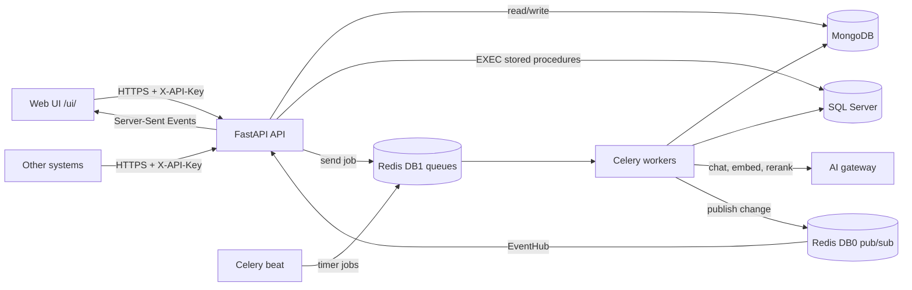
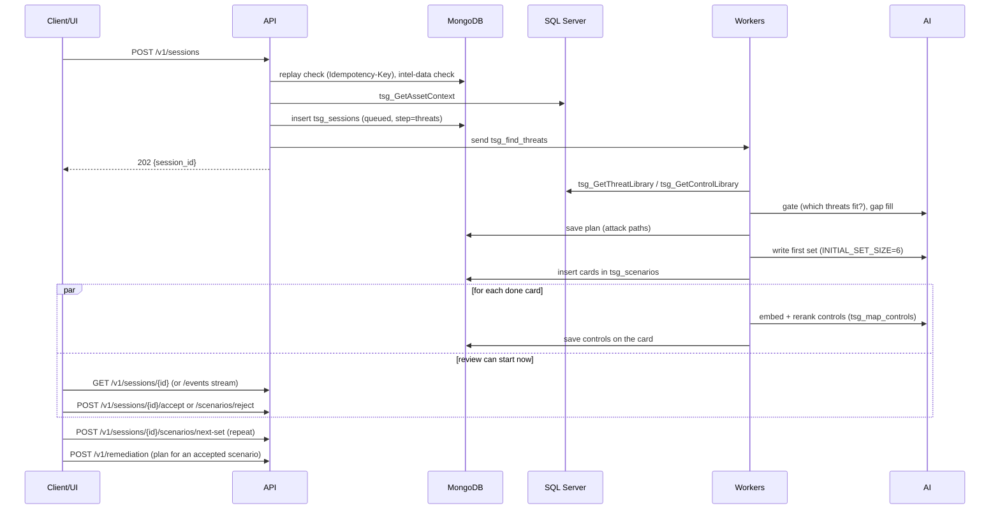
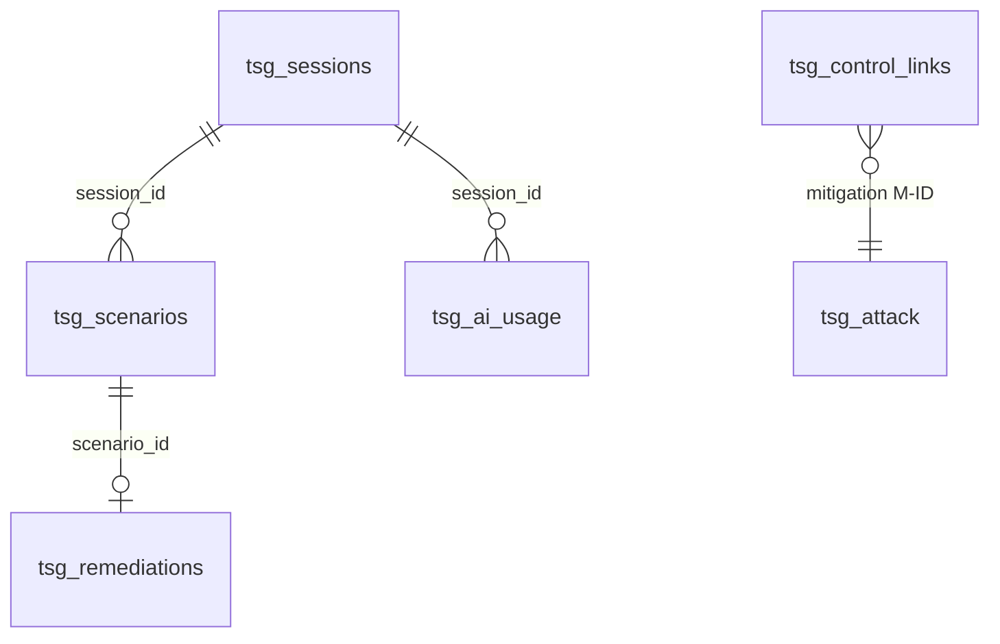

# TSG Developer Handover Guide

For developers who will support and change TSG (Threat Scenario Generator, repo `cii`).

## About this document

**Template:** every section has the same three parts:

| Part | What it holds |
|---|---|
| **What** | The idea in plain words |
| **Where** | Real files, functions, routes, collections |
| **Watch out** | The mistakes people make here (only when there are some) |

**Rule:** the code is the truth. If this guide and the code disagree, trust the code and fix this guide.

**Reading order:** read sections 1 to 3 first to understand the system. Use sections 4 to 6 to find code. Use
sections 7 to 9 when you fix a bug or make a change.

---

## 1. Solution Overview

### What
A **threat scenario** is a short story about how an attacker could harm a critical asset (for example a "Grid
Control Centre") and what the damage would be. Writing them by hand is slow, generic and not based on real threat data.

TSG writes them with an AI model and keeps a person in charge of every result:

1. It reads the asset and its **supporting systems** from SQL Server.
2. It finds the threats that fit, from **MITRE ATT&CK** (a public catalogue of real attacker groups and techniques).
3. The AI writes each scenario: a title, a scenario statement and a risk statement.
4. It maps controls from the **control library** (security measures such as "MFA for remote access").
5. A reviewer **accepts** or **rejects** each scenario. Nothing is final until a person accepts it.
6. For an accepted scenario, TSG writes a **remediation (treatment) plan**.
7. A separate module, the **service mapper**, finds which other services a service depends on.

### Key terms (used in the rest of this guide)
| Term | Meaning |
|---|---|
| Entity / tenant | The organisation that owns the assets (`X-Entity-Id` header), and its tenant (`X-Tenant-Id` header). A caller only ever sees its own entity's data |
| Run (session) | One request to write scenarios for one asset. Stored in `tsg_sessions` |
| Attack path | One threat, as one kind of attack, through one or more systems. Each path becomes one scenario |
| Card | One version of one scenario, stored in `tsg_scenarios`. A rewrite makes a new card and keeps the old one |
| Set | Scenarios are written a few at a time: first `INITIAL_SET_SIZE` (6), then `NEXT_SET_SIZE` (6) each time the reviewer asks for the next set |
| STRIDE | The six kinds of attack: Spoofing, Tampering, Repudiation, Information disclosure, Denial of service, Elevation of privilege |
| Embedding / rerank | An embedding turns text into numbers so that similar texts can be found. A reranker then re-scores the best matches more precisely |
| STIX | The JSON format MITRE publishes ATT&CK data in |
| Idempotency-Key | An optional header. The same key sent again returns the first answer instead of starting the work twice |

### Where
- `README.md`: a one-page summary.
- `docs/SOLUTION_DESIGN.md`: the full design and the reasons behind it. It is long, so use it for reference only.

---

## 2. Architecture

### What
TSG has one API process and several background **workers**. The API answers fast. Slow AI work runs in workers
that take jobs from queues.

| Piece | Technology | Job |
|---|---|---|
| API | FastAPI + uvicorn (`app/main.py`) | Checks the request, saves a record, queues a job, returns `202` |
| Workers | Celery, thread pool (`app/worker/`) | Do the slow work: AI calls, search, saving results |
| Beat | Celery beat | A timer that sends repeating jobs (reaper, imports, roll-ups) |
| MongoDB | `cii_tsg` database | All of TSG's own data: runs, scenarios, plans, keys, audit |
| SQL Server | Stored procedures only | Asset data and the threat and control libraries (owned by another team) |
| Redis | DB 0 and DB 1 | DB 1 holds the job queues. DB 0 holds live-update messages, AI rate limits and locks |
| AI gateway | LiteLLM-compatible HTTP API | Chat models (Kimi, GLM), embeddings, reranker |
| Web UI | Plain JavaScript in `app/ui/` | Served by the API at `/ui/` |



### Layers (enforced by a test)
Code is split into layers, and a layer may only import from the layers listed for it. `tests/test_code_conventions.py`
(`ALLOWED_IMPORTS`) fails the build if you break this.

```
api/routes  ->  domain  ->  crud (database)  ->  core
   |             |  \-> ai, search
   |             \-> worker.send_job
worker  ->  domain
```

- **Database calls (`find`, `insert_one`, …) are only allowed in `app/crud/`**, and the same test checks this.
- Pydantic request and response shapes live only in `app/schemas/`.
- Every "now" comes from `app/core/clock.py`. Calling `datetime.now()` directly fails the tests.

### Queues and workers
The queues are defined in `app/core/constants/jobs.py` (`TASK_ROUTES`):

| Task | Queue | What it does |
|---|---|---|
| `tsg_find_threats` | `tsg_threats` | Stage 1 of a standard run |
| `tsg_write_scenarios`, `tsg_write_mitre_scenarios` | `tsg_scenarios` | Stage 2: write scenarios |
| `tsg_map_controls` | `tsg_controls` | Stage 3: map library controls |
| `tsg_write_plan` | `tsg_remediation` | Write a remediation plan |
| `tsg_map_services` | `tsg_servicemapper` | Service mapper |
| `tsg_build_library_indexes`, `tsg_refresh_external_intelligence`, `tsg_link_mitigations`, `tsg_roll_up_ai_usage` | `tsg_maintenance` | Long admin jobs |
| `tsg_reap`, `tsg_retry_controls` | `tsg_reaper` | Repair lost or stuck jobs |

Beat schedule (`app/worker/celery_app.py`, `_BEAT`):

| Timer job | How often |
|---|---|
| Reaper (`tsg_reap`) | every 60 s |
| Intelligence check | every 60 s; it starts an import only when one is due |
| Controls sweep (`tsg_retry_controls`) | every 300 s |
| AI usage roll-up | every 300 s |
| Library index build | every 1,800 s |

---

## 3. End-to-End Flow

### 3.1 Three ways to start a scenario run

| Route | Pipeline | Where threats come from |
|---|---|---|
| `POST /v1/sessions` | standard | The SQL threat library. The AI judges which threats fit |
| `POST /v1/create_session` | attack | The AI's ATT&CK knowledge, checked against TSG's stored copy (`tsg_attack`) |
| `POST /v1/mitre_create_session` | mitre | Stored MITRE STIX data. Code checks every quote, technique and group |

All three take the same body (`StartRunRequest`: `asset_id`, `supporting_system_id`, optional `service_id`,
`sector_id`, `subsector_id`) and the same headers.

### 3.2 A standard run, step by step



1. **Request check.** `app/api/routes/scenarios.py:start_run` calls `app/domain/scenario/runs.py:create_threat_scenario_session`.
   - `app/api/deps.py:get_authenticated_principal` needs `X-API-Key` plus `X-User-Id`, `X-Entity-Id` and `X-Tenant-Id`. Without them the answer is 401.
   - `runs._replay`: the same `Idempotency-Key` returns the same run (200). Sending the same request again within a minute without a key gives 409 `duplicate_request`.
   - `runs._refuse_without_intel_data`: if the evidence switch is on but no ATT&CK data has been indexed yet, the answer is 409 `intel_no_data`. This check runs before any SQL call.
2. **Asset facts.** The stored procedure `tsg_GetAssetContext` is called. `session.py:build_run_context` checks that the asset belongs to the entity (403) and that the required facts exist (422).
3. **Save and queue.** A `tsg_sessions` document is inserted with `status=queued, step=threats`, and `tsg_find_threats` is sent.
4. **Stage 1, threats** (`app/worker/scenario/tasks.py` → `app/domain/scenario/plan.py:find_threats`):
   - The library is loaded and cached (`app/search/library_cache.py`).
   - An AI **gate** call (prompt `[scenario.gate]` in `app/prompts.toml`) keeps the threats that fit.
   - A **gap fill** call (`[scenario.gap_fill]`) proposes threats for STRIDE categories that have none.
   - Duplicates are merged, and an attacker is picked from the library actors.
   - `plan.py:build_plan` ranks one attack path per threat (risk = impact × likelihood) and saves the plan on the run.
   - The same job then hands over to stage 2 with the first `INITIAL_SET_SIZE` paths.
5. **Stage 2, scenarios** (`app/worker/scenario/write_job.py`, `app/domain/scenario/write.py:write_scenario_set`):
   - If the evidence switch is on, ATT&CK evidence is attached to each path first (`app/domain/intel/evidence.py`).
   - One AI call writes the set (`[scenario.writer]`), with at most one repair call.
   - `apply_safety_checks` marks each card `done` or `blocked`. Paths that failed get a `failed` card. The cards are saved to `tsg_scenarios`.
   - Each `done` card gets its own `tsg_map_controls` job straight away.
   - When the set is saved, the run's job ends (`status=done`).
6. **Stage 3, controls** (`app/worker/scenario/controls_job.py`, `write.py:map_controls`). This runs **alongside review**, not before it:
   - Controls are found by embedding search plus rerank, with no chat call.
   - Thresholds: `CONTROL_SIMILARITY_THRESHOLD`, `MIN_CONTROLS`, `MAX_CONTROLS`.
   - If a mapping stalls, the controls sweep sends it again.
7. **Review** (`app/domain/scenario/runs.py`, section 5.3):
   - Review opens as soon as the run's job ends, even if controls are still being mapped. Before that, every review call answers 409.
   - Only `done` cards that are still `pending` can be accepted or rejected.
   - The reviewer can then ask for the next set, which repeats step 5 for the next `NEXT_SET_SIZE` paths.
   - `progress.overall` (section 3.4) tells the client which of these comes next.
8. **Remediation plan** for an accepted scenario: section 5.4. Controls do not have to be finished first, because the plan job maps them if they are missing.

### 3.3 How the other two pipelines differ
- **Attack** (`/v1/create_session`) has no threat stage and starts straight at `tsg_write_scenarios`.
  - The writer uses `[scenario.attack]` and names a group, techniques and mitigations.
  - `app/domain/scenario/attack.py:confirm_attack_set` checks every name against `tsg_attack`. A name it cannot confirm is asked again once, then the scenario is dropped.
  - Controls come from `tsg_control_links` through `attack_controls.py:pick_set_controls` (`[controls.picks]`).
- **MITRE** (`/v1/mitre_create_session`) uses one task, `tsg_write_mitre_scenarios`, and its prompts are in `app/mitre_prompts.toml`. Its stages are:
  1. Select actors: the AI picks MITRE groups, and each quote must really appear in MITRE's text.
  2. Plan attack paths over every Enterprise and ICS technique.
  3. Write the scenarios, then check them in code: techniques must be planned ones, and groups must be documented for them.
  4. Map CII library controls per technique.
  - An IT asset uses Enterprise techniques. An OT or `IT\OT` asset also needs ICS techniques.
  - Code: `app/domain/scenario/mitre_scenario/mitre_engine.py` and `mitre_session.py`.
  - **A MITRE run uses its own routes** under `/v1/mitre_sessions/{id}/…` for progress, review, next set and regenerate. Calling `/v1/sessions/{id}/scenarios/next-set` or `/regenerate/scenarios` on a MITRE run returns 409. The shared `GET /v1/sessions/{id}` still works for it.
- **Before an attack or MITRE run:** the ATT&CK import must have run (section 8.2), otherwise the start answers 409 `intel_no_data`.

### 3.4 Following progress
- **Polling:** `GET /v1/sessions/{id}` returns `progress.overall`: `pending`, `in_progress`, `awaiting_review`, `awaiting_next_set`, `complete`, `error` or `cancelled`.
- **Live updates:** `GET /v1/sessions/{id}/events` uses Server-Sent Events, a one-way HTTP stream from server to browser.
  - After each change, a worker publishes to the Redis channel `tsg:events:session:{id}` (`app/realtime/publisher.py`).
  - The API's single `EventHub` (`app/realtime/event_hub.py`) passes it on, and `app/api/status_stream.py` re-reads the status from MongoDB and sends it.

---

## 4. Code Structure

```
app/
  main.py            builds the FastAPI app: routers, middleware, error handlers, start-up
  prompts.toml       every AI prompt (scenario, remediation, service mapper, controls)
  mitre_prompts.toml the MITRE pipeline's prompts
  api/               HTTP only: routes/, deps.py (auth, idempotency), errors.py, middleware.py
  domain/            business logic
    scenario/        runs.py (actions), session.py (context, status board), plan.py (stage 1),
                     write.py (stages 2-3), attack*.py (attack pipeline), mitre_scenario/
    remediation/     plans.py (plan lifecycle), write.py (AI plan writing)
    service_mapper/  mappings.py (lifecycle), generate.py (AI run), catalog.py (SQL catalog)
    intel/           MITRE ATT&CK import, schedule, switch, evidence, control links
    shared/          ask_ai.py, names.py, parallel.py, prompt_redaction.py
  crud/              the ONLY place that reads or writes MongoDB or calls stored procedures
  schemas/           Pydantic request/response models
  ai/                chat.py (LLM calls), slots.py (rate limits in Redis), embeddings.py, rerank.py,
                     attempts.py (usage rows), profiles.py (allowed models)
  search/            in-memory search over the library: word match (BM25) + embeddings; mitre/ index
  worker/            Celery tasks: jobs.py (lease, retry, reaper), scenario/, remediation.py, ...
  realtime/          Redis pub/sub publisher and EventHub
  core/              config.py (all settings), constants/, database.py, exceptions.py, logging.py
  ui/                web UI: app.js (shell + page table), api.js, pages/*.js, styles.css
scripts/             sql/ (stored procedure sources), debug_tools.py, e2e_all_api.py, monitoring*.py
tests/               pytest suite (real local MongoDB/SQL/Redis), contract/ (frozen API, enums, indexes)
deploy/              OpenShift YAML, build-image.bat, DEPLOYMENT_GUIDE.md
observability/       Prometheus, Grafana, Loki, Alertmanager config
```

### API groups (see Swagger at `/docs`)

| Group | Routes (file) |
|---|---|
| Health | `/health`, `/ready`, `/metrics` (`routes/health.py`) |
| Runs and review | `/v1/sessions…`, `/v1/create_session`, `/v1/entities/{id}/scenarios` (`routes/scenarios.py`) |
| MITRE runs | `/v1/mitre_create_session`, `/v1/mitre_sessions/{id}…` (`routes/mitre_scenarios.py`) |
| Remediation | `POST /v1/remediation`, `/v1/sessions/{sid}/scenarios/{scid}/treatment-plan[/status,/review,/regenerate,/cancel]`, `…/treatment-plans` lists (`routes/remediation.py`) |
| Jobs | `GET /v1/jobs`, `POST /v1/sessions/{id}/cancel`, `DELETE /v1/sessions/{id}` (`routes/jobs.py`) |
| Service mapper | `/v1/service-mapper…`, `/v1/entities/{id}/services` (`routes/service_mapper.py`) |
| Intelligence | `/v1/tsg/intel/{switch,refresh,health,schedule,control-links}` (`routes/intel.py`) |
| Admin (`X-Admin-Key`) | `/v1/tsg/api-clients`, `/v1/embeddings`, `/v1/admin/jobs`, `/v1/tsg/library/{pending,decisions}` (`routes/admin.py`) |
| AI usage | `/v1/ai-usage`, `/requests`, `/requests/{id}`, `/calls` (`routes/ai_usage.py`) |

### Watch out
- **Never change an existing API path, payload or response.** The UI team uses them, and `tests/contract/openapi.json` freezes them. Only additive changes are allowed.
- In the UI, write each API path as one string, for example `` `/v1/sessions/${id}/results` ``. `tests/test_admin_ui.py` checks every path against the real routes.
- Size limits are checked by `tests/test_code_conventions.py`: 500 lines per file and 40 lines per function.

---

## 5. Key Logic

### 5.1 Jobs, leases and epochs (`app/worker/jobs.py`, `app/crud/jobs.py`)
This is the most important mechanism. A slow job's state lives **on its MongoDB record**, not in Celery.
- **Claim:** `JobRepository.claim_job` changes the record from queued to running in one atomic update. It sets a 120 s **lease** (a time-limited lock) and adds 1 to `job.attempts`. If two messages arrive, only one claim can win.
- **Renew:** `lease_renewal.keep_lease_alive` renews the lease every 30 s. Every write a job makes is **fenced**: it only succeeds if the job still owns the lease. Otherwise it raises `LeaseLost` and the job stops quietly.
- **Retry:** an outage error (`Unavailable`) puts the job back in the queue after 15, 30, 60, then 120 s, up to `Lease.MAX_ATTEMPTS = 5`. A `JobFailed` error fails the job at once.
- **Reap:** `tsg_reap` (`reap_jobs`, every 60 s) re-queues jobs whose lease expired, for example because a pod was killed. When the attempts run out, it fails them with `job_abandoned`.
- **Epoch:** the job's generation number. It is 1 at start and goes up by 1 for each next set or regenerate. A message with an old epoch can never claim the record.
- **Cancel:** `app/crud/work_control.py` sets the record to cancelled, and the worker's next fenced write stops it.

### 5.2 Calling the AI (`app/ai/`)
- `chat.py:ChatModel.ask_for_checked_json` asks for JSON and checks the answer. If the check fails, it asks once more in the same conversation.
- `slots.py` limits calls across all pods, using Redis sorted sets and Lua scripts: requests per minute, tokens per minute, and calls at once.
- A `429` (too many requests) lowers the shared limit and the call waits. A timeout is never retried.
- Each module has its own settings block, `CII_<MODULE>_CHAT_*`, where the module is `SCENARIO`, `REMEDIATION` or `SERVICE_MAPPER`. The model must be listed in `app/ai/profiles.py`, or start-up stops.
- Every attempt is recorded in `tsg_ai_usage`, and every prompt and answer in `tsg_ai_call_texts`. A retried job can then **reuse** an earlier answer instead of paying for it again.
- **Rule:** do not send database IDs to the AI. Send names only. Send asset facts through `prompt_redaction.py` and `facts_safe_for_prompt`.

### 5.3 Review actions (`app/domain/scenario/runs.py`)
| Action | Function | Rule |
|---|---|---|
| Accept | `accept_threat_scenarios` | Modes `subset`, `all`, `none`. One accepted version per path |
| Reject | `reject_threat_scenarios` | Only a pending card can be rejected |
| Regenerate | `regenerate_threat_scenarios` | Writes version + 1. The old version stays readable |
| Next set | `write_next_threat_scenario_set` | `NEXT_SET_SIZE` (default 6) more paths, else 409 `nothing_left` |
| Promote | `promote_threat_scenario_to_library` | Calls `tsg_ResolveThreat`. The threat goes in **pending** until a curator decides (`/v1/tsg/library/decisions`) |

Every action first calls `check_session_ready_for_review`, which answers 409 while the run is still working.
For a MITRE run, next set and regenerate go through the `/v1/mitre_sessions/…` routes (section 3.3).

### 5.4 Remediation plans (`app/domain/remediation/`)
1. `POST /v1/remediation` → `plans.create_plan`.
   - With `is_manual=false`, send the `session_id` and `scenario_id` of an accepted scenario. Otherwise the answer is 409 `scenario_not_accepted`.
   - With `is_manual=true`, send a `manual_scenario`. TSG saves it as an accepted scenario first.
   - A second request for the same scenario answers 409 `plan_already_exists`. Use regenerate instead.
   - No AI is called in the request itself.
2. A `tsg_remediations` document is created (one per scenario, unique `scenario_id`) with a `versions[]` list,
   and `tsg_write_plan` is sent.
3. The worker (`app/worker/remediation.py`) does three things:
   - maps controls if needed and adds alternative controls;
   - makes one AI call (`[remediation.plan]`);
   - checks the answer and adds dates (`schedule_plan`).
4. Review, regenerate and cancel:
   - `POST …/treatment-plan/review` accepts or rejects a version.
   - `…/regenerate` adds a version, up to `REGENERATIONS_MAX_VERSION_COUNT` (default 10).
   - `…/cancel` stops the plan being written.

### 5.5 Service mapper (`app/domain/service_mapper/`)
- **Input:** `service_name`, `service_description`, `sector`, an optional `subsector`, and `entity_names`.
- **Catalog:** read from `tsg_Onboarding_GetServicesWithSectorDetails` and `tsg_GetServiceMapperAssociations`, and cached for 60 s.
- **Mappings:** there is one per service (`service_key` hash). Each run makes one AI call (`[service_mapper.generate]`) and only **adds** services the mapping does not have yet.
- **Run limit:** `SERVICE_MAPPER_MAX_GENERATIONS` (default 5) caps the runs.
- **Decisions:** `POST …/dependencies/decision` saves accept and reject decisions.

### 5.6 External intelligence (`app/domain/intel/`)
- **Source:** MITRE ATT&CK only, Enterprise and ICS. The files are downloaded from MITRE's GitHub STIX files (`sources/attack.py:DATASETS`).
- **Schedule:** weekly on Sunday at 02:00 UTC by default, and once after the first start. It can be changed through `PUT /v1/tsg/intel/schedule`.
- **The import writes:** `tsg_intel`, `tsg_attack` (the group, technique and mitigation graph) and `tsg_mitre_{enterprise,ics}_stix`. After each import, `tsg_link_mitigations` links each ATT&CK mitigation to library controls in `tsg_control_links`.
- **Switch:** the evidence switch (`/v1/tsg/intel/switch`) is on only when `EXTERNAL_INTELLIGENCE_ENABLED=true` **and** the runtime flag is on. The ATT&CK import runs whatever the switch says.

---

## 6. Database

### 6.1 MongoDB (TSG's own data, database `cii_tsg`)
Names are in `app/core/constants/common.py` (`Collection`). Indexes are created at start-up by
`app/crud/indexes.py:create_all_indexes`, so there is nothing to run by hand.

| Collection | Holds | Key links |
|---|---|---|
| `tsg_sessions` | One run: context, plan, job, status, step, `pipeline` | `_id` = session_id, `entity_id` |
| `tsg_scenarios` | One scenario card per version: content, controls, decision | `session_id`, `path_id`, `entity_id` |
| `tsg_remediations` | One plan per scenario, with `versions[]` | `scenario_id` (unique), `session_id` |
| `tsg_service_mappings` | One mapping per service, with `result.dependencies[]` | `tenant_id`, `entity_id`, `service_key` |
| `tsg_api_clients` | API keys (only the SHA-256 `key_hash` is stored) | `key_hash` unique |
| `tsg_audit` | Who did what (append-only, deleted after 365 days) | `target.id`, `actor.entity_id` |
| `tsg_admin_jobs` | Admin jobs (index builds, imports) | one active per `kind` |
| `tsg_ai_usage`, `_hourly`, `_requests`, `tsg_ai_call_texts` | AI usage and prompt texts, never deleted | `request_id`, `session_id`, `record_id` |
| `tsg_embeddings`, `tsg_query_vectors` | Library vectors and cached query vectors | |
| `tsg_intel`, `tsg_attack`, `tsg_mitre_enterprise_stix`, `tsg_mitre_ics_stix`, `tsg_external_feed_status`, `tsg_external_intelligence_snapshots` | MITRE ATT&CK data, the switch and the schedule | |
| `tsg_control_links` | ATT&CK mitigation (`_id` = M-ID) → library controls | |
| `tsg_sql_operations` | One record per SQL write, so a lost answer can be reconciled | |



### 6.2 SQL Server (owned by another team, read through stored procedures only)
`app/core/database.py:StoredProcedureClient.execute_procedure` accepts only names from the `StoredProcedure` enum
(`app/core/constants/planning.py`). The procedure sources are in `scripts/sql/`.

| Procedure | Used for | Main tables |
|---|---|---|
| `tsg_GetAssetContext` | The asset and its systems | `ctm_scan_entity`, `onboarding_*` |
| `tsg_GetThreatLibrary`, `tsg_GetControlLibrary`, `tsg_GetLibraryStamp` | The libraries and their change stamp | `Threat_Catalogue`, `Threat_Type`, `Threat_Actor`, `Control_Library` |
| `tsg_ResolveThreat`, `tsg_ListPendingThreats`, `tsg_DecidePendingThreats` | Promoted threats and curation | `Threat_Catalogue` |
| `tsg_Onboarding_GetServicesWithSectorDetails`, `tsg_GetServiceMapperAssociations` | The service mapper's catalog | `onboarding_services`, `onboarding_sector_services` |

**Watch out:** TSG has no direct access to the production databases. A new or changed procedure has to be
handed to the DBA team as a `.sql` file in `scripts/sql/`.

---

## 7. Error Handling and Logging

### 7.1 Errors
- **Raise one of these** from `app/core/exceptions.py`:

  | Error | HTTP status |
  |---|---|
  | `Invalid` | 422 |
  | `Unauthorized` | 401 |
  | `Forbidden` | 403 |
  | `NotFound` | 404 |
  | `Conflict` | 409 |
  | `Unavailable` | 503, and the job is retried |
  | `SetupError` | 500, needs a configuration fix |

- **Error body:** `app/api/errors.py` turns every error into one RFC 9457 problem body: `{type, title, status, detail, code, request_id, reason?, errors?, details?}`.
- **Codes:** `code` and `reason` come from `ErrorCode` and the other constants in `app/core/constants/`. Messages also come from constants. A raw string in `raise X("...")` is refused by the conventions test outside `crud`, `domain` and `schemas`.
- **Store outages:** when MongoDB, Redis or SQL Server cannot be reached, the API answers 503 and workers retry (section 5.1).
- **Failed jobs:** a failed job keeps its error on its record (`job.error.code`, `job.error.reason`), and the status board shows it.

### 7.2 Logs
- **Format:** JSON lines through structlog (`app/core/logging.py`). Secrets and personal data are masked.
- **Request id:** every request gets an `X-Request-Id`, which is echoed in the response header. It is also put on the jobs it starts, so one id follows the work from the API into the workers.
- **Access log:** `RequestContextMiddleware` writes one `http` line per request with method, route, status, `duration_ms` and `client_id`.
- **Laptop:** logs go to `logs/api.log`, `logs/worker-*.log` and `logs/beat.log` (`CII_LOG_DIR=logs`). Local Grafana is at `http://localhost:3000/grafana/`.
- **UAT and prod:** pods log to stdout. Loki collects the logs and Grafana shows them (`deploy/DEPLOYMENT_GUIDE.md`, Part 3).

**Find everything about one request, run or job:**

```powershell
.venv\Scripts\python scripts\debug_tools.py find <request_id or session_id or task_id>
```

Other commands: `stores`, `workers`, `queues` and `run-show <id>`. They are also available as VS Code tasks under "TSG: …".

---

## 8. Build and Deployment

### 8.1 Run on a laptop (Windows PowerShell 5.1)
MongoDB, SQL Server and Redis must already be running.

```powershell
py -3.12 -m venv .venv
```
```powershell
.venv\Scripts\Activate.ps1
```
```powershell
pip install -e ".[local,dev]" -c requirements.txt
```
```powershell
Copy-Item .env.dev.example .env
```

Fill in the blank values in `.env`. Every setting is described in `app/core/config.py`.

```powershell
.\run_dev.ps1
```

This starts the API, the workers (scenarios, remediation, mapper, maintenance, reaper), beat and monitoring, then
waits for `/ready`. Swagger is at `http://localhost:8000/docs`.

Use `.\run_dev.ps1 status` to see what is running, and `.\stop.ps1` to stop everything.

### 8.2 First-time setup, in this order
A new database is empty, so do these steps once before the first run. This is the same order `scripts/e2e_all_api.py` (`setup`) uses.

| # | Step | How | Why |
|---|---|---|---|
| 1 | Set the admin key | Set `CII_ADMIN_API_KEY` in `.env`, then restart | Every admin route answers 403 while it is empty |
| 2 | Check readiness | `GET /ready` must return 200, with a worker listed for every queue | A queue with no worker leaves its jobs waiting |
| 3 | Create a client API key | `POST /v1/tsg/api-clients` with `X-Admin-Key` and body `{"name": "..."}` | Every client route needs `X-API-Key`. The key is shown **once only** |
| 4 | Build the library vectors (optional) | `POST /v1/embeddings` with `X-Admin-Key`, then wait for `GET /v1/embeddings/{job_id}` | Without this, the first run builds the vectors itself, and is slower. Beat also rebuilds them every 30 min |
| 5 | Import MITRE ATT&CK | Runs once by itself after the first start. To run it now: `POST /v1/tsg/intel/refresh`, then check `GET /v1/tsg/intel/health` | Attack and MITRE runs answer 409 `intel_no_data` without it |
| 6 | Link mitigations to controls | Runs by itself after every import. To run it now: `POST /v1/tsg/intel/control-links/prepare` | Attack and MITRE runs pick controls through these links |
| 7 | Sign in to the UI | `http://localhost:8000/ui/`: enter the API key from step 3 and a user, entity and tenant id. For the admin pages, enter the admin key | The entity must own the asset you test with |

### 8.3 Test
```powershell
python -m pytest -q
```
The tests use the **real** local MongoDB, SQL Server and Redis, in a separate test database (`tests/conftest.py`).

Code checks: run the VS Code task "TSG: code checks". It runs `ruff check`, `ruff format --check` and `mypy app`.

To test every API against a running system:

```powershell
.venv\Scripts\python scripts\e2e_all_api.py
```

### 8.4 Deploy (OpenShift, UAT and prod)
- **One image for every role:** `Dockerfile` (UBI 9, Python 3.12, ODBC Driver 17), built by `deploy\build-image.bat`.
- **Deployments:**
  - `deploy/deploy_threatgen.yaml`: `api`, `worker-threats`, `worker-scenarios`, `worker-controls`, `worker-remediation`, `worker-service-mapper`, `worker-maintenance` and `beat`.
  - `deploy/deploy_common.yaml`: `worker-reaper` and the monitoring.
- **Settings and secrets:** `deploy/configmap.yaml` and `deploy/secrets.example.yaml`.
- **For a new release, follow `deploy/DEPLOYMENT_GUIDE.md`, Part 4.** Start the reaper first, then the app. Each step there says what you should see.
- **UAT on a Windows machine:** `readme_to_run_uat.txt` and `run_uat.ps1`.

---

## 9. Troubleshooting and Change Requests

### 9.1 Investigate a reported bug
1. **Get an id from the user.** Ask for the `session_id`, or the `X-Request-Id` from the response header or the browser network tab, plus the time.
2. **Read the record.** Run `debug_tools.py run-show <session_id>`, or call `GET /v1/sessions/{id}`. Look at:
   - `status`, `step` and `progress.overall`;
   - `job.error.code` and `reason`;
   - `job.attempts`.
3. **Read the logs.** Run `debug_tools.py find <id>` on a laptop, or search Loki in Grafana for UAT and prod.
4. **Check the system.** Use `GET /ready` (stores and live workers per queue), `debug_tools.py queues` (jobs waiting) and `GET /v1/admin/jobs`.
5. **Check the AI.** Use `GET /v1/ai-usage/calls?session_id=…`. It shows each AI call with its outcome, tokens and seconds, and finds 429s and timeouts.
6. **Find the code** with the table below.

| Symptom | Look first at |
|---|---|
| 401 or 403 on every call | `app/api/deps.py`, the key in `tsg_api_clients` (revoked?), the four identity headers |
| 409 `intel_no_data` | The ATT&CK import has not run: `GET /v1/tsg/intel/health`, `POST /v1/tsg/intel/refresh` |
| 422 `required_facts_missing` or `asset_not_owned` | `session.py:build_run_context`, the data returned by `tsg_GetAssetContext` |
| Run stuck in `queued` | No worker on that queue (`/ready` → `workers`). The reaper re-sends jobs after 120 s |
| `job_abandoned` | The job failed 5 times: find the earlier attempts' errors in the logs |
| Few or no scenarios | `GET /v1/sessions/{id}/plan-trace` shows why each candidate was dropped |
| A scenario is wrong or badly worded | The prompt in `app/prompts.toml` / `app/mitre_prompts.toml`, the checks in `write.py:apply_safety_checks` or `mitre_engine.py` |
| Wrong or missing controls | `write.py:map_controls`, the thresholds `CONTROL_SIMILARITY_THRESHOLD`, `MIN_CONTROLS`, `MAX_CONTROLS`, and `tsg_control_links` |
| Plan fails or is refused | `app/domain/remediation/write.py`, `plans.py:_check_plannable_scenario` |
| Live updates do not arrive | Redis DB 0, `app/realtime/event_hub.py`; polling `GET` still works |
| Slow, or AI 429s | `CII_*_REQUESTS_PER_MINUTE`, `CII_*_TOKENS_PER_MINUTE`, `app/ai/slots.py`, `docs/CONCURRENT_USERS_SIZING.md` |

### 9.2 Make a change
1. **Find the root cause.** Fix it in the shared function that every caller uses, not only on the path in the ticket. Use grep to find all callers first.
2. **Change the right layer.** Use the layer that owns the logic:
   - routes in `app/api/routes/`;
   - logic in `app/domain/`;
   - database calls in `app/crud/`;
   - shapes in `app/schemas/`;
   - messages and limits in `app/core/constants/`.
3. **New setting:** add it to `app/core/config.py` and to `.env.dev.example`, `.env.uat.example` and `deploy/configmap.yaml`.
4. **Prompt change:** edit `app/prompts.toml`, then compare old and new output on the same inputs at the same time before you keep it. The model's output drifts over time.
5. **API change:** only add things, never change existing fields. Update `docs/API_CONSUMER_GUIDE.md`.
6. **UI change:** edit `app/ui/pages/<page>.js` and follow the page contract at the top of `app/ui/app.js`.
7. **SQL change:** edit `scripts/sql/<procedure>.sql` and hand it to the DBA team.

### 9.3 Test the change
1. Write a regression test in `tests/` that fails before your fix and passes after it.
2. **Mutation check:** undo your fix for a moment and confirm that the test fails.
3. Run `python -m pytest -q` and the "TSG: code checks" task. Both must pass.
4. Run `scripts\e2e_all_api.py` or repeat the user's steps in the UI against your local run.
5. Ask the owner before you commit or push. Branch names end in `_YYYY-MM-DD_HH-MM`, and every pushed branch gets a draft PR that describes its changes.

---

## 10. Where to read more

| Document | Use it for |
|---|---|
| `docs/API_CONSUMER_GUIDE.md` | Every route, with examples, for callers |
| `docs/API_DEVELOPER_HANDBOOK.md` | How the API is built inside |
| `docs/TSG_END_TO_END_FLOW.md` | One session, end to end, in detail |
| `docs/SOLUTION_DESIGN.md` | The design and its decisions |
| `deploy/DEPLOYMENT_GUIDE.md` | OpenShift deployment, step by step |
| `docs/CONCURRENT_USERS_SIZING.md` | Capacity and AI limits |
| `.10x/decisions/`, `.10x/adrs/` | Why things are the way they are |
