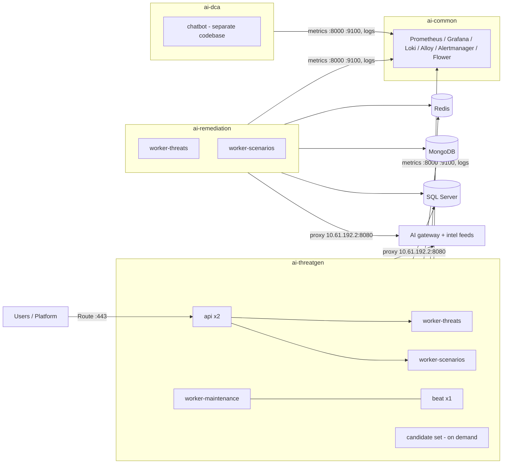
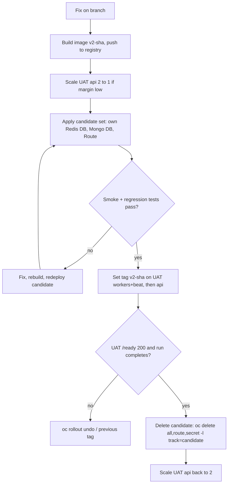

# OpenShift Deployment Handbook — AI Platform (TSG v2: Threat Scenarios, Remediation, Service Mapper)

Scope: `ai-threatgen`, `ai-remediation`, `ai-dca`, `ai-common` (quota 6 CPU / 12 GiB each).
Source of every number: `deploy/*.yaml` in this repository. **"(confirm)" marks anything the repo cannot prove.**

---

## 1. Executive Summary

- The repository already contains a deployable design: one image (`tsg-api:v2-<commit>`) run as an **API (2 pods)**, **3 Celery worker deployments**, **1 beat**, plus **Flower** and an **8-pod observability stack** (`deploy/deploy.yaml`, `deploy.ai-remediation.yaml`, `flower.yaml`, `observability.yaml`, `networkpolicy*.yaml`).
- **It fits the quota.** `ai-threatgen` application pods: requests 1.8 CPU / 4.3 GiB, limits 4.75 CPU / 8.5 GiB. `ai-remediation` workers + monitoring: requests 1.6 CPU / 3.6 GiB, limits 4.5 CPU / 8.3 GiB.
- **Limits are the risk, not requests.** If the quota counts limits, `ai-threatgen` has only 1.25 CPU / 3.5 GiB left, which a rolling update (maxSurge 1 = one extra 1 CPU / 2 GiB worker) or a test copy can consume. Verify with `oc describe quota` first (Step 2).
- **Recommended test approach:** a small, on-demand **candidate set in the same namespace**, isolated by its own Redis broker DB number, Mongo DB name and API key; deleted after validation (Section 6).
- **Observability:** reuse the existing stack; target home is `ai-common` (shared), currently wired to `ai-remediation` (Section 7).
- **Service Mapper** (routes and stub exist, no worker yet) needs one reserved queue and a 250m / 512Mi deployment slot; no redesign.
- **AI egress is settled:** the deployed manifests (`C:\Users\User\Desktop\deploy`) confirm it goes **through the corporate proxy `10.61.192.2:8080`**, with a `hostAliases` entry `10.231.255.253 → llmapi.govai.ae` and `TSG_LITELLM_BYPASS_PROXY=false`; the network team confirmed this (see `litellm-proxy-networkpolicy.yaml`). Section 8.

---

## 2. Existing Architecture and Deployment Inventory

| Component | Where defined | Command | Nature |
|---|---|---|---|
| api | `deploy.yaml` | `uvicorn app.main:app --port 8000 --proxy-headers` | I/O bound (HTTP, SSE); probes `/ready`, `/health` |
| worker-threats | `deploy.yaml` | `celery -A app.worker worker --pool=threads -c 10 -Q tsg_threats` | network bound (AI calls), memory (embeddings) |
| worker-scenarios | `deploy.yaml` | same, `-c 10 -Q tsg_scenarios` | network bound, longest AI jobs |
| worker-maintenance | `deploy.yaml` | same, `-c 3 -Q tsg_maintenance` | light; reaper + controls sweep |
| beat | `deploy.yaml` | `celery -A app.worker beat -s /tmp/beat/schedule` | tiny; **exactly 1** |
| Remediation workers | `deploy.ai-remediation.yaml` | threats + scenarios queues, own namespace | as above |
| Flower | `flower.yaml` | `celery ... flower --port=5555 --url_prefix=flower` | 1 replica (2 would show half the events) |
| Observability (8) | `observability.yaml` | prometheus, alertmanager, loki, alloy (1 only, else duplicate logs), grafana, redis-exporter, kube-state-metrics | CPU light, memory moderate (Loki, Prometheus) |

External dependencies (all outside OpenShift, from `.env.uat` and `networkpolicy.yaml`):

| Dependency | Address | Port |
|---|---|---|
| Redis (broker db 1/11, live+caches db 0/10) | 10.228.146.4 | 6379 |
| SQL Server (library, asset facts; stored procedures only) | 10.228.146.2 | 1444 |
| MongoDB (all runs, scenarios, plans, jobs, vectors) | 10.228.146.3 | 27018 |
| AI gateway `llmapi.govai.ae` (chat, embedding, rerank) | via proxy 10.61.192.2 | 8080 |
| Intel feeds (via the same proxy) | `www.cisa.gov`, `raw.githubusercontent.com` (MITRE ATT&CK STIX, CISA CSAF), `services.nvd.nist.gov`, `epss.empiricalsecurity.com` | 443 |

Not found in code: `attack-taxii.mitre.org` (the code reads MITRE from `raw.githubusercontent.com`). Drop it from the firewall request unless another component uses it (confirm).

Redis, MongoDB and SQL Server are **external**: this handbook does not deploy them. Their backup and recovery belong to the platform/DBA team.

---

## 3. Recommended Deployment Topology

Boundaries (decided from the code, not assumed):

- **Keep threats, scenarios and maintenance as three separate worker deployments.** Scenario writing is the longest AI work; sharing a worker lets it starve threat finding and the reaper (a stuck reaper never re-sends lost jobs).
- **One beat, always.** Two would double-fire the reaper and index refresh.
- **Service Mapper** rides the same image. Reserve queue `tsg_mapper` (name to confirm) and one deployment `worker-mapper`. Until its task exists, do not create it.
- **ai-dca** (chatbot) is a different codebase: only the observability hooks in Section 7 apply here.

---

## 4. Namespace-by-Namespace CPU and Memory Allocation

Per-pod values from the manifests (request / limit):

| Namespace | Workload | Replicas | CPU req / lim (each) | Mem req / lim (each) | CPU req total | Mem req total | CPU lim total | Mem lim total |
|---|---|---|---|---|---|---|---|---|
| ai-threatgen | api | 2 | 250m / 1 | 512Mi / 1Gi | 500m | 1024Mi | 2 | 2048Mi |
| ai-threatgen | worker-threats | 1 | 500m / 1 | 1Gi / 2Gi | 500m | 1024Mi | 1 | 2048Mi |
| ai-threatgen | worker-scenarios | 1 | 500m / 1 | 1Gi / 2Gi | 500m | 1024Mi | 1 | 2048Mi |
| ai-threatgen | worker-maintenance | 1 | 250m / 500m | 1Gi / 2Gi | 250m | 1024Mi | 500m | 2048Mi |
| ai-threatgen | beat | 1 | 50m / 250m | 320Mi / 512Mi | 50m | 320Mi | 250m | 512Mi |
| **ai-threatgen subtotal (app)** | | **6** | | | **1.80** | **4.31 GiB** | **4.75** | **8.50 GiB** |
| ai-remediation | worker-threats | 1 | 500m / 1 | 1Gi / 2Gi | 500m | 1Gi | 1 | 2Gi |
| ai-remediation | worker-scenarios | 1 | 500m / 1 | 1Gi / 2Gi | 500m | 1Gi | 1 | 2Gi |
| ai-remediation | observability (8 pods, today) | 8 | see Sec. 7 | | 470m | 1.38 GiB | 2.3 | 3.81 GiB |
| ai-remediation | Flower (if placed here) | 1 | 100m / 200m | 256Mi / 512Mi | 100m | 0.25 GiB | 0.2 | 0.5 GiB |
| **ai-remediation subtotal** | | | | | **1.57** | **3.63 GiB** | **4.50** | **8.31 GiB** |

Quota check (6 CPU / 12 GiB):

| Namespace | Requests used | Limits used | Free (limits) | Verdict |
|---|---|---|---|---|
| ai-threatgen | 1.80 CPU / 4.31 GiB | 4.75 / 8.50 | **1.25 CPU / 3.50 GiB** | Fits. A worker surge (+1 CPU / 2 GiB) leaves 0.25 / 1.5 |
| ai-remediation | 1.57 / 3.63 | 4.50 / 8.31 | 1.50 / 3.69 | Fits |
| ai-common | observability moved here: 0.57 / 1.63 | 2.5 / 4.31 | 3.5 / 7.7 | Fits, plenty of room |
| ai-dca | **unknown (chatbot manifests not in this repo)** | | | Confirm |

Recommended moves (cheap, safe):
1. Move observability + Flower to `ai-common` when ai-dca is onboarded (frees 2.5 CPU / 4.3 GiB of limits in `ai-remediation`). Until then it fits where it is.
2. Do not raise the quota. If a test needs more than the margin, scale UAT api 2→1 for the test window (Section 6).
3. Service Mapper worker (when it exists): 250m / 512Mi, limits 500m / 1Gi in `ai-threatgen` → limits 5.25 / 9.5; the margin shrinks to 0.75 CPU / 2.5 GiB, so a candidate test then needs the api scale-down.

If the quota counts only requests, all limits above are informational and the margins are far larger (4.2 CPU / 7.7 GiB free in `ai-threatgen`). **Confirm which, with `oc describe quota -n ai-threatgen`.**

---

## 5. Replica, Worker and Concurrency Configuration

| Workload | Replicas | Concurrency | Queue | Shutdown | Scale when |
|---|---|---|---|---|---|
| api | 2 | uvicorn, async | — | grace 40 s | p95 latency or `/ready` flaps; not CPU-bound |
| worker-threats | 1 | 10 threads | `tsg_threats` | grace 120 s | queue depth > 20 for 10 min **and** AI gateway not throttling |
| worker-scenarios | 1 | 10 threads | `tsg_scenarios` | grace 120 s | same |
| worker-maintenance | 1 | 3 threads | `tsg_maintenance` | grace 120 s | never; 1 is enough |
| beat | 1 | — | — | — | never |
| worker-mapper (future) | 1 | 4 threads (assume) | `tsg_mapper` | grace 120 s | as above |

Rules that come from the code, so concurrency numbers must not be raised casually:

- **Thread pool only.** Any other pool is refused at start-up. Total concurrent AI calls across all pods are capped by `CII_MAX_CONCURRENT_AI_CALLS` (16 in UAT). Two 10-thread workers can already ask for 20, so extra replicas mostly queue behind that cap.
- **Database pool:** each running task can hold two connections and the pool is `15 + 5 = 20`, so keep `-c x 2 <= pool`.
- **Retries and duplicates:** jobs are leased in MongoDB (about 2 min); the reaper (every minute, maintenance worker + beat) re-queues a job whose worker died, and fails it after 5 tries. A killed worker's job reruns after the lease expires. Keep `terminationGracePeriodSeconds: 120` so a warm stop finishes running jobs first.
- **AI throttling:** a 429 or timeout becomes a retry (60 s), not a failure; a saturated gateway means longer queues, not errors. Adding workers does not help then.
- The fallback model `glm-5` doubles worst-case stage time; keep the 120 s AI timeout.

---

## 6. UAT and Testing Strategy

| Option | Fit |
|---|---|
| 1. Permanent test copy in each namespace | Reserves ~1 CPU / 2.5 GiB limits always; breaks the 1.25 CPU margin. **No** |
| 2. **Test copy started only when needed** (same namespace) | Zero idle cost, UAT untouched. **Recommended** |
| 3. Shared UAT with traffic splitting | Same queues/DB, so test jobs can corrupt UAT runs. **No** |
| 4. Separate test namespace/node | Best isolation, but needs a new quota and admin rights not confirmed. Escalation only |

**Candidate set (label `track=candidate`):**

| Pod | Replicas | CPU req / lim | Mem req / lim |
|---|---|---|---|
| api-cand | 1 | 250m / 500m | 512Mi / 1Gi |
| worker-cand (`-c 3`, all three queues) | 1 | 250m / 500m | 1Gi / 1.5Gi |
| **Total** | 2 | 500m / 1 | 1.5Gi / 2.5Gi |

Limits with the candidate running and UAT api scaled to 1: 3.75 + 1.0 = 4.75 CPU, 6.5 + 2.5 = 9 GiB, inside the quota with margin.

**Isolation (stops test and UAT eating each other's jobs):**
- Own broker: `CII_REDIS_CELERY_BROKER_URL` → a spare Redis DB number (for example 21) and `CII_REDIS_URL` → another (20). Celery queues live in the broker DB, so no code change (confirm the server allows those numbers).
- Own Mongo database (for example `cii_tsg_cand`), so runs, API keys and vectors do not mix. The shared **SQL library** is read only through stored procedures.
- Own Route host, own API key, own Secret `tsg-cand-env` (never reuse UAT's).
- No beat in the candidate (the reaper is not needed for short tests).
- Schema changes: Mongo indexes are created at start-up and are additive; the candidate creates them in its own DB first. SQL stored-procedure changes go through the DBA before the new version rolls out.

**Workflow:** build `v2-<sha>` → apply the candidate (UAT api scaled to 1) → smoke tests → promote by setting the tag on UAT → delete the candidate and restore the api to 2.

---

## 7. Observability Configuration

Existing (`observability.yaml`, `observability/`, `scripts/monitoring*.py`): Prometheus v3.15, Alertmanager, Loki 3.7, Alloy (log reader), Grafana 12.4 (anonymous viewer), redis-exporter, kube-state-metrics, Flower. 18 alert rules in `observability/prometheus/rules.yml`. Metrics: API `:8000/metrics` (also `/health`, `/ready`), workers `:9100/metrics`, queue lengths from redis-exporter, restarts from kube-state-metrics.

Overhead (requests / limits):

| Pod | CPU | Memory |
|---|---|---|
| prometheus | 100m / 500m | 512Mi / 1Gi |
| loki | 100m / 500m | 256Mi / 1Gi |
| grafana | 100m / 500m | 256Mi / 512Mi |
| alloy | 50m / 300m | 128Mi / 512Mi |
| alertmanager | 25m / 100m | 64Mi / 256Mi |
| redis-exporter | 25m / 100m | 64Mi / 128Mi |
| kube-state-metrics | 20m / 100m | 64Mi / 192Mi |
| other container (second grafana init, per manifest) | 50m / 200m | 64Mi / 256Mi |
| **Total** | **470m / 2.3** | **1.4 GiB / 3.8 GiB** |
| Flower | 100m / 200m | 256Mi / 512Mi |

**Central (once):** the pods above, 3 PVCs (prometheus, loki, grafana), Routes `grafana`, `prometheus`, `alertmanager`, `loki`, `flower`.

**Per namespace (small; needs admin in that namespace):**
1. Role + RoleBinding giving the `prometheus` and `alloy` ServiceAccounts read on pods/logs (`prometheus-find-pods`, `alloy-read-logs`, `tsg-monitoring-read-pods`).
2. NetworkPolicy letting the monitoring namespace reach `:8000` and `:9100` (existing policy matches label `tsg-observability: "true"`).
3. Label `tsg-observability: "true"` on every app pod (and ai-dca's).
4. Logs are JSON on stdout; Alloy adds `namespace` and `pod`; correlation ids are `X-Request-Id` and the run id.

Alerts to keep (they exist): API 5xx share, `ApiNotRunning`, `WorkerNotRunning`, queue depth, `QueueDepthUnknown`, library check failing, `PodNotStarting`, AI failures per model. Add one: quota use > 85 % (`kube_resourcequota`), so the margins in Section 4 are watched.

Validate per namespace: Prometheus *Targets* shows all pods `UP`; Grafana "Overview" green; Loki `{namespace="ai-dca"}` returns lines; kill one worker pod and see the restart/`WorkerNotRunning` signal.

OpenShift limits: you may not be cluster-admin. The Roles above are **namespaced**, which an admin of each project can create. Platform user-workload monitoring is an alternative if enabled (confirm); this repo does not rely on it.

---

## 8. Network, Security and External Dependencies

- **Ingress:** router → API `:8000` only (label `policy-group.network.openshift.io/ingress`). Prometheus → `:8000`, `:9100`.
- **Egress allowed today (`networkpolicy.yaml`):** DNS (openshift-dns 53/5353), **proxy 10.61.192.2:8080**, Redis 10.228.146.4:6379, SQL 10.228.146.2:1444, Mongo 10.228.146.3:27018. Everything else is dropped; a new dependency needs a rule in the same change.
- **AI gateway (confirmed path):** HTTPS to `llmapi.govai.ae` goes **via the corporate proxy** `10.61.192.2:8080` (`HTTP_PROXY/HTTPS_PROXY` in every pod). `hostAliases` pins `llmapi.govai.ae → 10.231.255.253`, but that IP is not an egress rule: pods may only reach the proxy (`litellm-proxy-networkpolicy.yaml`: "litellm traffic is proxied, not direct — confirmed with network team"). Keep `TSG_LITELLM_BYPASS_PROXY=false` in the Secret. The required firewall flow is therefore **proxy → 10.231.255.253:443** (the proxy's job), not pod → 10.231.255.253. Do **not** set `NO_PROXY=llmapi.govai.ae` in pods; that is only for the UAT VM outside the cluster, where the proxy is not used.
- **Intel feeds** go through the proxy: allow `www.cisa.gov`, `raw.githubusercontent.com`, `services.nvd.nist.gov`, `epss.empiricalsecurity.com` on the **proxy allow-list**, not as pod egress.
- **Secrets / ConfigMaps:** settings come from `.env.uat` as ConfigMap (non-secret) + Secret (keys, DB URLs, admin key), loaded with `envFrom`. Never commit `.env.uat`; rotate any key that appeared in a log (the AI key did).
- **App safeguards:** `CII_ENV=uat/prod` refuses `CORS=*` and an admin key under 32 characters; admin and API keys are separate.
- **Service accounts:** app pods use the default SA (no API access needed); `prometheus`, `alloy`, `kube-state-metrics` get read-only pod/log Roles.

---

## 9. Step-by-Step Deployment Instructions

> Adapted from the repo's `deploy/` files. Replace `<sha>` with the image tag and `<registry>` with `quay-quay-registry.apps.dda-desc-az1-01.desccii.local/dda-desc`. Nothing here is executed by this document.

| # | Step | Action | Expected / check | If it fails |
|---|---|---|---|---|
| 1 | Pre-checks | `oc whoami`; `oc project ai-threatgen`; from a debug pod run `python -c "from app.services.readiness import check_readiness; print(check_readiness()[0])"` | Mongo, SQL, Redis all `True` | firewall rule missing → network team |
| 2 | Quota & capacity | `oc describe quota,limitrange -n ai-threatgen` (each namespace); `oc get pods -n <ns>`; sum requests/limits | margins as in Section 4 | smaller quota → recompute; escalate only if needed |
| 3 | Config & Secrets | `oc create secret generic tsg-env --from-env-file=.env.uat -n ai-threatgen` (names must match `envFrom` in `deploy.yaml`, confirm) | `oc get secret` | name mismatch → CrashLoop "Field required" |
| 4 | Stored procedures & indexes | DBA runs `scripts/sql/tsg_*.sql` and `grants.sql` on `EYShieldDB_Copy`; Mongo indexes are created by the app at first start | `EXEC dbo.tsg_GetLibraryStamp` returns 7 rows | "Invalid column name" → missing table column |
| 5 | Redis / v1 | confirm v1 pods are scaled to 0 (shared `tsg:*` keys); confirm DB numbers (0/1, or 10/11 as `.env.uat`) | no v1 pods | duplicate jobs → stop v1 |
| 6 | Shared services (`ai-common`) | mirror the images (STEP 0 in `observability.yaml`), then `oc apply -f deploy/observability.yaml` | 8 pods `Running` | ImagePull → mirror images |
| 7 | **Threat generation** | `oc apply -f deploy/networkpolicy.yaml`; apply `deploy/deploy.yaml` with the tag replaced; wait for workers and beat, **then** api (API is ready only when every queue has a worker) | `oc rollout status deploy/worker-threats` etc. | api not ready → a queue has no worker |
| 8 | **Remediation** | `oc apply -f deploy/deploy.ai-remediation.yaml -f deploy/networkpolicy.ai-remediation.yaml` | 2 workers running | same checks |
| 9 | **Chatbot** (`ai-dca`) | its own manifests; add label `tsg-observability: "true"` and the scrape policy | targets `UP` | — |
| 10 | Service Mapper | not deployed yet; later copy `worker-maintenance`, change `-Q tsg_mapper -c 4` | — | — |
| 11 | Routes & policies | Routes come with `deploy.yaml` and `observability.yaml` | `curl -k https://<host>/health` → `{"status":"ok"}` | 503 → pods not ready |
| 12 | Observability per namespace | apply the Roles / NetworkPolicies / labels from Section 7 | Prometheus targets all `UP` | missing label or Role |

```mermaid
flowchart LR
  P[Pre-checks 1-2] --> S[Secrets+Config 3]
  S --> DB[SQL procs + indexes 4]
  DB --> V1[v1 stopped 5]
  V1 --> OBS[ai-common observability 6]
  OBS --> NP[NetworkPolicies]
  NP --> W[workers + beat 7]
  W --> API[api 7]
  API --> REM[ai-remediation 8]
  REM --> M[Monitoring per namespace 12]
  M --> SM[Smoke tests 14]
  SM --> UAT[UAT acceptance 15]
```

| 13 | Flower | `oc apply -f deploy/flower.yaml` (needs basic auth set, else it refuses to start) | `https://<host>/flower/` | — |
| 14 | Smoke tests | `/ready` 200 with all stores `true`; create API key `POST /v1/tsg/api-clients`; `POST /v1/tsg/intel/refresh` then `GET /v1/tsg/intel/health` (`snapshot_id` set); one run, watched via SSE `/v1/sessions/<id>/events` | run completes | AI errors → Section 8 |
| 15 | Acceptance & rollback | record the image tag in the change ticket. **Rollback:** `oc rollout undo deploy/<name>`, or set the previous tag (workers first) | previous tag healthy | — |

---

## 10. Troubleshooting, Rollback and Production Readiness

| Symptom | Cause | Fix |
|---|---|---|
| `/ready` 503, `workers: {...: 0}` | a queue has no worker | start that worker deployment; start workers before the api |
| `ai.call_unavailable`, `503 ERR_CONNECT_FAIL 110` | AI call cannot reach the gateway | Section 8: proxy path, `hostAliases`, egress rule |
| `Worker metrics port 9100 in use` | two workers on one host | one worker per pod, or set `CII_WORKER_METRICS_PORT` |
| `EvidenceIndexRefused` warning at start | intel feeds never refreshed | run the first refresh; expected until then |
| `Field required … db_dsn` | Secret/ConfigMap missing a key | recreate from `.env.uat` |
| Start-up refused (`CORS *` / short admin key) | `CII_ENV` is uat/prod | real origin, 32+ char key |
| Jobs stuck `running` | worker killed, lease not expired | wait ~2 min; the reaper re-queues (needs beat + maintenance worker) |

**Production readiness checklist**
- [ ] Image pinned to `v2-<sha>`, never `:latest`; previous tag recorded.
- [ ] `RollingUpdate maxUnavailable 0, maxSurge 1` (already in manifests) and surge headroom confirmed in quota.
- [ ] Probes: api `/ready` and `/health`; liveness on workers and beat; beat has 1 replica.
- [ ] Graceful shutdown: grace 120 s workers, 40 s api.
- [ ] PodDisruptionBudget for api (minAvailable 1): **not in the repo, add**. Two replicas under one quota, node or shared dependency are not high availability.
- [ ] Mongo/Redis/SQL backups are owned by their teams; the app's state lives only in Mongo.
- [ ] Log retention: fix the Loki PVC size; audit trail kept 365 days in Mongo (`tsg_audit`); AI call records 14 days.
- [ ] Secret rotation: change the Secret, `oc rollout restart` workers then api. Rotate any key seen in logs.
- [ ] Load test with a candidate set before raising `-c`; watch gateway 429s and queue age.
- [ ] Alerts reach a person: Alertmanager has **no channel** (decision D-05). Configure e-mail/Teams before production.

---

## 11. Assumptions, Risks and Outstanding Decisions

| # | Item | Why it matters | Owner |
|---|---|---|---|
| 1 | Does the quota count **limits** or only requests? | decides the real margin (1.25 vs 4.2 CPU) | platform |
| 2 | Real LimitRange defaults | pods without limits get defaults | platform |
| 3 | ~~AI egress path~~ **Resolved:** via proxy 10.61.192.2:8080 (confirmed by network team) | — | — |
| 4 | `attack-taxii.mitre.org` — deferred by the owner | not used by this code; revisit if needed | security |
| 5 | Contents of `ai-common` and `ai-dca` (existing pods) | not in this repo; not counted | owners |
| 6 | Service Mapper queue name, concurrency, memory | only a stub exists | dev |
| 7 | Redis DB numbers 20/21 free for the candidate; v1 DBs 0/1 vs 10/11 | clash with v1 | DBA |
| 8 | Who can create Roles/NetworkPolicies per namespace | per-namespace observability needs it | platform |
| 9 | Alert channel: recommended **e-mail via the internal SMTP relay + a Teams webhook** for critical alerts (see reply / `observability/alertmanager/alertmanager.yml`) | alerts only on Grafana/Alertmanager today | owner |
| 10 | PDB and node spread not defined | HA claim not supported | platform |

**Final resource summary (proposed, steady state)**

| Namespace | CPU req | Mem req | CPU lim | Mem lim | Quota 6 / 12 GiB |
|---|---|---|---|---|---|
| ai-threatgen | 1.80 | 4.31 GiB | 4.75 | 8.50 GiB | **fits** (+ candidate 1.0 / 2.5 GiB only with api scaled to 1) |
| ai-remediation | 1.00 (workers; monitoring moved) | 2.00 GiB | 2.00 | 4.00 GiB | **fits** (4.50 / 8.31 if monitoring stays) |
| ai-common | 0.57 | 1.63 GiB | 2.50 | 4.31 GiB | **fits** |
| ai-dca | not in this repo | | | | **confirm** |

Consistency review: every async workload (threats, scenarios, maintenance, remediation threats/scenarios) has at least one worker; replicas and thread concurrency are listed separately; totals include every pod, beat and Flower; the candidate set does not touch UAT queues, Mongo or Route; observability covers all four namespaces via Section 7; Service Mapper adds one worker deployment and one queue, no redesign. Facts the repo cannot prove are in Section 11, not stated as facts.
