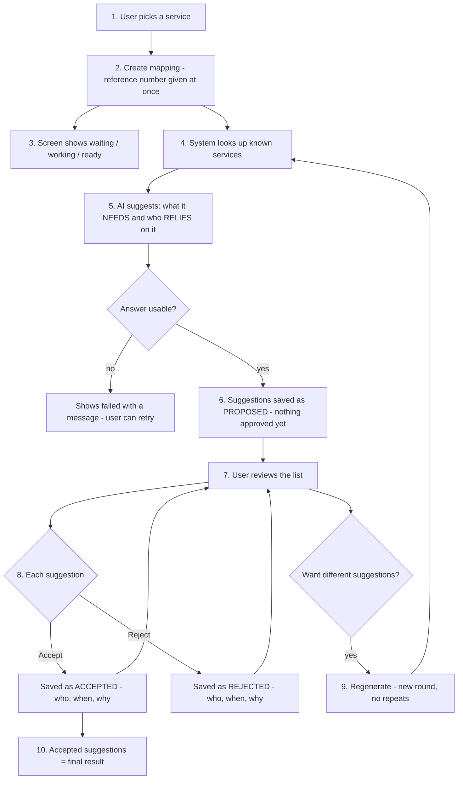
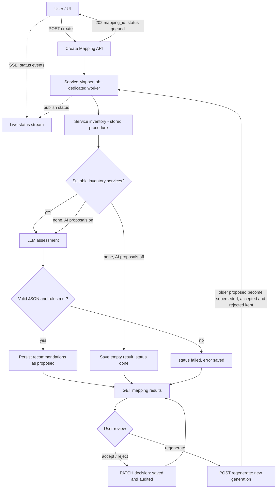

# Service Mapper — Design (3 pages)

> **Superseded:** the current design (version lifecycle, data model, five APIs) is [SERVICE_MAPPER_SOLUTION.md](SERVICE_MAPPER_SOLUTION.md); where this file differs, that one governs.

Status: **Proposed**. Endpoints and fields are proposals validated against the TSG codebase; unverified details are listed as assumptions in section 3.
Detailed reference: [SERVICE_MAPPER.md](SERVICE_MAPPER.md). Candidate selection and matching (including other-sector services) is governed by [SERVICE_MAPPER_HOW_IT_WORKS.md](SERVICE_MAPPER_HOW_IT_WORKS.md).

## 1. Overview and end-to-end flow

**Purpose.** For a chosen service of an entity, the Service Mapper proposes which services it **needs (upstream)** and which **rely on it (downstream)**.
Candidates come from the existing service inventory first. The AI proposes and explains; people **accept or reject** each recommendation. Nothing is approved automatically.

**Reuses TSG:** header authentication and entity ownership, SQL stored procedures, MongoDB record, Celery job lease/retry, AI slot limiter, `ChatModel`, `record_audit`, RFC 9457 errors.
**New:** one Celery queue/worker (`tsg_service_map`), one Mongo collection (`tsg_service_maps`), two stored procedures, five endpoints plus one live-status (SSE) stream. No new retrieval stack, vector store or broker.

### How it works (plain English)
**Example:** a user at Entity 5 wants to know what the *Online Payment Service* depends on, and who depends on it.

1. **Pick a service.** The user chooses one of the entity's services from a list, or types the name of a new service.
2. **Press "Create mapping".** The system answers straight away with a reference number (the *mapping ID*) and says "queued". The real work happens in the background, so the screen never freezes.
3. **Watch the progress.** The screen shows *waiting -> working -> ready* by itself, as the system sends live updates.
4. **The system gathers what it knows.** It looks up the company's list of known services (the inventory), starting with the same sector.
5. **The AI makes suggestions.** It reads the service, sector and entity, plus the known-services list, and suggests two groups:
   - **Needs (upstream):** services Online Payment needs, e.g. *Identity Service*.
   - **Relied on by (downstream):** services that rely on Online Payment, e.g. *Customer Application*.

   Each suggestion has a short reason and a confidence (high / medium / low). The AI prefers real services from the inventory. A name not in the inventory is marked **"AI suggested"** (this can be switched off).
6. **The system saves the suggestions as "proposed".** Nothing is approved yet. If the AI's answer cannot be used, the mapping shows "failed" with a message and the user can try again.
7. **The user reviews.** Each suggestion shows its name, direction, reason, confidence, and whether it is "AI suggested".
8. **Accept or reject each one**, with an optional comment. The system saves who decided, when, and why. A decision is final and goes to the audit log. Deciding the same thing twice changes nothing.
9. **Not happy with the rest? Regenerate.** The system runs another round. Accepted and rejected suggestions stay exactly as they are; suggestions nobody decided are replaced by new ones; names already seen are not repeated.
10. **Finish.** The accepted suggestions are the final result for that service. The user can return later and see the full history.


PROPOSED = waiting for a person. ACCEPTED / REJECTED = final; a new round never changes them. The technical flow below shows the same journey with the system parts.

### Technical flow

Accepted relationships are stored on the mapping and never overwritten by regeneration.

## 2. Five APIs, one live stream, and payloads
All calls need `X-API-Key`, `X-User-Id`, `X-Entity-Id`, `X-Tenant-Id`; POSTs accept `Idempotency-Key`. Paths use `/v1` to match the codebase.

| # | Operation | Method and path | Purpose | Expected time (target) |
|---|---|---|---|---|
| 1 | Create mapping | `POST /v1/service-mapper` | Start a mapping; returns at once | Reply < 1 s; ready in about 10 s to 2 min |
| 2 | Get mapping | `GET /v1/service-mapper/{mapping_id}` | Status plus all recommendations | < 1 s |
| 3 | Entity services | `GET /v1/entities/{entity_id}/services` | Services the UI can pick as the selected service | < 1 s |
| 4 | Regenerate | `POST /v1/service-mapper/{mapping_id}/regenerate` | New generation of proposals | Reply < 1 s; ready in about 10 s to 2 min |
| 5 | Decide | `PATCH /v1/service-mapper/recommendations/{recommendation_id}/decision` | Accept or reject one recommendation | < 1 s |
| + | Live status (SSE) | `GET /v1/service-mapper/{mapping_id}/events` | Pushes status changes; the UI then calls API 2 for the result | Opens < 1 s; keep-alive every 15 s |

Times are design targets, not measurements; "ready in" is the background AI work (about 5 s on the faster model, 55-99 s on the slower one, plus the shortlist step) and grows when many requests queue. Confirm with a load test.

**1. Create** - `entity_id` must equal `X-Entity-Id` (else 403). Give `service_id` (existing service) **or** `service_name` (a new service; optional `sector_id`, `sub_sector_id`).
```json
{"entity_id": 5, "service_id": 31}
```
`202` (`200` on an `Idempotency-Key` replay):
```json
{"mapping_id": "6a1f0c2e9b7d4e58a3c1d2e4f5a60718", "status": "queued", "generation": 1}
```

**2. Get mapping** - poll until `status` is `done` or `failed`.
```json
{"mapping_id": "6a1f0c2e9b7d4e58a3c1d2e4f5a60718", "entity_id": 5,
 "service": {"service_id": 31, "name": "Online Payment Service"},
 "status": "done", "generation": 2, "error": null,
 "recommendations": [
  {"recommendation_id": "c41d9e07b2a84f6e9d5a3b1c7e8f2a60", "generation": 1, "direction": "upstream",
   "related_service_id": 58, "name": "Identity Service", "ai_generated": false,
   "reason": "Payment needs identity to verify the payer.", "confidence": "high",
   "status": "accepted", "decision": {"by": "user-123", "at": "2026-10-15T10:42:11Z", "comment": "Relationship verified."}},
  {"recommendation_id": "e5b2a7c9013d4f68b9a1c3d5e7f90214", "generation": 1, "direction": "downstream",
   "related_service_id": null, "name": "Merchant Portal", "ai_generated": true,
   "reason": "Merchants may rely on payment.", "confidence": "low",
   "status": "rejected", "decision": {"by": "user-123", "at": "2026-10-15T10:44:02Z", "comment": "Not used here."}},
  {"recommendation_id": "0b7e3d5a9c1f4286a4d6e8f0b2c41973", "generation": 2, "direction": "downstream",
   "related_service_id": 77, "name": "Customer Application", "ai_generated": false,
   "reason": "The app relies on payment to charge users.", "confidence": "medium",
   "status": "proposed", "decision": null}]}
```
`ai_generated: true` means the name is not in the inventory (`related_service_id` is null).

**Live status (SSE)** - open after create or regenerate; owner only (403/404 as for API 2). Each event carries only ids and status, never the result:
```
event: status
data: {"mapping_id": "6a1f0c2e9b7d4e58a3c1d2e4f5a60718", "status": "running", "generation": 2}
```
Events: `queued` -> `running` -> `done` / `failed`; the UI then calls **API 2** for the result. A keep-alive comment is sent every 15 s, and the stream re-reads the record on every event and every 30 s, so a missed event is recovered. API 2 stays the source of truth (reconnect, page reload). Built on the existing Redis publish and event hub (`app/realtime`, `app/api/routers/events.py`).

**3. Entity services** - read-only list from the inventory.
```json
{"entity_id": 5, "services": [{"service_id": 31, "name": "Online Payment Service"}, {"service_id": 58, "name": "Identity Service"}]}
```

**4. Regenerate** - no body. `409 generation_in_progress` if a job is running. `202`:
```json
{"mapping_id": "6a1f0c2e9b7d4e58a3c1d2e4f5a60718", "status": "queued", "generation": 2}
```

**5. Decide** - only on a `proposed` recommendation of the current generation.
```json
{"action": "accept", "reviewer_comment": "Relationship verified."}
```
```json
{"action": "reject", "reviewer_comment": "Not used by this entity."}
```
`200`:
```json
{"recommendation_id": "c41d9e07b2a84f6e9d5a3b1c7e8f2a60", "status": "accepted",
 "decision": {"by": "user-123", "at": "2026-10-15T10:42:11Z", "comment": "Relationship verified."}}
```
Audit: every first decision writes one `tsg_audit` record (`record_audit`): actor (client, user, entity), target = recommendation, `before` status, `after` status + comment. A repeat writes nothing.

## 3. Business rules and assumptions

**Identifiers.** `entity_id` and `service_id` = SQL integers (inventory). `mapping_id` and `recommendation_id` = uuid hex (Mongo). `related_service_id` = inventory id or null.

**Statuses.**
| Object | Status | Meaning |
|---|---|---|
| Mapping | `queued` -> `running` -> `done` or `failed` | Async job; `error` set when failed; previous generations stay readable |
| Recommendation | `proposed` | Awaiting review |
| | `accepted` / `rejected` | Final; never overwritten or re-proposed |
| | `superseded` | Was `proposed` when a newer generation started |

**Inventory integrity.** Candidates are inventory rows. The model returns names; a name that matches an inventory row gets its `service_id`, anything else is `ai_generated: true` with no id. AI-named services can be turned off (`CII_SERVICE_MAP_AI_GENERATE`, default off). Accepting never creates or edits inventory records (platform tables are read-only for TSG).

**Processing.** Create and regenerate return `202` + `mapping_id`; the UI listens on the SSE stream (or polls API 2) and reads the result from API 2. Worker: load names and inventory via stored procedure, one LLM call (rules in the prompt), match names, save as `proposed`.

**Regeneration.** Starts `generation + 1`. Older `proposed` become `superseded`; `accepted` and `rejected` stay. The prompt lists every name already seen (all generations, all statuses) as "do not repeat", and saving skips any recommendation whose normalised direction + name already exists on the mapping (unique key). Counts per direction are configurable (`..._DEFAULT_COUNT`, `..._REGENERATE_DEFAULT_COUNT`).

**Review.** Allowed only when the mapping is `done`, the recommendation is `proposed` and in the current generation. `action` must be `accept` or `reject`. Caller must own the entity. Records `decision {by, at, comment}`; decisions are final.

**Consistency.** Decision = compare-and-set on `status = proposed`. Same decision repeated -> `200`, unchanged, no new audit. Opposite decision or superseded item -> `409`. A second regenerate while one runs -> `409`. `Idempotency-Key` on POSTs; worker lease/epoch fencing stops stale writers.

**Failure handling.**
| Case | HTTP / representation |
|---|---|
| Bad body, unknown action, missing/both of `service_id`/`service_name` | 422 |
| Missing or invalid API key/headers | 401 |
| Mapping/recommendation belongs to another entity | 403 |
| Unknown id | 404 |
| Already decided differently, superseded, generation running | 409 with `reason` (`decision_final`, `superseded`, `generation_in_progress`) |
| Too many pending jobs, store/AI unavailable | 503 + `Retry-After` |
| Processing error (unreadable AI output, retries exhausted) | Mapping `status: failed` with `error {code, message}`; regenerate to retry |

Errors use the existing RFC 9457 problem body.

**Assumptions to confirm (not verified in the code).**
1. New stored procedures: entity services (`ctm_scan_entity_bu` joined to `onboarding_services`, `is_deleted = 0`) and mapping context (sector/sub-sector names, candidates).
2. Accepted relationships live in MongoDB only; mappings carry no TTL, so decisions persist (audit kept 365 days).
3. One entity per mapping (earlier plan allowed a list); `entity_id` must equal `X-Entity-Id`.
4. No role model exists; any caller of the owning entity may decide. Role-based reviewers would be new.
5. The unique-key duplicate skip is a small code guard beyond the earlier "prompt-only" decision.
6. The SSE stream is a sixth route beyond the five requested; it needs a new `service_mapper` channel in the existing realtime publisher and event router.
7. Candidate pool = non-deleted `onboarding_services` (same sector first, capped); the error reasons above are new `ConflictReason` values.
