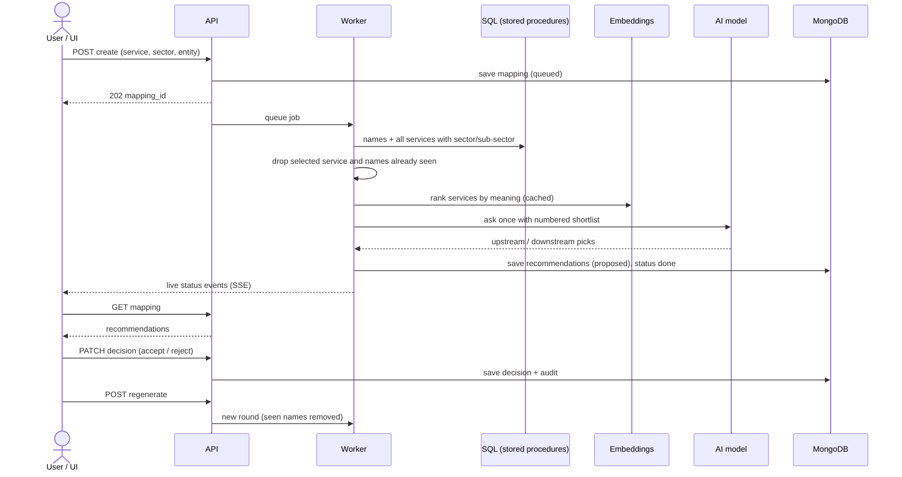

# Service Mapper — How It Works, and the APIs

> **Superseded where different:** the version lifecycle, data model and five-API contract are now in [SERVICE_MAPPER_SOLUTION.md](SERVICE_MAPPER_SOLUTION.md). This file still explains how candidates are chosen and matched.

Status: **Proposed** (nothing is built). This file governs how candidate services are chosen and matched, including services from **other sectors and sub-sectors**.
It supersedes that logic in [SERVICE_MAPPER.md](SERVICE_MAPPER.md) and [SERVICE_MAPPER_DESIGN.md](SERVICE_MAPPER_DESIGN.md).

---

## Part A. Why the earlier logic would fail for other-sector services

Upstream and downstream services of a new service can belong to **any** sector or sub-sector. The sector and sub-sector given in the request describe the **selected** service only.

| # | Problem (checked in the repo) | Effect | Fix in the new logic |
|---|---|---|---|
| 1 | `onboarding_services` has **no sector column**, and no service-to-sector link table exists in the repo (`tests/sql/schema.sql:16-19`). Sectors and sub-sectors are one tree (`onboarding_sectors.parent_id`). | A service's sector cannot be shown or compared. | The stored procedure must read the real link table (the junction table). **Open item: its name and columns.** |
| 2 | Sending "all services, same sector first, capped" to the AI. | A large inventory does not fit one prompt (about 400-500 names fit; chat input limit is 60,000 characters). The cap drops exactly the other-sector services, so the AI invents them as `ai_generated`. | **Shortlist by relevance, not by sector.** Code ranks every service in every sector against the selected service and keeps the top K (default 60). The AI then chooses from that shortlist. |
| 3 | AI free-text names matched back to the database by exact normalised name (`name_match_key`, `app/engine/shared/names.py:26`). | "Identity Svc" is wrongly marked AI-generated, so real services are lost. | The shortlist is **numbered**. The AI answers with the **number** for database picks and a free-text name only for new ideas. |
| 4 | "Database first, AI only if none fits" left to the AI. | Unreliable. | Code decides: only numbered picks are database services; free-text names are `ai_generated` and are accepted only when AI suggestions are on. |
| 5 | Regenerate relied on "do not repeat" in the prompt. | The AI may repeat, or never reach the next-best database services. | Code removes every service already seen on the mapping **before** shortlisting, so each round shows the next best candidates. |

Each related service carries its **own** `sector` and `sub_sector`, plus a `cross_sector` flag (true when its sector differs from the selected service's).

Shortlisting reuses what the repo already has, with no new index or vector store: `EmbeddingModel.embed_search_queries` (`app/ai/embeddings.py:76`; vectors cached 14 days) plus a simple similarity ranking. The reranker (`RerankModel.score_relevance`, `app/ai/rerank.py:50`) is the fallback if quality is poor.

---

## Part B. How the Service Mapper works, step by step

Example: Entity 5 selects *Online Payment Service* (Finance / Payments).

1. **The user picks a service** from the entity's list, or types the name of a new service (sector and sub-sector are optional).
2. **The user presses Create.** The system replies at once with a reference number (the *mapping ID*) and "queued". The work continues in the background, so the screen never freezes.
3. **The screen shows live progress** (waiting, working, ready) through the live-status stream.
4. **The system looks up names** of the chosen sector, sub-sector and entity from the database (stored procedure).
5. **The system loads every known service from all sectors**, each with its sector and sub-sector.
6. **The system removes** the selected service itself and every service already shown on this mapping in earlier rounds.
7. **The system shortlists** the services most relevant to the selected one (by meaning, across all sectors) — for example 60 out of 800 — and numbers them.
8. **The AI is asked once.** It receives the selected service, its sector, the entity, and the numbered shortlist with each service's sector. It returns two groups: what the service **needs** (upstream) and what **relies on** it (downstream), each with a reason and a confidence. It answers with list numbers. Only if AI suggestions are switched on may it add a name that is not in the list.
9. **The system turns the answer into suggestions.** A number becomes the real service (its id, sector, sub-sector and `cross_sector` flag). A free-text name becomes "AI suggested". All are saved as **proposed**. If the answer is unreadable, the mapping shows **failed** with a message.
10. **The user reviews** the suggestions. Cross-sector ones are marked.
11. **The user accepts or rejects** each one, with an optional comment. The decision is final and audited.
12. **The user can regenerate.** Steps 5 to 9 run again with everything already seen removed. Accepted and rejected suggestions stay; undecided old ones become "superseded".
13. **The accepted suggestions are the final result** for that service.

### Sequence


---

## Part C. API list

All paths are under `/v1`. Every call needs the headers `X-API-Key`, `X-User-Id`, `X-Entity-Id`, `X-Tenant-Id`. POSTs accept `Idempotency-Key`.

| # | Method and path | Purpose | Expected time (target) |
|---|---|---|---|
| 1 | `POST /v1/service-mapper` | Create a mapping | Reply under 1 s; the mapping is then ready in about 10 s to 2 min |
| 2 | `GET /v1/service-mapper/{mapping_id}` | Status and recommendations | Under 1 s |
| 3 | `GET /v1/entities/{entity_id}/services` | Services the user can pick from | Under 1 s |
| 4 | `POST /v1/service-mapper/{mapping_id}/regenerate` | Start a new round | Reply under 1 s; the new round is ready in about 10 s to 2 min |
| 5 | `PATCH /v1/service-mapper/recommendations/{recommendation_id}/decision` | Accept or reject one recommendation | Under 1 s |
| 6 | `GET /v1/service-mapper/{mapping_id}/events` | Live status (SSE) | Opens under 1 s; an update arrives when the status changes; a keep-alive every 15 s |

**About these times.** They are design targets, not measurements, and must be confirmed by a load test on the real environment.
- **Fast calls (under 1 s):** they only read or write one record, or queue a job. This matches the platform's existing aim that the API answers in under 1 s.
- **Time to ready (create and regenerate):** this is the background work. It is dominated by the AI call, which the existing model settings show as about 5 s for the faster model and 55 to 99 s for the slower one. Add a few seconds for the shortlist step.
- **Busy periods:** many people submitting at once wait in a queue, because the number of simultaneous AI calls is limited (16 by default). A burst of 1,000 requests would take several minutes to clear, depending on model speed.

### 1. Create
`entity_id` must equal `X-Entity-Id`. Give `service_id` (an existing service) **or** `service_name` (a new service).

Input:
```json
{"entity_id": 5, "service_name": "Online Payment Service", "sector_id": 12, "sub_sector_id": 45}
```
or
```json
{"entity_id": 5, "service_id": 31}
```
Output `202` (`200` on an `Idempotency-Key` replay):
```json
{"mapping_id": "6a1f0c2e9b7d4e58a3c1d2e4f5a60718", "status": "queued", "generation": 1}
```

### 2. Get mapping
Poll, or wait for the live-status event, until `status` is `done` or `failed`.
```json
{"mapping_id": "6a1f0c2e9b7d4e58a3c1d2e4f5a60718", "entity_id": 5, "status": "done", "generation": 2, "error": null,
 "service": {"service_id": 31, "name": "Online Payment Service", "sector": "Finance", "sub_sector": "Payments"},
 "recommendations": [
  {"recommendation_id": "c41d9e07b2a84f6e9d5a3b1c7e8f2a60", "generation": 1, "direction": "upstream",
   "related_service_id": 58, "name": "Identity Service", "sector": "Technology", "sub_sector": "Identity", "cross_sector": true,
   "ai_generated": false, "reason": "Payment needs identity to verify the payer.", "confidence": "high",
   "status": "accepted", "decision": {"by": "user-123", "at": "2026-10-15T10:42:11Z", "comment": "Relationship verified."}},
  {"recommendation_id": "e5b2a7c9013d4f68b9a1c3d5e7f90214", "generation": 1, "direction": "downstream",
   "related_service_id": null, "name": "Merchant Portal", "sector": null, "sub_sector": null, "cross_sector": null,
   "ai_generated": true, "reason": "Merchants may rely on payment.", "confidence": "low",
   "status": "rejected", "decision": {"by": "user-123", "at": "2026-10-15T10:44:02Z", "comment": "Not used here."}},
  {"recommendation_id": "0b7e3d5a9c1f4286a4d6e8f0b2c41973", "generation": 2, "direction": "downstream",
   "related_service_id": 77, "name": "Utility Bill Collection", "sector": "Energy", "sub_sector": "Electricity", "cross_sector": true,
   "ai_generated": false, "reason": "Bill collection relies on payment to take customer payments.", "confidence": "medium",
   "status": "proposed", "decision": null}]}
```
`cross_sector` is true when the related service's sector differs from the selected service's, and null for AI-suggested names (no sector known). `status` per recommendation is `proposed`, `accepted`, `rejected` or `superseded`.

### 3. Entity services
```json
{"entity_id": 5, "services": [{"service_id": 31, "name": "Online Payment Service", "sector": "Finance", "sub_sector": "Payments"}]}
```

### 4. Regenerate
No body. Output `202`:
```json
{"mapping_id": "6a1f0c2e9b7d4e58a3c1d2e4f5a60718", "status": "queued", "generation": 2}
```
`409` if a round is already running.

### 5. Decide
Input:
```json
{"action": "accept", "reviewer_comment": "Relationship verified."}
```
```json
{"action": "reject", "reviewer_comment": "Not used by this entity."}
```
Output `200`:
```json
{"recommendation_id": "c41d9e07b2a84f6e9d5a3b1c7e8f2a60", "status": "accepted",
 "decision": {"by": "user-123", "at": "2026-10-15T10:42:11Z", "comment": "Relationship verified."}}
```
Repeating the same decision changes nothing. The opposite decision, or a superseded item, returns `409`. Every first decision is written to the audit log (who, when, before and after).

### 6. Live status (SSE)
Events carry ids and status only. The UI then calls API 2 for the result.
```
event: status
data: {"mapping_id": "6a1f0c2e9b7d4e58a3c1d2e4f5a60718", "status": "running", "generation": 2}
```

### Errors
Errors use the existing problem body (RFC 9457): `401` missing or invalid headers/key, `403` another entity's data, `404` unknown id, `409` conflict (`decision_final`, `superseded`, `generation_in_progress`), `422` bad input, `503` with `Retry-After` when overloaded.
A failed job shows `status: "failed"` and an `error {code, message}` on API 2; the user can regenerate to retry.

---

## Assumptions and open items
1. **Service-to-sector link table** (name and columns) is not in the repo. Until it is known, `sector`, `sub_sector` and `cross_sector` for database services are null.
2. Inventory size is unknown. The shortlist size defaults to 60 (`CII_SERVICE_MAPPER_SHORTLIST_SIZE`) and should be checked on real data; the reranker is the fallback.
3. One entity per mapping; authorisation is entity ownership only (no role model exists); mappings carry no expiry so decisions persist.
4. AI suggestions (names not in the inventory) are off by default (`CII_SERVICE_MAP_AI_GENERATE`).
5. New stored procedures are needed: entity services, and mapping context (names plus all services with sector and sub-sector).
