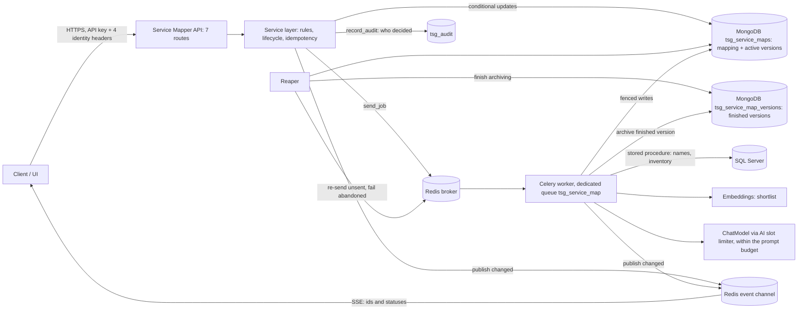
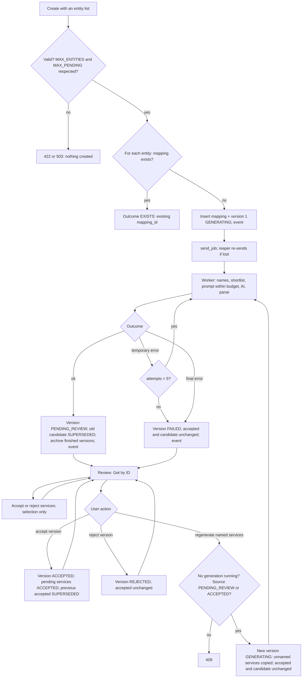

# Service Mapper — Consolidated Solution

Status: **Proposed** (nothing is built). This document is the single source of truth. It replaces the earlier Service Mapper documents wherever they differ (section 8).

## 1. Problem statement and proposed solution

**Problem.** Users cannot easily see which services a service depends on (**upstream**: it needs them) and which services rely on it (**downstream**), including services of other sectors and services that are new. The answers must be reviewable, versioned and auditable.
**Scope.** From a service name, a sector (and an optional sub-sector) and one or more entities, Service Mapper creates **one mapping per entity**. Each mapping produces **versions**; a version is one complete proposal of upstream and downstream services for that entity. Reviewers accept or reject individual services and the whole version. **Regenerate** replaces only the services the reviewer names, as a new version, and never changes the accepted version. A live-status stream tells the UI when generation finishes. Nothing is accepted automatically.

**Glossary**
| Term | Meaning |
|---|---|
| Mapping | One service for one entity, with all its versions (a Create for several entities makes one mapping per entity) |
| Version | One complete proposal (upstream and downstream lists) with a lifecycle status |
| Service (also "recommendation") | One suggested service inside a version, identified by `recommendation_id` |
| Inventory | The table `onboarding_services` (service id and name only) |
| Caller | An API client acting with the four identity headers |
| Reviewer | A caller who records a decision |
| Active version | The accepted version, the candidate version and the generating version of a mapping |
| Candidate | The version in status `PENDING_REVIEW` (at most one per mapping) |
| Source version | The version whose services a regenerate copies from; it contains the named services |
| Stub | The short record that stays in the mapping for a finished version (section 3) |
| Shortlist | The `SHORTLIST_SIZE` inventory services most similar in meaning to the selected service (embeddings), numbered in the prompt |
| Dummy router | The existing placeholder `app/api/routers/service_mapper.py` that returns canned data |

| Area | Existing in TSG | Proposed |
|---|---|---|
| Authentication | API key plus four identity headers (`X-API-Key`, `X-User-Id`, `X-Entity-Id`, `X-Tenant-Id`) giving a `Principal` | Same. Create needs a valid key, `X-User-Id` and `X-Entity-Id` (any entity ids may be listed). Reading or deciding on a mapping needs the same three, and the caller's `X-Entity-Id` must equal the mapping's `entity_id` |
| Storage | MongoDB; remediation plans keep versions in an embedded `versions[]` array | Collection `tsg_service_maps` (mapping and active versions) and `tsg_service_map_versions` (finished versions) |
| Background work | Celery jobs: lease fenced on `job.epoch`, 5 attempts, reaper | New task and dedicated queue and worker `tsg_service_map`; collection added to the reaper |
| Live status | Redis channel per record, SSE route that re-reads Mongo | New channel; the dummy router's events route |
| Duplicates | `Idempotency-Key` with a unique partial index | Same pattern |
| Audit | `record_audit` into `tsg_audit` (365 days, best effort) | New actions; who decided is recorded; no new table |
| Data and AI | Stored procedures; `ChatModel`; AI slot limiter; prompt-size limit; embeddings | One stored procedure (names and inventory); shortlist; one AI call; a prompt budget (section 6). Only names go to the AI, never ids |
| API layer | Dummy router (follows `scenarios.py`) | Keep its paths and extend it (section 5) |

**Workflow.** Create -> version 1 `GENERATING` -> worker generates -> `PENDING_REVIEW` -> reviewer accepts or rejects services, then the version -> Regenerate (named services) -> new version -> accepting it supersedes the old accepted version.
**Minimum components:** router, service layer, two Mongo collections, Celery task and queue, reaper registration (re-send, fail, archive), event channel, one stored procedure, audit actions.

**Settings** (`.env`, all prefixed `CII_SERVICE_MAPPER_` except the last)
| Setting | Default | Meaning |
|---|---|---|
| `AI_GENERATE` | false | When true, the AI may name services that are not in the inventory (`ai_generated` = true) |
| `DEFAULT_COUNT` | 5 | At most this many services per direction in a full generation; `UPSTREAM_COUNT` and `DOWNSTREAM_COUNT` override it per direction |
| `TEMPERATURE`, `REGENERATE_TEMPERATURE` | empty | Model temperature for a full generation and for a regenerate; empty = not sent; sent only when the model accepts it |
| `SHORTLIST_SIZE` | 60 | Starting size of the shortlist |
| `MAX_PENDING` | 200 | Create and Regenerate answer 503 when the jobs already queued or running plus the jobs this call would add exceed this value |
| `MAX_VERSIONS` | 10000 | Versions per mapping; 0 = no ceiling |
| `MAX_ENTITIES` | 0 | Entities in one Create call (each adds one mapping and one job); 0 = no ceiling |
| `CII_MAX_REQUEST_MB` (existing) | 2 | Request size limit of every API, so it also limits the entity list |

## 2. Business rules

| # | Rule | Trigger and validation | Result and data change | Next permitted action |
|---|---|---|---|---|
| BR1 | Creation: one mapping per entity | `POST` Create needs a valid API key and the headers `X-User-Id` and `X-Entity-Id` (the caller; any entity ids may be listed). Body: `service_name` (1 to 255 characters), `sector_id` (required; exists, not deleted), `sub_sector_id` (optional; child of the sector), `entity_id` (a list of one or more distinct ids; each must exist; at most `MAX_ENTITIES` when set). An unknown field, sector or entity gives 422 and nothing is created. The jobs this call adds plus the jobs already queued or running must not exceed `MAX_PENDING` (else 503, nothing created) | For each listed entity: if no mapping exists for the service, sector, sub-sector and that entity, one is inserted with version 1 `GENERATING`, `generating_version` = 1 and a queued job (outcome `CREATED`); if one exists, nothing is created and the entry carries the existing mapping (outcome `EXISTS`). The creator (user, client and the caller's entity) is stored on each new mapping | Get the mapping of an entity; follow its live status |
| BR2 | Identification and duplicates | `mapping_id`, `version_id` and `recommendation_id` are server-made 32-character hex ids. `service_key` = normalised name, `sector_id`, `sub_sector_id` and `entity_id` joined; it is **unique**, so an entity has at most one mapping per service and sector. The same `Idempotency-Key` with the same body replays the Create and returns the same entries with 200; a retry after a failure creates only the missing mappings. The same key with a different body: 409 `idempotency_key_conflict` | A unique index decides a race: the loser re-reads and reports `EXISTS` | Use the existing mapping |
| BR3 | Generation and when the AI is called | The stored procedure returns the names of the sector, sub-sector, the entity and every inventory service. The shortlist is numbered in the prompt; the AI answers with a list position for an inventory service, or with a name (only when `AI_GENERATE` is true). The AI is called whenever the inventory is not empty or `AI_GENERATE` is true. The rules about direction, self-reference and relevance are in the prompt only; the code removes duplicates by normalised name and the selected service itself. **Only names and list positions go to the prompt, never ids** | `result` filled; `ai_generated` is true exactly when `related_service_id` is null. If neither direction has a service, the version still completes, with the warning `no_result`: "No result found: no matching service in the inventory, and AI suggestions are switched off" (or "the AI proposed none" when they are on) | Review (such a version can only be rejected or regenerated) |
| BR4 | Retrieval, history, live status, access | Get, List and events. A mapping is readable by any caller with a valid key, `X-User-Id` and an `X-Entity-Id` equal to the mapping's `entity_id`. An unknown id gives 404; a known id of another entity gives 403 | Read only. Get returns `accepted`, `candidate`, `generating` and `history[]` (stubs) | Any |
| BR5 | Regeneration of named services | `POST` Regenerate with a list of one or more distinct `recommendation_id`s. All must belong to **one** version of the mapping, the source version (unknown id: 404 `recommendation_not_found`; ids from different versions: 422). The source version must be `PENDING_REVIEW` or `ACCEPTED` (else 409 `version_not_regenerable`). `generating_version` must be null (else 409 `generation_in_progress`); the version count must be below `MAX_VERSIONS` (else 409 `version_limit`) | Version n+1 `GENERATING`. Services **not** named are copied from the source version with new `recommendation_id`s, `carried_from_recommendation_id`, and their selection and decision kept. The named services are **removed**; for each, one replacement is generated in the same direction, avoiding every name in the source version. The new version holds 0 to N replacements (N = number named); fewer than N adds the warning `partial_replacement` ("Found X of N replacements"). Accepted and candidate versions are unchanged until n+1 succeeds. When it succeeds it becomes the candidate and supersedes the current candidate, whatever its source | Follow the live status |
| BR6 | Accept or reject a **service** | `PATCH` on a `recommendation_id`. Its version must be `PENDING_REVIEW` (else 409 `version_not_reviewable`) | The service's `selection` becomes `ACCEPTED` or `REJECTED` with `by`, `client`, `entity_id`, `at`, `comment`. It can be changed again while the version is `PENDING_REVIEW`. The version status does not change | Another service decision; a version decision; Regenerate |
| BR7 | Accept or reject a **version** | `PATCH` on `mapping_id` and `version_id`. The version must be `PENDING_REVIEW`. Accept also needs at least one service that is not `REJECTED` (else 409 `nothing_to_accept`) | Accept: version `ACCEPTED`; every service still `PENDING` becomes `ACCEPTED` with the same stamp as the version decision; `REJECTED` services stay rejected; the previous accepted version becomes `SUPERSEDED`. Reject: version `REJECTED`; selections stay as history; the accepted version is unchanged | Regenerate |
| BR8 | Preserve the accepted version | Always | Only accepting a replacement version changes the accepted version. Rejecting, failing and regenerating never touch it | None |
| BR9 | Failure, retries, repeats, concurrency | A **temporary error** (store, broker or AI unavailable, timeout) retries the same version: 5 attempts in total, waiting 15, 30, 60 and 120 seconds between them. A **final error** (the AI answer is not valid JSON of the agreed shape, or a refusal) fails at once. The same decision repeated: 200, no write, no audit record. Every state change is a conditional update (section 3) | After the last attempt or a final error the version is `FAILED` (stored; the shared job-failure code is extended to do this), `generating_version` is null, candidate and accepted are unchanged. A retry never creates a version; only a user Regenerate does | Regenerate |
| BR10 | Authorization and audit | Every call needs a valid API key, `X-User-Id` and `X-Entity-Id`. On an existing mapping the caller's entity must equal the mapping's entity (403). Create, Regenerate and every accept or reject write one audit record per mapping: actor (client, user id, entity), target, before and after (ids, statuses, selections). A repeat writes none | Each decision stores `by` (user id), `client`, `entity_id` (the caller's), `at`, `comment`. The audit write is best effort (existing behaviour), so the stored stamp is the durable record | None |
| BR11 | Consistency and transitions | Only the transitions in section 4 are allowed | At most one `ACCEPTED`, one `PENDING_REVIEW` and one `GENERATING` version per mapping, enforced by three pointers and conditional updates | None |

## 3. Data models
A mapping is **one MongoDB document holding its active versions**, so each lifecycle transition is one atomic single-document update (no transactions). A finished version (`REJECTED`, `FAILED` or `SUPERSEDED`) moves to a second collection.

**ServiceMapping** (collection `tsg_service_maps`)
| Field | Type | Required | Notes |
|---|---|---|---|
| `_id` (= `mapping_id`) | string (hex) | Yes | Primary key |
| `entity_id` | int | Yes | The entity of the mapping; the caller's `X-Entity-Id` must equal it |
| `service_name` | string | Yes | As given |
| `service_key` | string | Yes | See BR2; unique |
| `sector_id` | int | Yes | |
| `sub_sector_id` | int | No | |
| `sector`, `sub_sector` | string | Yes, No | Names resolved when the mapping is created |
| `accepted_version`, `candidate_version`, `generating_version` | int or null | Yes | The three pointers (version numbers) |
| `next_version` | int | Yes | The number the next version gets |
| `latest_status` | string | Yes | Status of the newest version: one of the six in section 4 |
| `status` | string | Yes | Job state of the newest generation: `queued`, `running`, `done` or `failed` |
| `active` | bool | Yes | True while a generation job is queued or running |
| `job` | object | Yes | `task`, `epoch` (the number of the version being generated), `task_id`, `attempts`, `due_at`, `lease_until`, `resends`, `error` |
| `idempotency_key`, `request_hash` | string | No | Of the Create request |
| `created_by`, `created_by_client`, `created_entity_id`, `created_at`, `updated_at` | string, string, int, datetime, datetime | Yes | Who created it |
| `versions` | array | Yes | Active versions in full; finished versions as stubs |

**MappingVersion** (in `versions`; full while active)
| Field | Type | Required | Notes |
|---|---|---|---|
| `version_id` | string (hex) | Yes | Unique |
| `version` | int | Yes | 1, 2, 3 ...; unique in the mapping |
| `status` | enum | Yes | Section 4 |
| `source_version` | int | No | Set when created by a Regenerate |
| `replaced_recommendation_ids` | list | No | The ids named in the Regenerate (ids of services in the source version) |
| `requested_by`, `requested_by_client`, `requested_entity_id`, `requested_at` | string, string, int, datetime | Yes | |
| `completed_at` | datetime | After generation | |
| `result` | `{upstream: [ServiceItem], downstream: [ServiceItem]}` | After success | |
| `warnings` | list of `{code, message}` | No | Codes: `no_result`, `partial_replacement`, `prompt_trimmed` |
| `ai_suggestions_enabled` | bool | Yes | Value of `AI_GENERATE` when the version was generated |
| `prompt_version`, `idempotency_key` | string | No | A Regenerate repeated with the same key returns the same version |
| `error` | `{code, message}` | When `FAILED` | |
| `decision` | `{by, client, entity_id, at, comment}` | When accepted or rejected | |
| `superseded_by`, `superseded_at` | version_id, datetime | When `SUPERSEDED` | |

**ServiceItem** (in `result`)
| Field | Type | Notes |
|---|---|---|
| `recommendation_id` | string (hex) | Generated when the item is created; unique in the system; the id used by the decision and regenerate APIs |
| `related_service_id` | int or null | Id in the inventory; null when the AI named the service |
| `carried_from_recommendation_id` | string or null | The item this one was copied from by a Regenerate |
| `name`, `reason` | string | |
| `confidence` | `high`, `medium` or `low` | The model's own estimate |
| `sector`, `sub_sector` | string or null | No table links a service to a sector, so these are the AI's best guess or null |
| `cross_sector` | bool or null | True when the normalised sector names differ, false when equal; null when either is unknown |
| `ai_generated` | bool | True exactly when `related_service_id` is null |
| `selection` | `PENDING`, `ACCEPTED` or `REJECTED` | Default `PENDING` |
| `decision` | `{by, client, entity_id, at, comment}` or null | The last decision on this service |

**Stub and archive.** The archive is the collection `tsg_service_map_versions`, one immutable document per finished version. When a version becomes `REJECTED`, `FAILED` or `SUPERSEDED`: (1) its full body is inserted into the archive (idempotent on `version_id`); (2) the embedded version is reduced to a **stub**: `version_id`, `version`, `status`, request stamps, `decision`, `superseded_by`, `source_version`, `error`, `services` (count), `accepted_services` (count), `archived: true`. If the process stops after step 1, the version stays embedded and is still correct; the reaper finishes step 2 on its next run (every 60 seconds).
**Why the 16 MB limit is not reached.** A mapping holds at most three full versions (3 x 16 services x 600 bytes = 28,800 bytes) and one stub of 500 bytes per finished version, so the 16 MB limit (16,777,216 bytes) holds 33,000 stubs. `MAX_VERSIONS` (default 10,000) stops far below that with 409 `version_limit`; 0 removes the ceiling.

**Audit.** `record_audit` into `tsg_audit`, new actions `mapping.created`, `version.regenerated`, `service.accepted`, `service.rejected`, `version.accepted`, `version.rejected`, new target `service_mapping`. No new table.
**How the model tells versions apart.** The current accepted version is `accepted_version`; the reviewable candidate is `candidate_version`; the generation in progress is `generating_version`; every other version is a stub whose status says rejected, failed or superseded. Nothing is deleted. The accepted set of services is the `ACCEPTED` services of the `ACCEPTED` version.
**Indexes.** `tsg_service_maps`: unique `service_key`; unique partial `(created_entity_id, idempotency_key, entity_id)`; `(entity_id, created_at descending)` and `(entity_id, latest_status, created_at descending)`; multikey `versions.result.upstream.recommendation_id` and `versions.result.downstream.recommendation_id`. `tsg_service_map_versions`: unique `version_id`; `(mapping_id, version)`.
**Concurrency protection.** Each transition is one `update_one` whose filter states the expected state (version status and pointers) and, for generation results, the `job.epoch` fence. A writer that matches nothing re-reads and answers 409, or 200 when the stored state already equals what it asked for. A Regenerate copies the unnamed services **inside** its own update (an aggregation-pipeline update that reads the source version), so the copy is the exact state at that instant.

## 4. Lifecycle statuses and valid transitions
| Status | Meaning |
|---|---|
| `GENERATING` | Being generated: the job is queued or running; retries stay in this status |
| `PENDING_REVIEW` | Generated; the candidate |
| `ACCEPTED` | Approved; the current accepted version |
| `REJECTED` | Rejected by a reviewer (terminal) |
| `FAILED` | Generation failed after the last attempt or on a final error (terminal) |
| `SUPERSEDED` | Replaced by a newer version (terminal) |

| Transition | Trigger | Guard | The same update also |
|---|---|---|---|
| (new) -> `GENERATING` | Create or Regenerate | BR1 or BR5 | Sets `generating_version`; a Regenerate also copies the unnamed services |
| `GENERATING` -> `PENDING_REVIEW` | Worker succeeds | `job.epoch` equals the version | Sets the old candidate (if still `PENDING_REVIEW`) to `SUPERSEDED` with `superseded_by`; sets `candidate_version` to the new version; clears `generating_version` |
| `GENERATING` -> `FAILED` | Last attempt fails, or a final error | `job.epoch` equals the version | Clears `generating_version`; candidate and accepted unchanged |
| `PENDING_REVIEW` -> `ACCEPTED` | Version accept | Version is `PENDING_REVIEW`; a non-rejected service exists | `PENDING` services become `ACCEPTED`; the previous accepted version becomes `SUPERSEDED`; sets `accepted_version`; clears `candidate_version` |
| `PENDING_REVIEW` -> `REJECTED` | Version reject | Version is `PENDING_REVIEW` | Clears `candidate_version` |
| `PENDING_REVIEW` -> `SUPERSEDED` | A newer version succeeds | See the second row | (second row) |
| `ACCEPTED` -> `SUPERSEDED` | A newer version is accepted | See the fourth row | (fourth row) |
| `REJECTED`, `FAILED` or `SUPERSEDED` -> archived | After the transition | Idempotent | Body to the archive; stub stays |

**Service selection.** `PENDING` -> `ACCEPTED` or `REJECTED`; `ACCEPTED` and `REJECTED` can be swapped; all only while the version is `PENDING_REVIEW`. When the version leaves `PENDING_REVIEW` the selections can no longer change. A decision that finds the version no longer `PENDING_REVIEW` gets 409 `version_not_reviewable` and changes nothing. No other transition exists; terminal versions are never reclassified.
**Job status and version status.** Job `queued` or `running` = version `GENERATING`; job `done` = the version has been promoted; job `failed` = version `FAILED`.

## 5. Required APIs
The dummy router's paths are kept. All routes are under `/v1`, need an API key and the four identity headers, and return errors in the existing problem format (RFC 9457). Create and Regenerate accept an `Idempotency-Key` header. Ids: `mapping_id` (the mapping), `version_id` (one version), `recommendation_id` (one service in a version), `entity_id` (SQL integer; a list in payloads). In the examples, ids are shortened with "..."; real ids are 32 characters.

| Operation | Route | Compared with the dummy router |
|---|---|---|
| Create | `POST /v1/service-mapper` | Kept; new payload; the response has one entry per entity |
| Get by ID | `GET /v1/service-mapper/{mapping_id}` | Kept; versions, selections, history |
| List by Entity | `GET /v1/entities/{listed_entity_id}/service-mapper` | New; replaces the dummy's entity-services route |
| Regenerate | `POST /v1/service-mapper/{mapping_id}/regenerate` | Kept; the body names the services to replace |
| Accept or reject a service | `PATCH /v1/service-mapper/recommendations/{recommendation_id}/decision` | Kept |
| Accept or reject a version | `PATCH /v1/service-mapper/{mapping_id}/versions/{version_id}/decision` | New |
| Live status (SSE) | `GET /v1/service-mapper/{mapping_id}/events` | Kept |

**Errors** (HTTP status; `reason` for a 409)
| Reason or code | Status | Meaning | Routes | In TSG today |
|---|---|---|---|---|
| unauthorized | 401 | Missing or invalid key or headers | All | Yes |
| forbidden | 403 | The caller's entity is not the mapping's entity | All except Create | Yes |
| not_found; `recommendation_not_found` | 404 | Unknown mapping, version or service | All except Create | Yes; reason is new |
| validation_error | 422 | Bad field, unknown sector or entity, sub-sector not under the sector, ids from different versions | Create, Regenerate, decisions, List | Yes |
| `idempotency_key_conflict` | 409 | The key was used with a different body | Create, Regenerate | Yes |
| `generation_in_progress` | 409 | A generation is already running | Regenerate | Yes |
| `version_not_regenerable` | 409 | The source version is not `PENDING_REVIEW` or `ACCEPTED` | Regenerate | New |
| `version_limit` | 409 | `MAX_VERSIONS` reached | Regenerate | New |
| `version_not_reviewable` | 409 | The version is no longer `PENDING_REVIEW` | Both decisions | New |
| `nothing_to_accept` | 409 | Every service is rejected, or there are none | Version decision | Yes |
| unavailable | 503 | `MAX_PENDING` reached, or a store or queue is down; `Retry-After` is sent | Create, Regenerate | Yes |

The examples tell one story. Mapping `6a1f0c2e9b7d4e58a3c1d2e4f5a60718` (entity 5) has: version 1 (`SUPERSEDED`), version 2 (`ACCEPTED`: Identity Service, Billing Service, Merchant Portal), version 3 (`REJECTED`), version 4 (`PENDING_REVIEW`: version 2 with Billing Service replaced by Card Gateway), version 5 (`GENERATING`, regenerated from version 4 naming Card Gateway).

**1. Create.** One request creates one mapping for each listed entity. It needs a valid API key and the headers `X-User-Id` and `X-Entity-Id`; the caller may list any entities. `service_name` and `sector_id` are required, `sub_sector_id` is optional, `entity_id` is a list of one or more entities.
```json
{"service_name": "Online Payment Service", "sector_id": 12, "sub_sector_id": 45, "entity_id": [5, 9]}
```
Response **202** when at least one mapping was created, **200** when every entry already existed (this includes a replay of the same `Idempotency-Key`). It has one entry per listed entity, in the order sent. `outcome` is `CREATED` (a new mapping with version 1 `GENERATING`) or `EXISTS` (the entity already has a mapping for this service and sector; the entry shows its newest version):
```json
{"mappings": [
  {"entity_id": 5, "outcome": "CREATED", "mapping_id": "6a1f0c2e9b7d4e58a3c1d2e4f5a60718", "version_id": "a10d...3c", "version": 1, "status": "GENERATING"},
  {"entity_id": 9, "outcome": "EXISTS", "mapping_id": "9b2d4f6a8c1e4d37a5b7c9e1f3a5b7d9", "version_id": "f3a6...c8", "version": 2, "status": "ACCEPTED"}]}
```
Each mapping has its own versions, accepted version, AI run (the AI is told that entity's name) and live status. Entity 5's mapping is read with `X-Entity-Id: 5`, entity 9's with `X-Entity-Id: 9`. For each created mapping: one insert, `send_job`, a status event and one `mapping.created` audit record naming the creator. Nothing is created when the request is invalid (422) or would exceed `MAX_PENDING` (503). If the store fails part-way the call answers 503; repeating it with the same `Idempotency-Key` creates only the missing mappings and returns the existing ones as `EXISTS`. Errors: 401, 409 (`idempotency_key_conflict`), 422, 503.

**2. Get by ID.** 200. `accepted`, `candidate` and `generating` are each a version or null (all three are shown); `history` holds stubs, oldest first. The query `include_history_results=true` adds the archived `result` of each history entry, paged with `history_offset` (default 0) and `history_limit` (default 10, maximum 50).
```json
{"mapping_id": "6a1f0c2e9b7d4e58a3c1d2e4f5a60718", "entity_id": 5,
 "service": {"service_name": "Online Payment Service", "sector": "Finance", "sub_sector": "Payments"},
 "accepted": {"version_id": "b81f...02", "version": 2, "status": "ACCEPTED", "requested_at": "2026-10-15T09:10:00Z", "completed_at": "2026-10-15T09:10:41Z",
   "decision": {"by": "user-123", "client": "web-ui", "entity_id": 5, "at": "2026-10-15T09:30:12Z", "comment": "Verified."}, "warnings": [],
   "result": {"upstream": [
      {"recommendation_id": "c41d...60", "related_service_id": 58, "carried_from_recommendation_id": null, "name": "Identity Service", "sector": "Technology", "sub_sector": "Identity", "cross_sector": true, "ai_generated": false, "reason": "Payment needs identity to verify the payer.", "confidence": "high", "selection": "ACCEPTED", "decision": {"by": "user-123", "client": "web-ui", "entity_id": 5, "at": "2026-10-15T09:30:12Z", "comment": "Verified."}},
      {"recommendation_id": "b3c4...d5", "related_service_id": 61, "carried_from_recommendation_id": null, "name": "Billing Service", "sector": "Finance", "sub_sector": "Billing", "cross_sector": false, "ai_generated": false, "reason": "Payment posts charges to billing.", "confidence": "medium", "selection": "ACCEPTED", "decision": {"by": "user-123", "client": "web-ui", "entity_id": 5, "at": "2026-10-15T09:30:12Z", "comment": "Verified."}}],
     "downstream": [
      {"recommendation_id": "d8e9...f0", "related_service_id": null, "carried_from_recommendation_id": null, "name": "Merchant Portal", "sector": null, "sub_sector": null, "cross_sector": null, "ai_generated": true, "reason": "Merchants may rely on payment.", "confidence": "low", "selection": "ACCEPTED", "decision": {"by": "user-123", "client": "web-ui", "entity_id": 5, "at": "2026-10-15T09:30:12Z", "comment": "Verified."}}]}},
 "candidate": {"version_id": "c42e...77", "version": 4, "status": "PENDING_REVIEW", "source_version": 2, "replaced_recommendation_ids": ["b3c4...d5"], "requested_at": "2026-10-15T10:00:00Z", "completed_at": "2026-10-15T10:00:38Z", "decision": null, "warnings": [],
   "result": {"upstream": [
      {"recommendation_id": "a7d3...e2", "related_service_id": 58, "carried_from_recommendation_id": "c41d...60", "name": "Identity Service", "sector": "Technology", "sub_sector": "Identity", "cross_sector": true, "ai_generated": false, "reason": "Payment needs identity to verify the payer.", "confidence": "high", "selection": "ACCEPTED", "decision": {"by": "user-123", "client": "web-ui", "entity_id": 5, "at": "2026-10-15T09:30:12Z", "comment": "Verified."}},
      {"recommendation_id": "f9a1...3b", "related_service_id": 52, "carried_from_recommendation_id": null, "name": "Card Gateway", "sector": "Finance", "sub_sector": "Cards", "cross_sector": false, "ai_generated": false, "reason": "Payment authorises cards through the gateway.", "confidence": "medium", "selection": "REJECTED", "decision": {"by": "user-456", "client": "web-ui", "entity_id": 5, "at": "2026-10-15T10:05:00Z", "comment": "Not relevant."}}],
     "downstream": [
      {"recommendation_id": "e5b2...14", "related_service_id": null, "carried_from_recommendation_id": "d8e9...f0", "name": "Merchant Portal", "sector": null, "sub_sector": null, "cross_sector": null, "ai_generated": true, "reason": "Merchants may rely on payment.", "confidence": "low", "selection": "ACCEPTED", "decision": {"by": "user-123", "client": "web-ui", "entity_id": 5, "at": "2026-10-15T09:30:12Z", "comment": "Verified."}}]}},
 "generating": {"version_id": "d93a...15", "version": 5, "status": "GENERATING", "source_version": 4, "requested_at": "2026-10-15T10:20:00Z", "attempts": 1},
 "history": [
   {"version_id": "a10d...3c", "version": 1, "status": "SUPERSEDED", "superseded_by": "b81f...02", "requested_at": "2026-10-15T09:00:00Z", "decision": null, "error": null, "source_version": null, "services": 3, "accepted_services": 0, "archived": true},
   {"version_id": "e77b...91", "version": 3, "status": "REJECTED", "superseded_by": null, "requested_at": "2026-10-15T09:40:00Z", "decision": {"by": "user-456", "client": "web-ui", "entity_id": 5, "at": "2026-10-15T09:55:00Z", "comment": "Not relevant."}, "error": null, "source_version": 2, "services": 4, "accepted_services": 1, "archived": true}]}
```
Errors: 401, 403, 404.

**3. List by Entity.** Query: `status` (one of the six version statuses; filters on the newest version), `offset` (0 or more, default 0), `limit` (1 to 500, default 50). `listed_entity_id` must be the caller's entity (403). It returns the mappings of that entity, newest first, without `result` or `history`.
```json
{"items": [{"mapping_id": "6a1f0c2e9b7d4e58a3c1d2e4f5a60718", "service": {"service_name": "Online Payment Service", "sector": "Finance", "sub_sector": "Payments"}, "entity_id": 5,
  "accepted": {"version_id": "b81f...02", "version": 2}, "candidate": {"version_id": "c42e...77", "version": 4}, "generating": {"version_id": "d93a...15", "version": 5},
  "latest_status": "GENERATING", "created_at": "2026-10-15T09:00:00Z", "updated_at": "2026-10-15T10:20:00Z"}], "total": 1}
```
Errors: 401, 403, 422.

**4. Regenerate.** The body names one or more distinct services of one version that is `PENDING_REVIEW` or `ACCEPTED`.
```json
{"recommendation_id": ["f9a1...3b"]}
```
Response **202** (200 when the same `Idempotency-Key` repeats): `{"mapping_id": "6a1f0c2e9b7d4e58a3c1d2e4f5a60718", "version_id": "d93a...15", "version": 5, "status": "GENERATING", "source_version": 4, "replacing": 1}`, where `replacing` is the number of services named. Effects: one conditional update (checks `generating_version`, the source version's status and `MAX_VERSIONS`, and copies the unnamed services), then `send_job`, a status event, one `version.regenerated` audit record. Errors: 401, 403, 404, 409 (`generation_in_progress`, `version_not_regenerable`, `version_limit`, `idempotency_key_conflict`), 422, 503.

**5. Accept or reject a service.** Body: `action` (`accept` or `reject`) and `comment` (optional, 2,000 characters at most). The mapping is found from the `recommendation_id`; its version must be `PENDING_REVIEW`.
```json
{"action": "reject", "comment": "Not relevant."}
```
Response **200**:
```json
{"recommendation_id": "f9a1...3b", "mapping_id": "6a1f0c2e9b7d4e58a3c1d2e4f5a60718", "version_id": "c42e...77", "selection": "REJECTED",
 "decision": {"by": "user-456", "client": "web-ui", "entity_id": 5, "at": "2026-10-15T10:05:00Z", "comment": "Not relevant."}}
```
Effects: one conditional update, one `service.accepted` or `service.rejected` audit record, a status event. The same decision repeated returns 200 and writes nothing. Errors: 401, 403, 404, 409 `version_not_reviewable`, 422.

**6. Accept or reject a version.** Both ids are required and the version must belong to the mapping. Body: `{"action": "accept", "comment": "Final."}` or `{"action": "reject", "comment": "Not relevant."}`. Response **200**:
```json
{"mapping_id": "6a1f0c2e9b7d4e58a3c1d2e4f5a60718", "version_id": "c42e...77", "version": 4, "status": "ACCEPTED", "accepted_version": 4, "candidate_version": null}
```
Effects: one conditional update (BR7), one `version.accepted` or `version.rejected` audit record listing the services this call accepted, a status event. Errors: 401, 403, 404, 409 (`version_not_reviewable`, `nothing_to_accept`), 422.

**7. Live status (SSE).** `GET /v1/service-mapper/{mapping_id}/events`. A check before the stream starts turns 401, 403 and 404 into normal error responses. The first event is the current state, then one event after each change (create, completion, failure, any decision); an unfinished mapping is also re-read every 30 seconds. An event carries only ids, version numbers and statuses:
```
event: status
data: {"mapping_id": "6a1f0c2e9b7d4e58a3c1d2e4f5a60718", "latest_status": "PENDING_REVIEW", "version_id": "c42e...77", "version": 4, "accepted_version": 2, "candidate_version": 4, "generating_version": null}
```
**Asynchronous results.** Create and Regenerate answer at once with status `GENERATING`. The UI follows the stream (or polls Get by ID) and reads the result with Get by ID.

## 6. Architecture and end-to-end workflow


**Prompt budget.** The budget is `chat.max_prompt_chars` (60,000 characters by default) times the existing prompt share 0.8 = 48,000 characters. The prompt is built from these parts; every size is computed before the AI call.
| Part | Content | Size rule |
|---|---|---|
| 1 Rules | Definitions of upstream and downstream, the answer format, "names only", the counts, the AI-suggestion wording | Fixed text, at most 4,000 characters |
| 2 Selected service and entity | Service name (cut to 255 characters), sector name, sub-sector name, the entity name (cut to 80 characters) | At most 700 characters |
| 3 Source names (Regenerate only) | The name of every service in the source version, each cut to 80 characters | At most 10% of the budget (4,800 characters) |
| 4 Shortlist | Numbered inventory service names | The rest of the budget: it starts at `SHORTLIST_SIZE` and halves (60, 30, 15 ...) until the prompt fits; the minimum is 1 |

Parts 1 to 3 are capped, so a prompt with a shortlist of 1 is always under the budget (a test proves it) and no AI call is ever oversized. When anything was trimmed the version gets the warning `prompt_trimmed`. The prompt names one entity, so it does not grow with the number of entities in a Create; the stored procedure checks the listed entity ids in chunks. The AI call uses the existing slot limiter, timeouts and retries.

| Step | Action | Processing and database change |
|---|---|---|
| 1 | Client sends Create | None |
| 2 | Authenticate, validate | API key gives the `Principal`; BR1: the whole request is checked (fields, sector, every entity, `MAX_ENTITIES`, `MAX_PENDING`); a failure ends here and nothing is created |
| 3 | Persist, per entity | For each listed entity without a mapping: one insert (mapping with version 1 `GENERATING`, `generating_version` 1, `job{epoch 1, due_at now}`, `status` queued); an entity that already has one is reported as `EXISTS`. The response lists every entity |
| 4 | Schedule | `send_job` after the insert. If it is lost, the reaper re-sends a job left queued: at most once per 120 seconds and at most 5 times; after that it marks the job and the version failed. A running job whose lease expired is re-queued the same way (the existing lease is 120 seconds, renewed every 30) |
| 5 | Worker generates | Claims the lease (fenced on `job.epoch`); names from the stored procedure; shortlist; prompt within budget; one AI call; assemble and parse. A temporary error retries the same version |
| 6 | Complete | One update sets the version to `PENDING_REVIEW` (or `FAILED`); a status event is published; a version that became terminal is archived |
| 7 | Client reads | Get by ID shows the `candidate`; `generating` is null |
| 8 | Reviewer decides | Accepts or rejects services (as often as needed while `PENDING_REVIEW`), then accepts or rejects the exact `version_id` |
| 9 | Validate and commit | The version is still `PENDING_REVIEW`; one conditional update; audit record with who decided; status event |
| 10 | Regenerate | One update: version n+1 `GENERATING`, unnamed services copied; accepted and candidate unchanged |
| 11 | New version succeeds | It becomes `PENDING_REVIEW`; in the same update the old candidate becomes `SUPERSEDED`, unless it was already accepted or rejected, in which case it is left alone; an `ACCEPTED` source stays accepted |
| 12 | New version accepted | Atomically `ACCEPTED`; the previous accepted version becomes `SUPERSEDED`; `accepted_version` moves |
| 13 | New version rejected or failed | Accepted and candidate unchanged |
| 14 | Later reads | Get and List read the committed state; events describe the same state |

**Races**
| Race | Outcome |
|---|---|
| Regenerate and Regenerate | One finds `generating_version` null and wins; the other gets 409 `generation_in_progress` |
| Accept and reject, on a service or a version | One finds `PENDING_REVIEW` and wins; the other gets 409 `version_not_reviewable` (200 if it asked for the same decision) |
| A decision on the old candidate and the promotion of its replacement | The first commit wins. If the decision wins, the replacement is still promoted and the decided version is left alone. If the promotion wins, the decision gets 409 |
| A service decision and a Regenerate from the same source | The copy is made inside the Regenerate update, so it holds the state at that instant; a decision on the source after it is superseded gets 409 |
| A service decision and a version decision | The first commit wins; the other gets 409 |
| Create and Create | The unique index lets one insert succeed; the other reports `EXISTS` for that entity (or replays with 200 for the same `Idempotency-Key`) |



## 7. Implementation and acceptance criteria
| Phase | Deliverable | Validation before the next phase |
|---|---|---|
| 1 Verify | The defaults in section 9 confirmed; the entity and sector checks agreed | Owner sign-off |
| 2 Contracts and models | Pydantic models, enums, constants and error reasons for the seven routes | Contract review; the conventions tests pass |
| 3 Database | Two collections, indexes, the stored procedure (names and inventory; ids checked in chunks), grants, test schema | Index and procedure tests |
| 4 Lifecycle | Create, complete, fail, Regenerate (with the in-update copy), service decision, version decision and archiving, each as a conditional update | Unit tests of every transition, every race and every crash point of archiving |
| 5 Generation and APIs | Celery task, dedicated queue and worker, shortlist, prompt-budget builder, service layer; rework of the dummy router, models, samples and stub: new Create payload (`entity_id` list), versions in Get, the list route replacing entity-services, the version-decision route, the Regenerate body, the event data | API tests with a fake AI; the existing test suite still passes |
| 6 Safeguards | Entity authorization (the caller's entity equals the mapping's entity), audit with who decided, idempotency, retries, reaper (re-send, fail, archive), the extension of the shared job-failure code, event publishing | Failure-injection tests: lost job, worker crash, AI error, crash between archive and trim |
| 7 Testing | Functional, negative, failure-recovery, security, concurrency, regression and multi-entity Create tests | Full suite and a burst test |
| 8 Release | End-to-end run on the target environment with the new worker running | The acceptance criteria below |

| # | Acceptance criterion |
|---|---|
| AC1 | A Create for two entities returns one entry per entity (`CREATED` or `EXISTS`); each new mapping reaches `PENDING_REVIEW` on its own and the stream reports it; Get returns that entity's candidate; List shows each mapping to its own entity only |
| AC2 | A caller whose `X-Entity-Id` differs from a mapping's entity gets 403 on every route except Create; a caller with a valid key, `X-User-Id` and the mapping's entity id can read and decide; Create accepts any listed entities |
| AC3 | Regenerate leaves the accepted version unchanged; accepting the new version supersedes the old one and moves `accepted_version` in one update |
| AC4 | Rejecting a version leaves `accepted_version` and its services unchanged; the rejected version stays `REJECTED` |
| AC5 | After the last failed attempt only that version is `FAILED` (stored, not derived); candidate and accepted are unchanged; Regenerate works; a lost job is recovered by the reaper |
| AC6 | Two simultaneous Regenerates create one version and the other gets 409; a simultaneous accept and reject have one winner; a decision racing a promotion never leaves two accepted or two pending versions |
| AC7 | Every version, selection and decision (who, entity, time, comment) stays readable; each user action has one audit record naming the user |
| AC8 | Responses match the stored pointers and statuses; a stale decision gets 409 and changes nothing; a repeated identical decision gets 200 and changes nothing |
| AC9 | A service can be accepted, rejected and changed while the version is `PENDING_REVIEW` and not afterwards; accepting a version whose services are all rejected gets 409 `nothing_to_accept` |
| AC10 | The prompt contains names and list positions only, never ids; a service the AI names has `related_service_id` null and `ai_generated` true |
| AC11 | A status event follows create, completion, failure and each decision, and carries ids, version numbers and statuses only |
| AC12 | Regenerate naming services [a, b] removes exactly a and b, copies every other service with its selection and stamp, and adds at most 2 replacements; ids from two versions give 422; a source that is not `PENDING_REVIEW` or `ACCEPTED` gives 409 |
| AC13 | When fewer replacements are found than services named, the version completes with warning `partial_replacement` ("Found X of N replacements") |
| AC14 | After many Regenerates the mapping document holds at most three full versions plus stubs; archived results are returned with `include_history_results=true`; a crash between archive and trim loses nothing |
| AC15 | A Create with many entities makes one mapping, one prompt and one job per entity; every prompt is within the budget; the call is refused with 503 and creates nothing when its jobs would exceed `MAX_PENDING` |
| AC16 | With no match and `AI_GENERATE` false, a Create produces a `PENDING_REVIEW` version with warning `no_result` that states the rationale and that AI suggestions are off |
| AC17 | `MAX_VERSIONS`, `MAX_ENTITIES` and `MAX_PENDING` take effect from `.env`; the value 0 turns the first two ceilings off |

## 8. Gap analysis
**Differences from existing TSG code and the smallest safe reconciliation**
| Existing behaviour | Mapper rule | Reconciliation |
|---|---|---|
| Remediation has no `SUPERSEDED`; accepting another plan version returns the old accepted one to pending and clears its stamp | The old accepted version becomes `SUPERSEDED` and keeps its decision | Mapper uses its own transition code; remediation is unchanged |
| Decisions are guarded by a record-level `decision_seq` | Guard on the exact version's status | New conditional update in the mapping repository |
| The newest version's status lives only on the record until the next regenerate | Every version's status is written when it changes | Completion and failure are single updates |
| Older pending versions stay pending | The old candidate is superseded when its replacement succeeds | Part of the completion update |
| Shared job-failure and reaper code do not update a version | The version must become `FAILED` | Approved small extension: an optional extra update on the failure path; the collection is added to `JOB_COLLECTIONS` |
| Remediation keeps every version in one document | Versions without a limit | Finished versions are archived; only active versions stay embedded |
| Dummy router: 6 routes, one entity, a `service_id` input, entity-services, `generation`, events | This contract | Keep 5 routes (create, get, regenerate, service decision, events); drop entity-services; add list and version decision; `generation` becomes `version`; `recommendation_id` and `related_service_id` keep their names; payloads as in section 5 |
| No table links a service to a sector | Sector labels are the AI's guess or null | Section 3; nothing depends on them |
| Rules about direction, self-reference and relevance of the AI answer are checked only by the prompt | Accepted for the first release | Add code checks later if answer quality is poor |

**Consistency matrix** (rule, data fields, route, transitions, workflow steps, tests)
| Rule | Data fields | Route | Transitions | Steps | Tests |
|---|---|---|---|---|---|
| BR1 | `entity_id`, `sector_id`, `service_key` | Create | new -> `GENERATING` | 2-3 | AC1, AC2, AC15, AC17 |
| BR2 | `service_key`, `idempotency_key`, `request_hash` | Create, Regenerate | none | 2 | AC6 |
| BR3 | `result`, `warnings`, `ai_generated`, `ai_suggestions_enabled` | Worker | `GENERATING` -> `PENDING_REVIEW` | 5-6 | AC1, AC10, AC15, AC16 |
| BR4 | pointers, `versions`, archive, `entity_id` | Get, List, events | none | 7, 14 | AC1, AC8, AC11, AC14 |
| BR5 | `source_version`, `replaced_recommendation_ids`, `carried_from_recommendation_id`, `generating_version`, `job.epoch` | Regenerate | new -> `GENERATING` | 10-11 | AC3, AC6, AC12, AC13 |
| BR6 | `selection`, item `decision` | Service decision | selection changes only | 8-9 | AC7, AC9 |
| BR7 | version `decision`, pointers | Version decision | `PENDING_REVIEW` -> `ACCEPTED` or `REJECTED`; `ACCEPTED` -> `SUPERSEDED` | 8-9, 12 | AC3, AC4, AC9 |
| BR8 | `accepted_version` | Regenerate, decisions | none on the accepted version until BR7 | 10-13 | AC3, AC4, AC5 |
| BR9 | `job`, `status`, `error` | Create, Regenerate, decisions | `GENERATING` -> `FAILED`; archiving | 4-6, 13 | AC5, AC6, AC8, AC14 |
| BR10 | `entity_id`, `decision.by`, audit | All | none | 2, 9 | AC2, AC7 |
| BR11 | pointers, `status` | All | All | All | AC6, AC8 |

**Gaps found and how this document resolves them**
| Gap | Resolution |
|---|---|
| A pending version lost when its replacement fails | It is superseded only when the replacement succeeds |
| A committed record with no scheduled job | Insert, then send; the reaper re-sends, then fails the job and the version |
| Two accepted versions | One pointer and a conditional update |
| Stale decisions | The guard is the exact version's status |
| A decided candidate overwritten by a late replacement | Promotion supersedes only a candidate that is still `PENDING_REVIEW` |
| Service and version decisions contradicting each other | Service decisions only while `PENDING_REVIEW`; version accept applies the pending ones; `nothing_to_accept` when none can be accepted |
| A regenerate source changing between request and generation | The copy is made inside the request update |
| A named service with no replacement | It is removed; `partial_replacement` reports the shortfall |
| Two services with the same id in different versions | Copies get new `recommendation_id`s and `carried_from_recommendation_id` |
| The 16 MB document limit | Finished versions move to the archive; a stub stays |
| A long entity list in one Create | One mapping, one prompt and one job per entity, so the prompt never grows with the list; `MAX_PENDING` guards the burst; a store error part-way is repaired by repeating the Create with the same `Idempotency-Key` |
| An empty result looking like a failure | Warning `no_result` with the rationale |
| Terminal versions changing status | Never allowed |
| Version statuses lagging | Each is written in the update that changes it |
| Ids reaching the AI | Names and list positions only; AC10 |
| Missing sector data | Sector labels are advisory or null |
| The consistency matrix was built by hand | Not checked by a tool; review it with the acceptance tests |

## 9. Decisions recorded and defaults to confirm
**Decisions recorded**
| Decision | Choice | Applied in |
|---|---|---|
| Per-service accept and live status | Both stay, next to version-level decisions | BR6, BR7, route 7 |
| Service-to-sector table | None exists; sector labels are advisory | Section 3 |
| Dummy router | Its paths are kept; entity-services is replaced by List by Entity | Section 5 |
| Queue | Dedicated queue and worker `tsg_service_map` | Sections 1 and 6 |
| Empty result | Version completes with a `no_result` warning that gives the reason and says AI suggestions are off | BR3, AC16 |
| Version growth | No practical limit: finished versions are archived; `MAX_VERSIONS` is a configurable ceiling | Section 3 |
| One result per entity | A Create for several entities makes one independent mapping per entity: own versions, accepted version, AI run and live status | BR1 |
| Who may create, read and decide | Any caller with a valid API key, `X-User-Id` and `X-Entity-Id` may create for any entity ids listed; a mapping is readable and decidable by any caller whose `X-Entity-Id` equals its entity; who acted is recorded | BR1, BR4, BR10 |
| Failed version | Small extension of the shared job-failure code | BR9, section 8 |
| Regenerate | Takes `recommendation_id`s and replaces only those services; unnamed services, including rejected ones, are copied unchanged | BR5 |
| Entities per Create | No limit by default (`MAX_ENTITIES` = 0); each entity adds one mapping and one job, guarded by `MAX_PENDING` | BR1, section 6 |
| Id names | `recommendation_id` (generated) and `related_service_id` (inventory), as in the dummy router | Section 3 |
| Ceilings | `MAX_VERSIONS`, `MAX_ENTITIES` and `CII_MAX_REQUEST_MB` are configurable | Settings table |

**Defaults to confirm** (they are values, not open design questions)
| Value | Proposed | Why it matters |
|---|---|---|
| `MAX_PENDING` | 200 | Jobs queued or running before Create and Regenerate answer 503 |
| `MAX_VERSIONS` | 10,000 | Ceiling on the size of one mapping |
| `DEFAULT_COUNT` | 5 | Services per direction in a full generation |
| `SHORTLIST_SIZE` | 60 | Starting size of the shortlist |
| `history_limit` | default 10, maximum 50 | Size of one page of history results |
| `CII_SERVICE_MAPPER_REGENERATE_DEFAULT_COUNT` | Removed | The number of named services decides the number of replacements |
