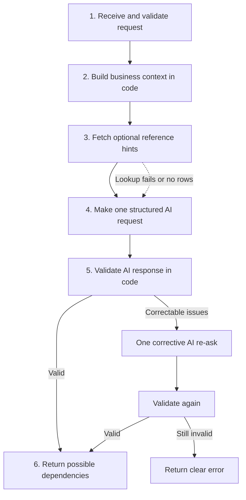

# Service Mapper — Detailed Implementation Recommendations

**Purpose:** Translate the current `SERVICE_MAPPER.md` plan into an implementation-ready recommendation while keeping the first release small, testable, and aligned with the stated problem and 1,000-user concurrency target.

**Recommended position:** Keep the existing plan's discovery and validation logic as the baseline. Strengthen business context, multi-entity handling, response semantics, and tests. Given the clarified target of 1,000 users using the service at the same time, treat a burst of 1,000 simultaneous submissions as a design case. Since TSG already uses Redis and Celery, reuse that established infrastructure for Service Mapper where capacity and operational isolation checks pass. Use a queued job API with FastAPI + Celery if users can receive results asynchronously. This changes the original synchronous/no-persistence API contract; see Section 9. Do not add a new retrieval stack or extra AI stages for concurrency reasons.

---

## 1. Problem statement and intended outcome

The user supplies:

- A selected service name.
- A sector.
- A subsector.
- One or more entities to assess.

The selected service may be new and may not exist in any database table. The system must identify **possible service-to-service dependencies in both directions**, from the selected service's point of view:

- **Upstream:** a service that the selected service needs.
- **Downstream:** a service that needs or relies on the selected service.

Example:

`Identity Service → Online Payment Service → Customer Application`

For `Online Payment Service`, Identity Service is upstream and Customer Application is downstream.

There may be multiple entities, and a dependency may apply to only some of them. Reference service names can help the model, but may be empty, incomplete, irrelevant, or unavailable. The response therefore cannot depend on reference data being present.

### Scope of the first release

The dependency-discovery logic should generate and validate possible dependencies, return them with explanations and confidence, and record the operation through the existing audit/logging framework. For a 1,000-simultaneous-submission design target, expose this work through a queued job contract unless product requirements explicitly require a result in the same HTTP response.

It does **not** create an approved dependency map, persist recommendations as approved relationships, or provide a human approval workflow. If the queued job API recommended in Section 9 is adopted, the platform must temporarily persist job status and results for retrieval, with defined expiry and cleanup; that is job-result storage, not an approved dependency map.

---

## 2. Recommended end-to-end flow



The lookup is advisory and fail-open: no rows or a lookup failure must not prevent the system from attempting dependency discovery. The corrective re-ask is only for a response that is malformed or violates specified rules; it is not a second independent discovery pass. The processing flow is the same whether it runs in the HTTP request or in a queued worker; Section 9 recommends queuing the work and retrieving the result by job ID for the stated concurrency target.

---

## 3. Step-by-step recommendations

### Step 1 — Receive and validate the request

The original plan uses the synchronous endpoint `POST /v1/service-map`. Given the stated 1,000-simultaneous-user requirement, use the job-submission contract in Section 9 if asynchronous completion is acceptable. If the synchronous contract is mandatory, retain this route only after load testing proves capacity and define a clear overload policy.

Original synchronous endpoint:

`POST /v1/service-map`

Example request:

```json
{
  "service_name": "Online Payment Service",
  "sector": "Finance",
  "subsector": "Payments",
  "entities": ["DEWA", "Entity B"]
}
```

Recommended behaviour:

1. Require a non-empty service name, sector, subsector, and at least one entity, in line with the current request contract.
2. Apply maximum-length and empty-value checks before building the AI prompt.
3. Validate and normalize entity values sufficiently to reject blank or repeated entity entries without silently merging distinct entity names.
4. Treat all user-provided text as untrusted data, not instructions. Continue using the existing prompt-redaction utility and clearly delimit user-provided values in the prompt.
5. Do not require the selected service to exist in a master table. Its absence is part of the stated problem, not a request-validation failure.

**Output:** A validated request object.

### Step 2 — Build an explicit business context in code

Create a structured context from the request before calling the model. This is deterministic prompt preparation; it should not require a separate AI call.

Include:

- Selected service name.
- Sector and subsector.
- All entities in the request.
- Any service description or dependency evidence that is already available to the endpoint.
- Optional reference-service names, once retrieved, clearly labelled as hints rather than verified dependencies.

Do not invent missing descriptions or entity-specific facts. When descriptions or dependency evidence are unavailable, the prompt should make clear that the model is reasoning from limited context and that the result is a set of possible dependencies rather than a verified architecture map.

For multiple entities, tell the model to consider applicability separately for each entity. A relationship that is plausible for one entity must not automatically be assigned to all supplied entities.

**Output:** A consistent, structured business context embedded in the single AI prompt.

### Step 3 — Retrieve optional reference hints

Retain the planned stored procedure:

`tsg_GetServiceReference(@Sector, @Subsector)`

The procedure can return up to approximately 40 names for the relevant sector and subsector, as defined in the current plan. All database reads must continue to use stored procedures, per the stated architecture rule.

Recommended behaviour:

| Result | Required behaviour |
|---|---|
| One or more potentially useful names are returned | Pass them to the model as optional hints. |
| No matching rows are returned | Continue without hints. |
| The procedure errors or times out | Log the failure and continue without hints. |
| A returned name is irrelevant | The model must be told to ignore it. |
| A dependency is not in the hint list | The model may still suggest it if it is a plausible dependency. |
| A dependency could be in another sector | Do not prohibit it simply because hint retrieval was limited to the requested sector/subsector. |

The selected service does not have to be in the returned list. The hint list is not the allowed universe of dependencies.

#### Correct interpretation of reference status

A match against the returned hints is not the same as a full-inventory existence check. A name absent from the hints may still exist in the wider master inventory.

If the existing response field `in_reference` is retained, document it as **matched one of the hints retrieved for this request**. Do not use `false` to claim that a service does not exist in the master database. If the response contract can be changed, a clearer name is `matched_reference_hint`.

The status should be computed in code using normalized-name comparison, not supplied by the model.

**Output:** An optional hint list and a logged lookup outcome. A missing hint list is a valid operating condition.

### Step 4 — Make one structured AI request

Use one normal AI call for dependency discovery. Keep the existing low-temperature setting and structured JSON contract. Do not add a separate call to create the business context.

The prompt should clearly specify the following.

#### A. Direction is always relative to the selected service

- Upstream means `selected service needs candidate service`.
- Downstream means `candidate service needs or relies on selected service`.
- The relationship enum and the destination list must agree.
- The reason must describe the same direction as the enum.

Examples:

| Selected service | Candidate | Direction | Explanation expected |
|---|---|---|---|
| Online Payment Service | Identity Service | Upstream | The payment service needs identity verification. |
| Online Payment Service | Customer Application | Downstream | The customer application relies on the payment service to process payments. |

The prompt must not infer a dependency solely from services being similar, being in the same sector, or commonly appearing together.

#### B. Discover plausible services without being restricted to the hint list

- Use reference names only when relevant.
- Do not invent a relationship merely to include a reference name.
- Do not assume every likely dependency is represented in the master service data.
- Allow a dependency to be outside the requested sector or subsector when the operational relationship supports that conclusion.
- Allow an empty upstream or downstream list if no sufficiently plausible dependency is identified.
- Return no more than eight items per direction.

The model may suggest a service name that does not appear among the hints, but that suggestion must be presented as a possible dependency—not as proof that the service is registered, deployed, or used by the entity.

#### C. Assess applicability entity by entity

For every recommendation, the model must explicitly identify the input entities to which it applies when multiple entities are supplied. It must not assume that a relationship applies across entities just because the service names are the same.

Use the following rule in application validation:

- With one input entity, a missing applicability list may default to that entity if this default is part of the agreed contract.
- With multiple input entities, applicability must be explicit. An absent or ambiguous list must trigger the corrective re-ask; if still unresolved, do not silently default to all entities.

#### D. Provide a reason and calibrated confidence

The model should return a concise, specific reason for each relationship and one confidence value: `high`, `medium`, or `low`.

Use these definitions consistently:

- **High:** Strongly supported by the available input and evidence.
- **Medium:** Operationally plausible, but some supporting information is missing.
- **Low:** Possible, but substantially dependent on assumptions.

Confidence is the model's assessment, not a verified probability. The API should label results as possible dependencies. Do not claim that a high-confidence result proves the relationship exists in the entity's production environment.

#### E. Return a candidate's sector only when supportable

The current AI contract asks for a best-guess sector. If the schema permits, allow `null` or an explicit unknown value where the sector cannot be determined reliably. Do not force the model to fabricate a sector merely to fill a field.

**Output:** A structured AI response containing upstream and downstream recommendations, including service name, sector where available, reason, relation, confidence, and entity applicability.

### Step 5 — Validate the AI response in code

Treat the AI response as untrusted input. Pydantic and application checks enforce structural and consistency rules; they do not independently prove that the operational relationship is real.

| Check | Recommended rule |
|---|---|
| JSON/schema | Parse the expected schema; reject unknown fields (`extra="forbid"`) and invalid enum values. |
| Direction/list consistency | Items in the upstream list must have `selected_needs_this`; downstream items must have `this_needs_selected`. |
| Reason consistency | The reason must identify the candidate and support the stated direction. A contradictory or non-explanatory reason is invalid. |
| Self-reference | Reject the selected service as its own dependency using normalized-name comparison. |
| Duplicate within a list | Reject or deterministically deduplicate duplicate normalized service names. |
| Candidate in both lists | Permit only when each direction is independently explained and supported; otherwise re-ask or reject the ambiguous output. |
| Entity subset | Each `applies_to_entities` value must be one of the entities in the request. |
| Missing multi-entity applicability | Do not default to all entities. Re-ask once, then reject or return a clearly handled validation failure. |
| Item limits | Enforce at most eight items per direction, regardless of what the model returns. |
| Confidence | Accept only the agreed values. Do not treat confidence as factual proof. |
| Candidate name | Require a non-empty service name. Do not imply that absence from the hints proves that it is invalid. |
| Response size / parsing | Keep existing handling for truncated or unreadable answers. |

#### Reason validation: what code can and cannot establish

Code can check that a reason is non-empty, mentions the candidate service where appropriate, and does not obviously contradict the stated direction. It cannot reliably prove the truth of a natural-language claim with a simple string check. Keep direction labels and structural checks deterministic; use the corrective re-ask for unclear or conflicting explanations; preserve the final response as a recommendation rather than a verified fact.

#### Corrective re-ask

Retain the plan's limit of one corrective re-ask:

1. Validate the first response.
2. If problems are correctable, send the model the response plus a concise, explicit list of validation problems and request a corrected response using the same schema.
3. Validate the corrected response again.
4. If it still fails, return a clear error using the existing error-handling conventions. Do not silently return a response that failed validation.

This second call is a repair attempt, not a separate discovery stage. It should be bounded and observable.

### Step 6 — Assemble the API response and record the operation

Application code, not the model, should calculate whether a candidate matched a returned reference hint and should perform final sorting by confidence as in the original plan.

The public response should retain the information needed by the caller. The current plan's example response omits some fields present in its internal AI contract. Ensure that important fields—especially relationship direction and `applies_to_entities`—are not dropped when mapping the AI output into the response object.

Recommended item fields:

| Field | Meaning |
|---|---|
| `name` | Proposed dependency service name. |
| `sector` | Sector classification, if supportable. |
| `reason` | Why the dependency is plausible. |
| `relation` | `selected_needs_this` or `this_needs_selected`. |
| `confidence` | `high`, `medium`, or `low`. |
| `applies_to_entities` | Input entities to which the recommendation applies. |
| `in_reference` or `matched_reference_hint` | Whether the name matched the hints retrieved for this request. |

The API should continue to expose top-level `upstream` and `downstream` lists. Document that an empty list is valid and means the model did not identify a sufficiently plausible dependency for that direction from the supplied context.

#### Audit and logging

Use the existing audit and logging conventions. Capture enough information to investigate the outcome, such as:

- Request/correlation identifier.
- Reference lookup success, no-match, or failure outcome.
- Model and prompt version, where available through existing infrastructure.
- Whether response validation passed on the first attempt or required a corrective re-ask.
- Validation/error category and final operation outcome.
- Relevant audit metadata already required by the platform.

Do not log sensitive or unredacted content unnecessarily. Clarify whether audit-write failure should block the API response, according to platform audit requirements.

There is an important scope distinction: **not persisting dependency recommendations** does not mean skipping required audit events. The operation may be audited without saving the returned recommendations as approved dependencies.

---

## 4. Example response contract

The following is illustrative only. The names, sectors, applicability, confidence, and directions must be generated from the actual request and validated; this example does not assert real dependencies for any entity.

```json
{
  "upstream": [
    {
      "name": "Identity Service",
      "sector": "Finance",
      "reason": "Online Payment Service may need identity verification before authorizing a payment.",
      "relation": "selected_needs_this",
      "confidence": "medium",
      "applies_to_entities": ["Entity A"],
      "in_reference": false
    }
  ],
  "downstream": [
    {
      "name": "Customer Application",
      "sector": "Finance",
      "reason": "A customer application may rely on Online Payment Service to process a payment.",
      "relation": "this_needs_selected",
      "confidence": "medium",
      "applies_to_entities": ["Entity A", "Entity B"],
      "in_reference": false
    }
  ]
}
```

In this example, `in_reference: false` means only that the name did not match the hints retrieved for this request. It does not mean the candidate is absent from the complete master inventory.

If the existing response model intentionally exposes fewer fields, document that contract and ensure the caller still receives enough information to distinguish directions and entity applicability.

---

## 5. Testing recommendations

Retain the current planned tests and add the cases below. The aim is to prove both normal behaviour and the safety of fallbacks.

| Test | Expected result |
|---|---|
| Selected service is absent from tables | Discovery is attempted; no service-registration prerequisite is imposed. |
| Reference procedure returns no rows | The request can still return a valid dependency map. |
| Reference procedure fails | Failure is logged; the AI discovery path continues without hints. |
| Irrelevant hints are returned | The model is instructed to ignore irrelevant hints; output is not forced to include them. |
| Candidate is absent from hints | It is not rejected solely for that reason. |
| Candidate may belong to another sector | Cross-sector relationships remain possible. |
| AI returns correct relationship enum in wrong list | Response is rejected or repaired. |
| Reason contradicts its direction | Response is rejected or repaired where detectable; it is not considered verified. |
| Selected service appears as its own candidate | Self-reference is rejected. |
| Duplicate candidate appears in one list | It is rejected or deterministically deduplicated. |
| Same candidate appears in both lists | Both directions require separate reasons; otherwise ambiguous result is rejected or repaired. |
| One entity supplied, applicability omitted | Apply the documented single-entity default if retained in the contract. |
| Multiple entities supplied, applicability omitted | Do not silently assign the dependency to all entities; corrective re-ask, then clear failure if unresolved. |
| AI returns an entity not in the request | Validation rejects the item or response. |
| AI returns empty dependency lists | Empty lists are allowed. |
| AI exceeds per-direction cap | Code enforces the maximum of eight per direction. |
| AI returns invalid enum or extra fields | Schema validation rejects it. |
| AI output is truncated or unreadable | Existing error/repair handling runs; second failure returns a clear error. |
| Hostile text appears in a supplied service name | The text is treated as data and cannot override the prompt instructions. |
| Response is assembled | Direction, reason, confidence and entity applicability are preserved in the public output. |
| Audit/log operation runs | The required operation and outcome are recorded without unnecessarily logging sensitive input. |

Run the test commands already listed in the implementation plan, as appropriate for the repository:

```bash
.venv\Scripts\python -m pytest tests/test_service_map.py tests/test_sql_procedures.py tests/test_code_conventions.py
ruff check .
mypy app
```

Also perform the planned manual POST check with and without reference rows.

---

## 6. Recommended implementation order

Keep the implementation order focused so each layer can be tested before integration.

1. **Request and response models:** Confirm required fields, enum values, output fields, entity applicability, and per-direction limits.
2. **Reference data access:** Implement or verify the stored-procedure wrapper, fail-open behaviour, reference-match semantics, and logging.
3. **Context and prompt:** Build the structured business context in code and define the final one-call prompt and JSON contract.
4. **Validation:** Implement deterministic checks and the bounded corrective re-ask.
5. **Service and API wiring:** Connect the service to the endpoint using the existing project layering and tracing/audit patterns.
6. **Tests and verification:** Cover schema, directions, entities, missing hints, procedure failures, retries, injection-like input, and response assembly; run the repository checks and manual API tests.

This sequence is a work order, not a multi-week delivery commitment. Actual effort depends on existing code conventions and reusable TSG components.

---

## 7. Deliberately excluded from the first version

Do not add the following unless evaluation or a confirmed requirement justifies them:

- A new vector database or embedding infrastructure.
- A reranker or a separate AI context-generation call.
- Multiple independent AI discovery calls.
- Additional AI stages, vector retrieval, or reranking for v1. Because 1,000 simultaneous users are a stated target, use the Section 9 decision to determine whether to expose the recommendation generation through a queued job API.
- Mandatory registration of the selected service before dependency discovery.
- A rule that candidates must come from the reference hint list.
- Automatic approval or persistence of AI recommendations as verified relationships.
- A full human approval workflow or canonical dependency-map lifecycle.

These exclusions keep the first implementation consistent with the stated design: LLM-based discovery, optional hints, deterministic validation, a bounded repair attempt, and a response labelled as possible dependencies.

### Future enhancement decision gate

Only consider a more elaborate candidate-retrieval approach if a representative, labelled evaluation set demonstrates a material quality problem—for example, important dependencies are consistently missed or unsupported service names are frequent. Compare the baseline and proposed enhancement using the same test cases and track both relevance and direction accuracy before increasing complexity.

---

## 8. Final recommendation

**Use the current `SERVICE_MAPPER.md` plan as the foundation, with targeted corrections rather than a redesign.** The highest-priority changes are:

1. Make the business context explicit in code and the prompt, without another AI call.
2. Keep reference data advisory and fail-open; clarify that a hint miss is not proof of inventory absence.
3. Treat multi-entity applicability explicitly and never default a missing multi-entity list to all entities.
4. Validate both the relationship enum and the consistency of the explanation, while recognizing that code cannot prove operational truth from prose alone.
5. Preserve relationship direction and entity applicability in the public response.
6. Test failure cases and audit outcomes before release.

The first release should return **possible dependencies**, not claim to certify an entity's actual service architecture. This is the simplest design that preserves the new-service requirement, multi-entity support, and safeguards against common LLM output errors.


---

## 9. Concurrency and workload handling: FastAPI async vs Celery

### Recommendation

**Given the clarified requirement—1,000 users using Service Mapper at the same time—and the fact that TSG already uses Redis and Celery, I recommend reusing the existing Redis/Celery platform components for a FastAPI + Celery job workflow**, provided their capacity, reliability and isolation are validated. Do not deploy a second broker/worker stack by default. For capacity planning, treat this as a possible burst of 1,000 simultaneous submissions, not merely 1,000 logged-in users. The API should accept and validate requests quickly; the worker fleet should process dependency-generation jobs at a controlled rate aligned with the actual LLM service capacity.

This is a deliberate change from the original synchronous `POST /v1/service-map` contract. Async FastAPI remains appropriate for the API layer, but async I/O alone does not buffer 1,000 expensive LLM calls or create more model throughput. FastAPI's own guidance says larger task-queue tools such as Celery are useful when heavy work can run independently across processes or servers: <https://fastapi.tiangolo.com/tutorial/background-tasks/>. Celery's broker/worker model distributes tasks across workers and machines: <https://docs.celeryq.dev/en/stable/getting-started/introduction.html>.

FastAPI guidance: <https://fastapi.tiangolo.com/async/>. Its worker/deployment guidance is at <https://fastapi.tiangolo.com/deployment/server-workers/>.

### Reuse the existing TSG Redis/Celery infrastructure

Because Redis and Celery are already used by TSG, Service Mapper should reuse the existing platform components rather than introduce another queue technology or separate infrastructure by default. Reuse is conditional on checking the current broker/result-backend configuration, Redis capacity, operational ownership, availability settings and ability to isolate Service Mapper workload from TSG workload. Sharing infrastructure does not mean sharing the same unbounded queue or letting both workloads compete without controls.

Recommended implementation:

1. **Create a dedicated Service Mapper task queue** (for example, `service_mapper`) and route only Service Mapper tasks to it. Do not put them on a shared default queue if that could let large Service Mapper bursts starve TSG tasks, or vice versa.
2. **Use a dedicated worker deployment/process pool for that queue**, even if it runs on the same OpenShift platform. Configure worker replicas and concurrency independently so Service Mapper capacity can be scaled and limited without unintentionally changing TSG processing. Initially share the existing Redis broker only if its tested capacity and operational controls support both workloads.
3. **Keep model concurrency bounded globally.** Celery concurrency limits per worker are not enough if replicas scale independently. Coordinate with a shared model gateway/rate limiter or otherwise enforce an aggregate in-flight limit aligned with the LLM service's quota and capacity.
4. **Separate task state and result lifecycle.** Use the existing result backend only if its retention, memory use, failure semantics and operational purpose are suitable. Define expiry and cleanup. If the platform requires job status/results to survive broker/backend cleanup or restarts, use an approved persistent store for job records/results; do not treat a short-lived Celery result as a permanent dependency record.
5. **Make tasks safe to retry or redeliver.** A task can be executed more than once after failures or worker restarts. Give each submitted job a stable ID, make completion/result persistence idempotent, and prevent a retried task from generating duplicate job results or audit events. Keep retries bounded and do not blindly retry validation failures or non-retryable model errors.
6. **Protect Redis and both workloads.** Monitor Redis memory, latency, connection counts, rejected/failed submissions, queue length and oldest-job age. Ensure broker data is protected from eviction and that Redis persistence/availability settings meet platform requirements. Confirm these details against the existing TSG deployment rather than assuming the current configuration is sufficient for Service Mapper.
7. **Define overload behaviour.** Set an explicit maximum pending-job count or age and reject new work with a controlled response when the configured limit is exceeded. Do not create an unbounded backlog. A queue handles bursts, but does not solve sustained arrival rates above processing capacity.

A dedicated queue and workers provide workload separation while reusing the existing infrastructure. If the current shared Redis instance cannot meet the combined capacity or isolation requirements, scale it or isolate the broker/result backend according to platform standards; do not assume that merely reusing Redis makes the design production-ready.

### Recommended production shape for the stated concurrency target

Use FastAPI for authentication, request validation, idempotency checks, and job submission. Use Celery workers for the optional hint lookup, business-context assembly, one normal LLM request, code validation, and at most one corrective re-ask. Store job state/result for retrieval using the platform's approved persistent store or a deliberately configured result backend with clear expiry/recovery semantics. Reuse the existing TSG broker/worker infrastructure only if it is approved and has adequate capacity/isolation.

The user-facing flow becomes: `POST /v1/service-map-jobs` → `202 Accepted` with `job_id` → `GET /v1/service-map-jobs/{job_id}` for `queued`, `running`, `succeeded`, or `failed` status and the final result when ready. If the public route must remain `/v1/service-map`, it can still return `202`, but document that this is an API contract change from the original immediate-result endpoint. Do not keep the original HTTP request open while waiting for Celery; that retains client/gateway timeout risks and removes much of the benefit of queuing.

The queue smooths bursts; it does not make an unsustainable sustained arrival rate sustainable. If requests arrive faster than the LLM can complete them for a long period, queue wait time will grow. Define a maximum queue depth/age and a controlled response when that limit is reached.

For the API layer, use:

- An async-compatible HTTP client for model/API calls where the API itself makes any synchronous external calls.
- Async database access where the current database stack supports it. If the stored-procedure driver is synchronous, do not call it directly in a way that blocks the event loop; use the project's supported thread-pool/synchronous execution pattern or an async-capable driver.
- Multiple FastAPI replicas behind the existing ingress/load balancer, scaled according to measured CPU and memory use and end-to-end performance.
- Explicit connection, request, and model-call timeouts.
- Bounded concurrency and rate limiting so bursts do not overwhelm the LLM endpoint or exhaust connections.
- Metrics for request latency, in-flight requests, model latency, model rate-limit responses, timeouts, validation retries, database latency, and 4xx/5xx rates.

Do not use `async def` around blocking model SDK or database calls and assume the implementation is now non-blocking. FastAPI's async guidance differentiates libraries that support `await` from synchronous libraries: <https://fastapi.tiangolo.com/async/>.

### The critical control: limit actual model calls

The LLM is likely to be the main capacity constraint. A 1,000-request burst must not automatically become 1,000 simultaneous model calls unless the model service has been verified to support that load.

Add bounded in-flight request control and a clear overload policy. The limit must be designed against the model service's supported concurrency and rate limits, not selected arbitrarily. If multiple API replicas are deployed, a limit held only in one process is not a global limit: the aggregate number of in-flight calls can grow with the replica count. Enforce the overall limit at a shared gateway/rate limiter or coordinate limits with the model-serving platform.

When the service is at capacity, use a defined behaviour—for example, wait for a short bounded interval, or return a controlled `429`/`503` response with retry guidance. Do not allow unbounded waiting, uncontrolled retries, or retry storms. The corrective LLM re-ask should remain limited to one attempt as defined earlier and should count against the same capacity controls.

A useful first sizing relationship is:

`average in-flight requests ≈ incoming requests per second × average end-to-end service time in seconds`

For example, 10 requests per second with an average service time of 8 seconds implies about 80 requests in flight on average. This is an illustration, not a capacity estimate for this deployment. Load testing must establish the actual request rate, latency distribution, available model concurrency, and safe operating limit.

### Why Celery is recommended for a 1,000-request burst (if asynchronous completion is acceptable)

Celery is justified here as a way to absorb bursts, keep API handling separate from model work, bound the number of active model calls, and make job state visible. It is not a way to increase the model endpoint's intrinsic throughput. Use it if users can accept asynchronous completion. If the contract strictly requires an immediate result in the same HTTP response, do not bolt Celery behind the endpoint and wait synchronously; instead, provide sufficient LLM capacity and use bounded global admission control, or revisit the response-time requirement.

- The user should submit a request and receive a job ID immediately, rather than hold an HTTP request open while dependency discovery runs.
- Dependency analysis can exceed the ingress, gateway, client, or application request timeout.
- Work must continue reliably after a client disconnects or after the API process restarts.
- Requests need durable queueing, controlled worker concurrency, retries, prioritisation, or smoothing of traffic bursts.
- The system needs task status such as queued/running/succeeded/failed and a separate endpoint to retrieve results.
- Load testing shows that the synchronous endpoint cannot meet the required latency and error-rate targets, while a queued job model is acceptable to product users.

A Celery design changes the API interaction. Typically, the submission endpoint returns `202 Accepted` with a job identifier, and the client polls a status/result endpoint or receives a completion notification. That implies job-state/result storage, expiry and cleanup rules, idempotency, retry semantics, and a defined failed-job response. This is not equivalent to the currently planned immediate response with no persisted dependency result.

**Do not add Celery and then synchronously wait for the Celery result inside the same HTTP request as a default design.** That often retains the original request-timeout and client-waiting problem while adding broker/worker complexity. Use Celery when the API is intentionally redesigned around queued jobs, or when asynchronous offload is needed for a specific operational reason.

Celery is a task-execution mechanism, not a way to increase the LLM provider's underlying capacity. Worker concurrency must still be bounded to the actual model/API capacity. Reference: <https://docs.celeryq.dev/en/stable/userguide/concurrency/index.html>.

### Load testing gate before production

Before declaring support for 1,000 concurrent users, run a load test with realistic request patterns. Include steady load and a burst of 1,000 simultaneous submissions to the selected endpoint (`POST /v1/service-map-jobs` for the queued design, or `POST /v1/service-map` if synchronous response is retained). Test the real model endpoint and database path, not only mocked components. Because Redis/Celery are shared with TSG, run a combined-load test as well: confirm that Service Mapper bursts do not cause unacceptable TSG queue delays, Redis saturation or worker starvation, and vice versa.

Measure at minimum:

- Successful request throughput and overall error rate.
- p50, p95 and p99 end-to-end response latency.
- Model-call latency, concurrent in-flight calls, throttling and timeouts.
- Number of corrective re-asks and their impact on load.
- API CPU/memory, event-loop blocking/lag, connection-pool saturation, and database latency.
- Behaviour at the capacity limit: bounded waiting or controlled overload responses, with no unbounded backlog or retry storm.
- Recovery after the burst has passed.

The acceptance thresholds (including p95/p99 latency, error rate, and maximum model concurrency) must be agreed with the product/platform owners and validated in the target environment. Do not claim a fixed 1,000-request capacity until those tests pass.

### Decision table

| Requirement / test outcome | Recommended approach |
|---|---|
| 1,000 users are active, but only a modest measured number submit map requests at once and immediate results are required | Async FastAPI can be sufficient if realistic load tests prove the full path meets latency/error targets. Use horizontal scaling and global LLM-call controls. |
| The system must handle a possible burst of 1,000 simultaneous map-generation submissions and users can retrieve results later | **Preferred for the stated requirement:** FastAPI submission API + Celery queue/workers + job status/result endpoint. Bound worker/model concurrency to measured LLM capacity. |
| 1,000 submissions arrive simultaneously, immediate results in the same HTTP response are mandatory, and the LLM cannot support the required parallelism | No choice of FastAPI or Celery alone solves the conflict. Increase/provision model capacity, or change the user experience to queued completion; otherwise use bounded admission and controlled overload responses. |
| Requests exceed the LLM's sustained throughput for an extended period | Queueing only buys time; reduce demand, increase model throughput, or enforce queue limits and backpressure. |
| Tasks must continue after client disconnects/API restarts, and need visible status/retries | Prefer a queued worker design; Celery is suitable if supported and operated by the existing TSG platform. |

### Final concurrency decision

For the clarified target of 1,000 users using the service at the same time, design conservatively for a burst of 1,000 submissions. **I recommend reusing the existing TSG Redis/Celery components for FastAPI + Celery queued execution, with a dedicated Service Mapper queue and worker pool, provided the product accepts asynchronous completion.** Validate the shared broker's capacity and protect TSG from workload contention. The Celery worker concurrency must be coordinated with a shared/global limit at the model gateway or serving layer; do not launch 1,000 simultaneous LLM calls just because 1,000 jobs were submitted. Use bounded queue depth, queue-age monitoring, timeouts, idempotency, and load tests.

If the business requires a result in the same HTTP response, retain a synchronous contract only after the target model-serving capacity proves it can support the load. In that case, use async FastAPI, horizontal scaling, a distributed admission limiter and explicit `429`/`503` overload behaviour—but understand that requests may be rejected or delayed. Do not claim support for 1,000 simultaneous generation requests until the target-environment load test passes.
