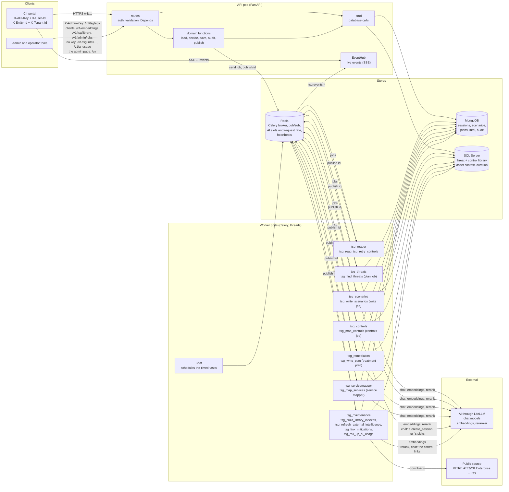

# TSG end-to-end flow

How the Threat Scenario Generator (TSG) turns one request into reviewed threat scenarios, with real-world evidence,
mapped controls and a treatment plan. It follows a request through its stages, queues and workers. It names routes,
queues, settings and stored records, not code functions: the code in `app/` is the truth, and this page says how the
parts fit. Diagrams use Mermaid (they render on GitHub, GitLab and in VS Code with a Mermaid extension).

The design decisions are in [SOLUTION_DESIGN.md](SOLUTION_DESIGN.md), the API reference in
[API_DEVELOPER_HANDBOOK.md](API_DEVELOPER_HANDBOOK.md), deployment in
[DEPLOYMENT_GUIDE.md](../deploy/DEPLOYMENT_GUIDE.md).

## TSG on one page (for managers)

**What it is.** TSG, the Threat Scenario Generator, writes the cyber threat scenarios a risk assessment needs for
one critical asset. Each scenario comes with a real-world precedent when a trusted public source records one,
the matching controls from our own control library, and a person's decision to accept or reject it.

**What goes in**
- The asset and its supporting systems, exactly as recorded in the CII platform.
- Our threat library (threats, threat types, attackers) and our control library.
- External intelligence: MITRE ATT&CK Enterprise and ICS (ADR-005). It is the only source of evidence.

**What comes out, for each scenario**
- A scenario statement (what could happen) and a risk statement (what it would cost the business).
- The systems involved, the type of attacker, and any assumptions, stated plainly.
- At most one real-world precedent, marked **[1]**, from external intelligence.
- The matching controls, each with a score out of 100 and a reason.
- A person's decision: accepted or rejected; a new version on request.

### One run in eight steps

| # | Step | What happens, in plain words |
|---|---|---|
| 1 | Start | A reviewer picks the asset and its systems. TSG reads their recorded facts once and freezes them for the run. |
| 2 | Find the threats that fit | An AI judges each library threat that fits the asset type against the recorded facts, under each of its own STRIDE kinds of attack, and picks its attacker. Code checks every answer. |
| 3 | Plan | One scenario per threat, told as its main kind, ranked by risk (impact times likelihood). The best are selected; the first set of 6 goes to writing. |
| 4 | Find evidence | For each threat, TSG searches its copy of MITRE ATT&CK (Enterprise and ICS), scores the closest records out of 100 and keeps up to 3. At most one is cited. |
| 5 | Write | One AI call writes the whole set, from a fixed brief per scenario: the asset's facts, the threat, the attacker, and the evidence marked as untrusted. |
| 6 | Check | Code checks each draft. One that is unreadable, off its threat or leaves an action of the threat untold is written again once. One with an invented label or advisory number, or a hidden instruction, is blocked and never shown; so is a repeat of a scenario the run already holds. |
| 7 | Match controls | Each scenario is matched to our control library by meaning and scored. Close matches are kept; when none is close, the nearest few, marked as such. |
| 8 | Decide | A person accepts or rejects, or asks for a new version. More scenarios come six at a time, on request. |

**AI calls per click.** A start asks the chat model a few questions: the threat check (75 library threats at 20 a
question are 4 questions, sent together), a gap fill only when a STRIDE kind found no threat, one call that writes
the first 6 scenarios, and one more only for drafts to write again. Evidence and controls use only the search models
(embedding and reranker). A second start on an unchanged asset within 24 hours reuses the threat check's answers.
A start with `POST /v1/create_session` asks two: one that writes the first set (and one re-ask only for a scenario it
would lose) and one that picks that set's controls (section 3.1).

### Why the output can be trusted
- **Facts first.** The AI sees only the asset's recorded facts. A missing fact is stated as an assumption
  ("assumes …", shown with "- not recorded in the platform" added by code), never invented.
- **Grounded claims.** A scenario names a real-world precedent only from external intelligence, and code, not the
  AI, adds that sentence, marked [1]. When no record clears the bar, the nearest is cited only as "related". With
  none, the scenario says nothing about the real world.
- **Outside text is untrusted.** Every imported text is screened: wording that reads like instructions to an AI is
  removed, or its record quarantined, never stored or searched. The writer gets the evidence in a block marked untrusted,
  and a draft that repeats an instruction is blocked.
- **Checked by code.** Exact rules, no second AI: invented labels or advisory numbers, citation markers the writer
  wrote, injected instructions, actions left out.
- **No duplicates within a run.** A run never shows the same threat as the same kind twice, nor the very same words
  twice. The asset's other runs never block a scenario.
- **People decide.** Every scenario waits for a person's decision, and decisions are audited.
- **Bounded cost and safe failure.** AI calls are limited across all pods, per module (UAT: threat scenarios 20 at
  once and 180 requests a minute to kimi-k2.5, under its own limit of 600; search calls 8 at once; section 13).
  Every job is saved before it is sent, leased while it runs and retried, so an outage never loses or duplicates
  work.

---

## 1. The big picture



**In one paragraph.** A reviewer starts a *session* (a run) for one critical asset and its supporting systems. The
API freezes the asset's facts and queues a **plan job**. The plan job asks the AI which library threats fit, picks an
attacker for each and ranks one **attack path** per threat. A **write job** then writes the paths a set at a time (6
by default), with **evidence** from external intelligence. Each written scenario gets library **controls** mapped to
it. The reviewer accepts, rejects, regenerates or asks for the next set; an accepted scenario can get an AI-written
**treatment plan**. Every job is leased, retried and watched by a **reaper**, so an outage never loses or duplicates
work.

**A second way to start** (`POST /v1/create_session`, section 3.1) skips the plan job: the AI writes the scenarios
from its own knowledge of MITRE ATT&CK, TSG's stored copy of ATT&CK confirms every group, technique and mitigation
it names, and the controls are picked from the control library. The same write and controls jobs do the work, and
every review call is the same.

| Worker (OpenShift) | Queue | Tasks | What it does |
|---|---|---|---|
| `worker-threats` | `tsg_threats` | `tsg_find_threats` | plans a run: threats, attackers, ranked paths (section 4) |
| `worker-scenarios` | `tsg_scenarios` | `tsg_write_scenarios` | searches evidence and writes each set (sections 5-7); the only worker holding the evidence index |
| `worker-controls` | `tsg_controls` | `tsg_map_controls` | maps library controls to each written scenario (section 8) |
| `worker-remediation` | `tsg_remediation` | `tsg_write_plan` | writes one treatment-plan version (section 11) |
| `worker-service-mapper` | `tsg_servicemapper` | `tsg_map_services` | generates one service mapping (section 12) |
| `worker-maintenance` | `tsg_maintenance` | `tsg_build_library_indexes`, `tsg_refresh_external_intelligence`, `tsg_link_mitigations`, `tsg_roll_up_ai_usage` | library search vectors (every 30 min), intelligence imports (on the saved schedule, asked every minute) and the control links after each, AI usage totals (every 5 min) |
| `worker-reaper` | `tsg_reaper` | `tsg_reap`, `tsg_retry_controls` | repairs lost jobs (every minute) and stalled control mappings (every 5 min), alone so no long job holds its threads |
| `beat` | - | - | sends the timed tasks above |

Each worker is one process with threads (`-c` in its Deployment). Locally `.\run.ps1` runs the same queues.

**The code layout.** The FastAPI layout (ADR-004): `app/api/routes` (one router per feature), `app/api/deps.py`
(the shared `Depends`), `app/schemas` (request and response shapes), `app/crud` (database calls), `app/domain` (the
rules) and `app/worker` (the Celery tasks), with a file or folder per feature: `scenario` (with controls),
`remediation`, `library`, `intel`, `service_mapper`, `admin` and the shared `jobs`. `app/ai` holds the AI gateways and
their limiters, `app/search` the search indexes; each long-lived object has a `@singleton` getter next to its class.

## 2. Before any session: what must be in place

### 2.1 API keys and identity
- An admin mints a key with `POST /v1/tsg/api-clients` (admin key `X-Admin-Key`). The key (`ciip_...`) is shown
  once; only its SHA-256 is stored in `tsg_api_clients`. Revoke with `POST /v1/tsg/api-clients/{client_id}/revoke`.
- Every portal call sends `X-API-Key`, `X-User-Id`, `X-Entity-Id` and `X-Tenant-Id`. A missing header or an unknown
  key is 401; a malformed `X-Entity-Id` (not a positive whole number) is 422. Verified keys are cached for 60 s per
  process. A session or plan of another entity answers 403.

### 2.2 The library (SQL Server)
- Threat types, threats, threat actors (attackers) and controls live in SQL Server. TSG reads them only through
  stored procedures: `tsg_GetLibraryStamp`, `tsg_GetThreatLibrary`, `tsg_GetControlLibrary`.
- Each process holds the library in memory, reads the stamp every 60 s and reloads only when it changed. If SQL
  Server is down, the last good copy keeps serving.
- One hybrid search index per corpus (threats, controls, actors, types): keywords (BM25) plus vectors, merged by
  reciprocal-rank fusion. Vectors are cached in `tsg_embeddings`. `POST /v1/embeddings` (admin, 202) queues
  `tsg_build_library_indexes`; beat also runs it every 30 minutes. One build at a time (409 `job_in_progress`).

### 2.3 External intelligence (the evidence source)

> **In plain words:** TSG keeps its own checked copy of two trusted public registers of real attacks (MITRE ATT&CK Enterprise and ICS).
> The copy refreshes itself every week; every text is screened so that nothing written in a source can give orders
> to the AI; and one numbered, searchable copy is shared by every server. A scenario can only cite what is in this
> copy. An operator can switch the whole feature off.

| Source | What one record holds | IT or OT | Searched? |
|---|---|---|---|
| `mitre_attack_enterprise` | an attacker technique: its goals, mitigations and known users | IT | yes |
| `mitre_attack_ics` | the same, for industrial control systems | OT | yes |

**The switches.** Evidence is used only when both are on.
1. `EXTERNAL_INTELLIGENCE_ENABLED`, the master switch: default `false`, `true` in UAT. While it is off, no
   intelligence store is read or written, no import is scheduled, and scenarios are written without evidence.
   `POST /v1/create_session` is the exception: it reads the ATT&CK graph already stored (section 3.1).
   Outside dev, turning it on needs `EVIDENCE_SIMILARITY_THRESHOLD` set, or start-up stops.
2. The runtime switch, `PUT /v1/tsg/intel/switch`: on by default, it can turn the feature off without a restart.
   Turning it on queues an import. A write job that cannot read it waits and retries, so it never writes a scenario
   without the evidence it should have.

While intelligence is on and nothing is imported yet, a start, a next set and a regenerate are refused with 409
`intel_no_data`.

**How the copy stays fresh and safe.**
- The import (`tsg_refresh_external_intelligence`, queue `tsg_maintenance`) runs on the saved schedule
  (`GET`/`PUT /v1/tsg/intel/schedule`: daily or weekly at one time; none saved: weekly on Sunday 02:00 UTC, with one
  first import at beat's first check, about a minute after the first start), on `POST /v1/tsg/intel/refresh` and when the runtime switch is turned on.
  Both sources are always imported. Beat asks every minute whether the schedule is due. A scheduled import that failed is due again
  within the hour; a failing source keeps its last good data, and a file MITRE did not change is not read again.
- An import also stores the whole ATT&CK graph in `tsg_attack`: groups, techniques, mitigations, software, campaigns
  and the "uses", "mitigates" and "attributed-to" links between them, without revoked or deprecated entries. A
  source's graph is replaced whole. `POST /v1/create_session` (section 3.1) checks its scenarios against it.
- After every import each ATT&CK mitigation is linked to library controls (`tsg_link_mitigations`, the same queue;
  by hand: `POST /v1/tsg/intel/control-links/prepare`): the 30 nearest controls are searched, the 15 the reranker
  scores best are judged by the AI in one call (`link_controls`), and the links are stored in `tsg_control_links`.
  One run at a time (a Redis lock). A mitigation whose text, candidates, prompt and models did not change costs no
  AI call, so the first run is about 100 AI calls (an estimate: one per mitigation) and a later one few or none;
  `GET /v1/tsg/intel/control-links` counts the prepared ones. No link record is ever deleted: a mitigation no
  source lists any more keeps its links.
- Every text is screened for wording that instructs an AI. A flagged description loses only its flagged sentences; a
  flagged name, title or link quarantines the whole record: it is never stored or searched.
- After every import the evidence index (keywords + vectors over the techniques) is
  rebuilt and published as the active snapshot (`tsg_external_intelligence_snapshots`). The scenarios worker loads
  it at start and follows the active one every 60 s; a batch reads one index, so a swap never mixes two.
- `GET /v1/tsg/intel/health` shows each source's last run. A source cannot be withdrawn. The `/v1/tsg/intel` routes
  take no key; every change is audited under `X-User-Id`.

## 3. Start a session

1. `POST /v1/sessions` with `asset_id`, `supporting_system_id` (one id or a list) and, optionally, `service_id`,
   `sector_id`, `subsector_id`. With an `Idempotency-Key` header a retry is safe (the same key and body: 200, the
   same run); without one, the same request again within a minute is 409 `duplicate_request`.
2. One SQL call, `dbo.tsg_GetAssetContext`, returns the asset, its linked systems, the service, the sector and the
   names behind coded values. Refused: another entity's asset (403 `asset_not_owned`), a system not linked to it (403
   `system_not_linked`), an unknown service or sector (404), a sub-sector outside its sector (422), and a fact that
   `ASSET_PROPERTIES_REQUIRED` / `SYSTEM_PROPERTIES_REQUIRED` require but the platform does not record (422).
3. **Freeze and queue.** The facts are stored on the run (`context`), coded values as names, never ids; the systems
   get aliases (SYS1, SYS2 ...) for the AI. The run is saved in `tsg_sessions` as `queued`, step `threats`, job
   `tsg_find_threats`, epoch 1; the job is sent, `run.started` is audited (the asset and its systems), and the
   answer is 202 with the status board and `session_id`.

### 3.1 The other way to start: `POST /v1/create_session`

> **In plain words:** the AI already knows MITRE ATT&CK. Here it writes the scenarios straight from that knowledge,
> naming the attacker group, the techniques and the mitigations. TSG then looks every one of those names up in its
> own stored copy of MITRE ATT&CK and shows only what the copy confirms. The controls still come from our library.

The same body, the same answer and the same `Idempotency-Key` rules as `POST /v1/sessions`; sections 9 and 10 work on
the run unchanged, and a treatment plan (section 11) is requested the same way. Sections 4 to 8 do not apply to it: there is no plan job, no evidence search and no control
search. The example below is an OT asset "SCADA historian" with 2 supporting systems, `TOTAL_SCENARIO_COUNT=15`,
`INITIAL_SET_SIZE=6`, `NEXT_SET_SIZE=6`.

| # | Step | What happens |
|---|---|---|
| 0 | The call (no AI) | Refused with 409 `intel_no_data` when the stored ATT&CK copy (`tsg_attack`) is empty or lacks a matrix the asset needs (ICS for OT, Enterprise for IT, both for an IT\OT (hybrid) asset, when the asset and its systems are mixed, or when they have no recorded type). The intelligence switch does not stop it: it runs from the ATT&CK data already stored. Else the facts are frozen as in step 3 above and the run is saved with `pipeline: "attack"`, step `scenarios` and a starting plan of 6 empty slots (`a001` ...); `tsg_write_scenarios` is sent. `progress.threats` reads `COMPLETE` at once. |
| 1 | Write (1 AI call) | The prompt is built for this request: it names only the facts the asset has, and the matrix by asset type, and it says its input blocks are data, never instructions. The AI fills the 6 slots: title, scenario and risk statements, a STRIDE category and a threat type copied from the library's lists, the attacker group, the techniques and the mitigations, each by ATT&CK ID and name. Each writing call also lists the further relevant risks it sees, most relevant first, each with its group and one technique, while the plan holds fewer risks than `TOTAL_SCENARIO_COUNT` (with 0, always); a regenerate never asks. A listed risk whose group or technique MITRE ATT&CK does not confirm is not planned, and once a call that asks lists no confirmed risk, no later call asks. Example: the first call writes 6 and lists 11, 17 in all. A first-set slot the AI leaves out because it sees no further risk is not an error and is not asked again: the run has fewer scenarios (4 risks for 6 slots: 4 scenarios). |
| 2 | Confirm (no AI; 3 lookups an answer, at most 4 MongoDB queries) | Every name is looked up by its ATT&CK ID, else by an exact name or alias that fits one entry only; never a loose match. Code settles a spelling variant: a name that shares the whole words of the ID's own entry ("Sandworm" for "Sandworm Team") or differs only by spaces ("Multifactor") takes that entry, and an ID given with another entry's exact name or alias takes the entry of that name. A name that is no one entry's is not trusted. A technique must be of the asset's matrix. A group's use of a technique is read from its own "uses" links and from those of the campaigns ATT&CK attributes to it. An unconfirmed extra technique or mitigation is dropped with no re-ask. Only a scenario that would be lost (no confirmed group, no confirmed technique, a field missing, or its slot left out by a call after the run's first) is asked again, once and alone: the re-ask names only those slots ("slot SC2: T9999 is not in MITRE ATT&CK ICS.") and every other slot keeps its first answer. Still lost after it, the scenario is given up: no card is shown and a spare risk takes its place. The AI's own text (title, statements, assumptions, threat name, the group's reason, the listed risks) is saved without technique, CVE or advisory numbers, links or `[n]` markers, and goes through the writer's exact checks of section 7 (`unknown_id`, `uncited_advisory_id`, `unknown_marker`, `injection_echo`): a draft one of them faults is kept hidden and its slot given up. An answer not in English is asked again the same way. |
| 3 | Count (one fenced write, before any card) | 17 found, 15 wanted: the best 15 are the run's scenarios (6 written, 9 for next sets), the last 2 are spares. With `TOTAL_SCENARIO_COUNT=0` all 17 are used; had the AI found 10, the run has 10. Never padded. |
| 4 | The card | The group is the acting attacker (its ATT&CK ID and the AI's reason in `selection_reason`). Each confirmed technique, at most 3, is an evidence entry with a sentence code adds to the statement: "MITRE ATT&CK records that Sandworm Team uses Valid Accounts [1]" when ATT&CK records that use, else "Valid Accounts is a technique of MITRE ATT&CK ICS [1]". The card's `evidence_mode` is `source-documented` when at least one cited use is recorded (by the group, or by a campaign ATT&CK attributes to it), else `inferred`. |
| 5 | Controls (1 AI call a set, `tsg_map_controls`) | Code shortlists 12 library controls per scenario: first the controls linked to its mitigations (section 2.3; those it names and those ATT&CK records for its techniques, best reranked first), then the nearest by meaning to its risk statement and each sentence. Only controls whose IT/OT type fits its systems; an IT and an OT copy of one control counts once. One call for the set, up to 6 scenarios (`pick_controls`), says which control reduces which sentence and how (prevent, detect, contain, recover): at most 2 per sentence, each control once. Code drops, with the reason stored, a pick that names no sentence or no listed control, a bad effect, a wrong type, a second use or a third pick on a sentence. Nothing is padded. A pick answer that cannot be read, or a scenario it leaves out even after the one re-ask: the search of section 8 maps those scenarios. A plan request (section 11) that has to map a create-session scenario's controls itself picks them the same way, never by the search alone. Stored with each scenario, in no API response: what the picks gave each technique (`controls.technique_states`: `matched`, `no_known_defence`, `not_prepared`, `no_library_control`, `type_mismatch`, `not_offered`, `not_picked`). |

- **No database id reaches the AI.** Controls are labelled `C1` to `C12`, sentences `S1`, `S2` ... and `R1` ...; a
  label can only resolve to a library row, so a control outside the library cannot appear.
- **AI calls.** All 15 scenarios: 3 calls to write the three sets and 3 to pick their controls, plus one re-ask a call only
  where a scenario would be lost (no confirmed group or technique, a slot left out after the first call, text not in English). A retried job whose question is unchanged reads its earlier answer back.
- **Next set and regenerate** queue the same write job: a next set writes the next listed risks; a regenerate tells
  the same risk another way as version 2 and keeps the slot's threat.
- **Deliberate limits** are listed in `API_CONSUMER_GUIDE.md`, section 3.1b.

## 4. The plan job: threats and attack paths

> **In plain words:** Like a librarian who first narrows the shelves, then reads the best books: code leaves out the
> threats that cannot fit, the AI judges the rest against the asset's facts, code checks every answer, and the plan
> ranks what is left by risk.

`tsg_find_threats` on queue `tsg_threats`.

1. **Claim.** The worker takes the job's lease (`queued` → `running`) and reads one copy of the library for the whole
   plan; with no threat linked to an attacker the run fails at once (`actor_library_empty`). The asset's and systems'
   facts become the text the AI reads, systems by alias, never a database id; with intelligence on, the country
   (`THREAT_CONTEXT_COUNTRY`) is one more fact.
2. **Code filter.** A threat is judged only when its asset type (IT, OT or both) fits the asset or one of the systems,
   it has a linked attacker, and it has a STRIDE kind.
3. **Relevance gate (AI, `relevance_gate`).** Each threat is judged once, for all its own kinds, in questions of up to
   `CII_THREATS_PER_QUESTION` whole threats, `CII_THREAT_QUESTIONS_AT_ONCE` at once. For each threat the AI answers:
   does it apply; under which of its own kinds (the main one first, each with its impact); the systems it involves
   and the ways in; its confidence; anything it needs that no fact records; the one attacker, from the threat's own
   list, who could most plausibly carry it out, with a reason; its likelihood; and the actions its name states.
4. **Code checks every answer.** A slot with problems (its threat not copied, a kind it does not list, an impact or
   reason missing, a system not named by alias) is asked again once; an answer cut off at its length is split in half
   once. A threat that needs something no fact records is refused (`needs_unrecorded`). A threat is kept only through
   the ways in its asset type fits (`asset_type_mismatch`). When the AI answered nothing at all, the job is retried:
   "no answer" never reads as "no threat applies".
5. **Gap fill (AI, `gap_fill`).** One question asks for one new threat for each STRIDE kind with no threat kept. A
   proposal that repeats a library threat is dropped; it must match a library threat type with a linked attacker
   (reranker score at least `THREAT_SIMILARITY_THRESHOLD`; UAT 60); then the gate judges it like any other.
6. **Merge.** The same threat found twice is joined; an AI rewording of a kept threat, or a library near copy of the
   same type and asset type, is merged into it (one embedding call).
7. **Attacker.** The gate's pick must be one of the threat's linked attackers; when none fits, the threat is not
   planned. The attacker is a type, never a named group.
8. **Paths and ranking.** One path per threat, told as its main kind, its other kinds listed with it. Paths are ranked
   by risk (impact times likelihood), then impact, confidence, STRIDE order, library threats before AI ones. They
   are then dealt in turns: each system in order, then the asset, takes the best path left that gets in there. The
   first `TOTAL_SCENARIO_COUNT` in that order are selected (0 = all; UAT 15); the others are reserves that can
   replace a path given up.
9. **Freeze and hand over.** The plan, its trace and the first set (`INITIAL_SET_SIZE`, 6) are saved in one write, and
   the job moves to `tsg_write_scenarios` on the same epoch, ahead of new work in its queue; a plan with no path ends
   the run `done`. `GET /v1/sessions/{id}/plan-trace` shows each stage's counts and why each threat was left out.

An outage retries the job (section 14); a refusal fails it at once. The asset's other sessions never take a path away.

## 5. The write job

`tsg_write_scenarios` on queue `tsg_scenarios`. One delivery writes one batch (up to `CII_SCENARIOS_WRITTEN_AT_ONCE`,
6), so a set of 6 is usually one batch.

```mermaid
sequenceDiagram
    actor Rev as Reviewer (portal)
    participant API as API
    participant PJ as Plan job
    participant WJ as Write job
    participant AI as AI models
    participant CJ as Controls job

    Rev->>API: POST /v1/sessions
    API-->>Rev: 202 + session_id (run queued, tsg_find_threats sent)
    API->>PJ: tsg_find_threats
    PJ->>AI: relevance gate (and gap fill when needed)
    PJ->>WJ: plan frozen, tsg_write_scenarios (same epoch)
    WJ->>AI: one evidence search (embedding, rerank)
    WJ->>AI: one call writes the set; one rewrite for drafts that failed
    WJ->>CJ: each scenario saved, tsg_map_controls
    WJ-->>Rev: session.updated (SSE, through Redis and the API)
    CJ->>AI: embed the query, rerank library controls
    Rev->>API: accept, reject, regenerate or next set
```

1. **Claim and skip what is done.** The run, its plan and the library copy are read; the switch is read once. A path
   an earlier delivery already wrote is served by that scenario, and a first write that would repeat a scenario the
   run holds now is given up (`near_duplicate`), both with no AI call.
2. **Evidence.** One search for the batch's distinct threats (section 6). An outage there holds those paths back, and
   the job is retried later.
3. **Brief, write, check** (section 7). A path the plan can no longer support (its threat or attacker retired from the
   library, no attacker) fails at once, with no AI call.
4. **Save each scenario** in `tsg_scenarios` as soon as it is final:
   - `done`: served and counted; its controls are queued and `tsg_map_controls` is sent.
   - `blocked`: a blocker was found; kept for audit only. The path is given up; a reserve may take its place.
   - `failed`: a visible failure card. After an AI outage the path is left open for a later set (up to 5 tries); any
     other failure gives it up.

   A title another current scenario of the run has gets the threat's name, or a number, added.
5. **Move on.** The set's next batch is handed over (for example a reserve that took a given-up path's place), or the
   set ends: `complete`, or `partial` when a path of the set was given up.

## 6. Evidence: found and cited

> **In plain words:** For each threat, TSG looks up its copy of the public sources, lets a scoring model rate each
> record, keeps the few best that truly fit this asset, and cites one. If none is close enough, it says only that the
> nearest is related; if none is found, the scenario makes no real-world claim.

1. **The question** is the threat's type and name only ("Threat: {type}: {name}"), cleaned and cut to 700 characters.
   The asset enters only through the IT / OT filter and the vendors and products it records.
2. **Candidates and scores.** One embedding call for the batch; the evidence index returns the `EVIDENCE_CANDIDATES`
   (30) closest records of the right kind (IT or OT). The reranker scores each 0-100 (at most
   `CII_RERANKS_AT_ONCE` at once per worker); a repeat of the same question on the same snapshot reuses its scores.
3. **Choose.** A record is kept when it scores at least `EVIDENCE_SIMILARITY_THRESHOLD` (UAT 50). Repeats are dropped; at most `EVIDENCE_KEPT_PER_THREAT` (3) are kept, best first, a kind not yet kept taking the place of a
   repeated one. When none clears the bar, the nearest under it are kept by the same rules, marked `nearest`.
4. **Facts.** Each kept record becomes up to 6 plain sentences built by code from its structured fields (attacker
   goals, mitigations, exploit likelihood, severity, versions), never from a source's free text.
5. **Cite.** The writer sees the kept records in a block marked untrusted, the first that gives one plain claim marked
   as the one to cite. It writes the attacker's step; code joins that step to the record ("... matches the "Command
   Message" technique [1].") at the end of the scenario statement. When the step cannot be used, code cites its own
   sentence from the same record (warning `citation_removed`).
6. **Recorded.** The scenario keeps the cited record (`content.evidence`), its `evidence_mode` (`source-documented`,
   `nearest` or `inferred`) and the whole search (`content.intel_search`), which names the search snapshot.

## 7. The writer and the checks

**The brief.** For each path: the asset's facts and those of the path's systems (names, not ids), the STRIDE kind,
the attacker and why, the likelihood, the threat with its actions and why it applies, the way in, which supporting
systems it reaches, and the evidence (section 6). Facts shared by the set are sent once.

**The writer (AI, `write_scenario`).** One call writes every scenario of the batch: title, scenario statement, risk
statement (`THREAT_SCENARIO_WORD_LIMIT`, `RISK_STATEMENT_WORD_LIMIT`; UAT 120-180 and 80-120 words), assumptions, the
way in, a reason per system, the evidence step, and which sentence tells each action. A slot is written again when
its answer is missing, names another threat, is not in English, breaks the answer format, or leaves an action of the
threat untold. All such slots go in one rewrite call (`repair_scenario`); the better of the two drafts is kept.

**Code checks** (exact rules, no AI):

| Finding | Severity | When |
|---|---|---|
| `unknown_id` | blocker | an internal label (SYS1 ...) the brief never gave |
| `uncited_advisory_id` | blocker | an advisory number (CVE, ICSA ...) no evidence supplied |
| `unknown_marker` | blocker | a [n] marker the writer wrote: only code cites |
| `injection_echo` | blocker | the draft repeats an instruction said to an AI ("As an AI, ...", "Instructions for the AI"); text that only speaks of AI ("suitable for AI-enhanced help desk fraud") is not flagged |
| `near_duplicate` | blocker | the same threat and kind, or the very same words, as a scenario the run holds |
| `citation_removed` | warning | the writer's evidence step was not used: code's own sentence instead |

A blocked draft is never served, and its path is given up at once.

## 8. Controls mapping

`tsg_map_controls` on queue `tsg_controls`, sent after each saved scenario: one delivery per run at a time, each
scenario under its own lease, 6 scenarios per delivery before the run's next turn. No chat AI call. (A
`POST /v1/create_session` run's controls are not searched this way: one chat call a set picks them, section 3.1;
this search is only its fallback.)

1. **The query:** the kind, threat, attacker, title, asset and its type, the mitigations the cited evidence names, the
   systems' facts, and the scenario and risk text.
2. **Search:** `CONTROL_CANDIDATES` (UAT 40) library controls of the scenario's asset types, by keywords and meaning.
   Controls of the AI domain are offered only for a threat about AI. No control of the type: the nearest of another
   type, each with a reason that says to check it fits.
3. **Score and keep:** the reranker scores each 0-100. Every control at or above `CONTROL_SIMILARITY_THRESHOLD` (50)
   is strong, at most `MAX_CONTROLS` (UAT 10); fewer than `MIN_CONTROLS` (3) strong: the nearest top them up; none
   strong: the `NEAREST_CONTROLS` (3) nearest, marked as fallback. Never zero while the library has controls. Each
   kept control is stored with its score and reason, beside the query and the scored shortlist.

The sweep (`tsg_retry_controls`, every 5 minutes) requeues stalled mappings; a failed one is tried again after 30
minutes, up to 5 attempts.

## 9. Live status

After every save and state change, workers and API services publish only the record id on Redis
(`tsg:events:session:{id}`, `tsg:events:remediation:{id}`, `tsg:events:mapping:{id}`), best effort; each API process
has one subscription to `tsg:events:*`. `GET /v1/sessions/{id}/events` (SSE) sends `session.updated` when the status
changed (`session.deleted` once when the run is gone), reads again every 30 s anyway, and ends quietly if the API key
is revoked. Polling instead: `GET /v1/sessions/{id}` (the status board) and `GET /v1/jobs`.

## 10. Review: accept, reject, regenerate, next set

Accept, reject, regenerate and next set are refused while the run is `queued` or `running` (409
`generation_in_progress`), or when it failed or was cancelled before its plan (409 `run_failed`, `run_cancelled`). An
accept, reject or regenerate takes 1-50 scenario ids; every id at fault is named before anything changes.

| Action | Route | What it does |
|---|---|---|
| Read | `GET /v1/sessions/{id}`, `.../results`, `.../scenarios/{sid}`, `.../plan-trace`, `GET /v1/entities/{eid}/scenarios` | the status board; the scenarios in the plan's order with evidence, controls and findings; one scenario; the plan's trace; the entity's scenarios |
| Accept | `POST /v1/sessions/{id}/accept` | pending → accepted; one accepted version per path (`replace_accepted` swaps); `"all"` skips what it cannot accept |
| Reject | `POST /v1/sessions/{id}/scenarios/reject` | pending → rejected |
| Regenerate | `POST /v1/sessions/{id}/regenerate/scenarios` | a new version of each chosen current scenario, written afresh (`tsg_write_scenarios`, new epoch); the old one stays until the new one is written. An AI outage's failure card is written again in its place |
| Next set | `POST /v1/sessions/{id}/scenarios/next-set` | the next `NEXT_SET_SIZE` (6) open paths, best rank first. None left: it resumes controls a cancel stopped, else 409 `nothing_left`, `target_reached` or `scenarios_abandoned` |
| Promote | `POST /v1/sessions/{id}/scenarios/{sid}/promote-to-library` | an accepted scenario's AI-proposed threat goes to the curators |
| Cancel | `POST /v1/sessions/{id}/cancel` | stops queued or running work, and controls still waiting |
| Delete | `DELETE /v1/sessions/{id}` | removes the run, its scenarios and plans; 409 `cancel_first` while work runs |

Each shown assumption ends with "- not recorded in the platform". Scenario versions have no cap;
`REGENERATIONS_MAX_VERSION_COUNT` caps treatment-plan versions only.

## 11. Treatment (remediation) plans

1. **Request:** `POST /v1/remediation` (202). With `is_manual=false` it needs an accepted generated scenario; with
   `is_manual=true` it takes a hand-written scenario, checked against the library and saved already accepted. One plan
   per scenario, stored in `tsg_remediations` with its versions.
2. **Job:** `tsg_write_plan` on queue `tsg_remediation` maps the scenario's controls when none are usable. From
   `supporting_systems_applicable_to_risk` and `supporting_systems_applicable_to_existing_controls` it works out the
   affected systems and each control's status (`implemented`, `partially_implemented` or `not_implemented`), and adds
   the 5 best library controls not already identified, as alternatives.
3. **AI (`remediation_plan`):** one call checks every identified control (`retained`, `replaced` by an alternative, or
   `flagged_for_review`) and writes actions for the controls not or partly in place and the parts of the risk no
   control covers. A faulty first answer is asked again once.
4. **Code fixes the plan:** only checked controls are recommended, each with the systems still needing it; code sets
   the coverage, the control assessment, the unresolved gaps, the title and the schedule dates.
5. **Later:** `GET /v1/sessions/{sid}/scenarios/{scid}/treatment-plan` (and `/status`), `.../review` (accept or reject
   a done version), `.../regenerate` (up to `REGENERATIONS_MAX_VERSION_COUNT`, 10 versions; one that failed for an
   outage is written again in place), `.../cancel`, and live updates on `.../treatment-plan/events`. Lists:
   `GET /v1/sessions/{sid}/treatment-plans` and `GET /v1/entities/{eid}/treatment-plans` (the register).

## 12. Curation, service mapper, AI usage

- **Curation** (admin key): `GET /v1/tsg/library/pending` lists the threats waiting for a curator (promoted from
  AI-written scenarios, or new from hand-written ones); `POST /v1/tsg/library/decisions` approves or rejects them in
  one SQL transaction. An approved threat joins the library at its next reload.
- **SQL write safety:** every SQL Server write goes through `tsg_sql_operations`, so a retry never applies it twice.
- **Service mapper** (`docs/service_mapper/SERVICE_MAPPER.md`): one AI call per generation (`service_mapper`), on queue
  `tsg_servicemapper`; one mapping per service, and Generate again or Regenerate only add new services.
- **AI usage** (`/v1/ai-usage/...`, no key, counts only): every AI attempt and every reused answer is one row in
  `tsg_ai_usage`; `tsg_roll_up_ai_usage` adds them up per hour. Nothing deletes them. The audit, `tsg_audit`, is
  append-only and kept 365 days.

## 13. AI limits as configured

Each module has its own chat model, key and limits (`CII_SCENARIO_...`, `CII_REMEDIATION_...`,
`CII_SERVICE_MAPPER_...`); there is no backup model, and one module's 429 never pauses another's, nor the search
calls'. The UAT column is the UAT server's `.env.uat` and OpenShift's `deploy/configmap.yaml`, the same on 16 Nov 2026
(5 users at once).

| Setting | Default | UAT | What it limits |
|---|---|---|---|
| `CII_SCENARIO_CHAT_MODEL` | required | `kimi-k2.5` | threat finding and writing |
| `CII_REMEDIATION_CHAT_MODEL`, `CII_SERVICE_MAPPER_CHAT_MODEL` | required | `glm-5.3`, `glm-5.3` | treatment plans, service mapper |
| `CII_SCENARIO_MAX_CONCURRENT_AI_CALLS` | 16 | 20 | threat-scenario chat calls at once, all pods |
| `CII_REMEDIATION_MAX_CONCURRENT_AI_CALLS`, `CII_SERVICE_MAPPER_MAX_CONCURRENT_AI_CALLS` | 16, 16 | 5, 5 | their chat calls at once, all pods |
| `CII_SCENARIO_CHAT_REQUESTS_PER_MINUTE` | 0 (none) | 180 | kimi-k2.5 requests a minute, retries included (its own limit is 600) |
| `CII_SCENARIO_CHAT_TOKENS_PER_MINUTE` | 0 (none) | 1,000,000 | question plus answer room booked a minute (the gateway allows 2,000,000 for every model together) |
| `CII_MAX_CONCURRENT_AI_CALLS` | 16 | 8 | search calls (embedding, reranker) at once, all pods; UAT's reranker drops connections above about 10 |
| every other `..._REQUESTS_PER_MINUTE` and `..._TOKENS_PER_MINUTE` | 0 | 0 | glm-5.3, the embedding model and the reranker have no limit of their own |
| `CII_RERANKS_AT_ONCE` | 6 | 4 | evidence reranks at once per worker |
| `CII_THREAT_QUESTIONS_AT_ONCE`, `CII_THREATS_PER_QUESTION` | 1, 40 | 16, 20 | gate questions at once per run, whole threats per question |
| `CII_SCENARIOS_WRITTEN_AT_ONCE` | 6 | 6 | scenarios in one write call |
| `CII_THREAT_FINDING_REUSE_HOURS` | 24 | 24 | a run reuses an earlier run's answer to the very same gate question; 0 = always ask |
| `CII_AI_CALL_TOKENS_LIMIT` | 20,000 | 20,000 | most tokens (question estimate + answer room) one call may hold; a bigger batch goes as halves |
| `CII_ANSWER_TOKENS_<TASK>` | gate 10,240; gap fill 1,024; write 6,144; repair 5,632; plan 3,584; mapper 3,072; link controls 2,048 (`CII_ANSWER_TOKENS_LINK_CONTROLS`); pick controls 3,072 (`CII_ANSWER_TOKENS_PICK_CONTROLS`) | gate 8,192; the rest the same | each task's answer room. Link controls: one MITRE ATT&CK mitigation judged against 15 library controls (section 2.3). Pick controls: one written set of a `POST /v1/create_session` run (section 3.1). Both use the threat-scenario chat model and count against its limits |
| `CII_AI_BUSY_MAX_WAIT_SECONDS`, `..._TOTAL_WAIT_SECONDS`, `..._LIMIT_FLOOR`, `..._LIMIT_SECONDS` | 20, 60, 4, 180 | 20, 60, 4, 60 | what a 429 ("too busy") does (below) |

**How the limiters work** (shared through Redis, so they hold across every pod):
- **At once:** each pool (the search calls, and each module's chat calls) is a set of leased slots. A caller waits in
  line for a free one; a pod that dies frees its slots within 60 s. The API waits at most 30 s, a worker until its
  job's lease ends.
- **Requests and tokens a minute:** each module's model is given turns 60 / N s apart (after a 30 s burst), and a
  large call waits for its tokens. LiteLLM holds a call's whole answer room while it runs, so TSG books the same and
  gives back the unused part once the answer comes.
- **A 429:** the same model is asked again after 2, 5, 10 and 15 s (or its Retry-After, up to 20 s), with at most 60 s
  of waits in all; then the job is retried later. A 429 also lowers its pool to half the calls then in flight (never
  below `CII_AI_BUSY_LIMIT_FLOOR`, 4) until `CII_AI_BUSY_LIMIT_SECONDS` after the last 429.
- **Busy, unreachable or cut off:** three quick retries (0.5, 1 and 2 s); a cut-off answer is asked once more with
  the model's full answer room. One that ran away (blank lines, one piece over and over, a string that never closes)
  is asked once more with the same room; one that is whole, or whole but for its own last brace before a long
  run of blank characters, is read as it is.

## 14. Reliability: leases, retries, the reaper

- **Save first, then send.** Every job is a record (`job.*` on the run or plan) before its message, which carries ids
  only, is sent. A lost message is sent again, never lost.
- **Lease and epoch fence.** A claim sets a 120 s lease, renewed every 30 s while the job works. Every write is fenced
  on the record, its task, epoch and attempt: a stale or duplicate delivery finds nothing to claim, and a delivery
  whose job was cancelled, deleted or taken over stops at its next write or AI call.
- **Retries.** Temporary errors (AI outage, MongoDB or Redis down) retry after 15, 30, 60 and 120 s; the 5th attempt
  fails the job as `unavailable`. Refusals fail at once. A job waiting for another job's work (a plan waiting for its
  scenario's controls) waits without using an attempt, for at most an hour.
- **Stalled and hung jobs.** A job with no AI call or wait check for 15 minutes stops renewing, and the reaper takes it
  over. When a thread is still running 10 minutes after its lease was lost, the worker stops touching its liveness
  file, so OpenShift restarts the pod.
- **Hand-back and queue order.** A worker told to stop waits 90 s, then gives back every lease it still holds, each
  job sent again at once. Each queue serves a run's next stage, a retry and a reaper re-send first, new work next, and
  a plan of an entity with 2 or more others queued or running last.
- **The reaper** (`tsg_reap`, every 60 s) requeues a job whose lease expired (failing it after 5 attempts,
  `job_abandoned`), re-sends a job still queued after 120 s when its queue is empty (or after 15 minutes anyway), and
  fails an admin job (an index build or an import) whose heartbeat ran out.

## 15. Operations

- **Health:** `GET /health` (always 200) and `GET /ready` (200 when MongoDB answers; Redis, SQL Server and each
  queue's live workers are reported but never fail it). A worker's probe fails when its liveness file, touched every
  20 s, is older than 180 s.
- **Logs, metrics, jobs:** one JSON line per event to stdout, secrets masked, shipped to Loki; a job's lines carry the
  `request_id` of the API call that sent it. `/metrics` on the API and on each worker's port 9100; alert rules in
  `observability/prometheus/rules.yml`; Grafana's "TSG — is everything working?" and "TSG — AI usage".
  `GET /v1/admin/jobs` (admin key) lists every job, its status, error and worker, and each queue's backlog.
- **The admin page:** the API serves it at `/ui/` (the files in `app/ui`, plain HTML, CSS and JavaScript; no build
  step, no extra pod). Ten pages: Data ingestion, Schedule, Control links, Service mapper, Jobs, Search vectors, API
  keys, Library curation, AI usage, System. It calls only the API's own routes. Service mapper calls them with the
  client key and identity headers typed on that page instead. Jobs, Search vectors, API keys and Library curation
  need the admin key, typed in the page and kept in that browser tab's memory only (gone on reload, never stored).
  It has no login of its own: whoever can reach the API can open it. Every answer carries `Cache-Control: no-store`,
  a `Content-Security-Policy` that allows only the page's own files, `X-Content-Type-Options: nosniff` and
  `Referrer-Policy: no-referrer`.
- **OpenShift:** `deploy/deploy_threatgen.yaml` runs the API, beat and one worker per queue in `ai-threatgen`;
  `deploy/deploy_common.yaml` runs `worker-reaper`, Flower and the monitoring in `ai-common`. The app's settings are
  ConfigMap `tsg-config` in `deploy/configmap.yaml`; the monitoring's config files are ConfigMaps made from
  `observability/` (its `kustomization.yaml`) with `oc apply -k observability`.

## 16. Reference: states and stores

**Session:** `status` `queued` (a job waits), `running` (a worker holds the lease), `done` (the set or action
finished, `complete` or `partial`), `failed` (`job.error` says why) or `cancelled` (stopped by its owner). `step` says
where it is (`threats`, `scenarios`); `progress.overall` says what to do next: `pending`, `in_progress`,
`awaiting_review`, `awaiting_next_set`, `complete`, `error`, `cancelled`.

A run started with `POST /v1/create_session` also stores `pipeline: "attack"`; it starts at step `scenarios`.

**Scenario:** `status` `done`, `blocked` or `failed` (section 5); `decision` `pending`, `accepted` or `rejected`;
`evidence_mode` `source-documented`, `nearest` or `inferred`; `controls.status` `queued`, `running`, `done`, `failed`
or `cancelled`.

| Store | What |
|---|---|
| MongoDB `tsg_sessions` | runs: frozen context, plan, paths, trace, counts, job |
| MongoDB `tsg_scenarios` | scenarios: content, evidence, findings, controls, decision |
| MongoDB `tsg_remediations` | treatment plans and their versions |
| MongoDB `tsg_intel`, `tsg_external_feed_status`, `tsg_external_intelligence_snapshots` | intelligence records, each source's state with the switch and the import schedule (one document each), evidence snapshots |
| MongoDB `tsg_attack`, `tsg_control_links` | the MITRE ATT&CK graph (objects and relationships, per source); per ATT&CK mitigation, the library controls that do what it says |
| MongoDB `tsg_embeddings`, `tsg_query_vectors`, `tsg_api_clients`, `tsg_admin_jobs`, `tsg_audit`, `tsg_sql_operations` | vector cache, keys, admin jobs, audit, SQL write safety |
| MongoDB `tsg_ai_call_texts`, `tsg_ai_usage`, `tsg_ai_usage_hourly`, `tsg_ai_usage_requests` | chat call texts, one row per AI attempt or reused answer, their totals: kept for good |
| SQL Server | threat and control library, asset context, curation (stored procedures only) |
| Redis | Celery broker (`tsg:` prefix), live events, AI slots and request turns, worker heartbeats |

## Glossary

| Term | Plain meaning |
|---|---|
| Asset | The critical system being assessed, e.g. a traffic control platform. |
| Supporting system | A system the asset depends on. A scenario may involve one, several or all of them. |
| IT / OT | Information technology (office and business systems) / operational technology (systems that control physical equipment, such as traffic signals). |
| Session (run) | One assessment of one asset, from start to reviewed scenarios. Each run is isolated. |
| Frozen context | The asset's and systems' recorded facts, read once at the start and kept unchanged for the whole run. |
| Threat library | Our approved list of threats, grouped by threat type, each linked to the attackers who could carry it out. |
| Attacker (threat actor) | The type of attacker, e.g. "Cybercriminal" or "Nation-state". It is never a named group, except on a run started with `POST /v1/create_session`, whose attacker is the MITRE ATT&CK group, e.g. "Sandworm Team". |
| Control link | A stored judgement that a library control does what one MITRE ATT&CK mitigation says, with how it helps (prevent, detect, contain, recover). |
| STRIDE | The six standard kinds of attack: Spoofing (pretending to be someone), Tampering (changing data or settings), Repudiation (hiding who did something), Information disclosure (leaking data), Denial of service (stopping a service), Elevation of privilege (gaining powers one should not have). |
| Attack path | One planned scenario: one threat, told as its main kind, on the systems it involves. |
| External intelligence | MITRE ATT&CK Enterprise and ICS, which TSG imports and searches; the only source of evidence. |
| Evidence | A record from external intelligence showing that a technique or weakness has been used in real attacks. |
| Candidate / kept / cited | Candidate: one of the closest records found (30). Kept: passed every check (at most 3). Cited: the one record quoted in the scenario as [1]. |
| Reranker | An AI model that reads the question and each record side by side and scores the match from 0 to 100. |
| Threshold (bar) | The lowest score accepted: evidence 50 and controls 50 in UAT. |
| Nearest evidence | When no record clears the bar, the closest records, used only as related context and labelled as such. |
| Treatment plan | An AI-drafted plan to reduce an accepted scenario's risk, using library controls only. |
