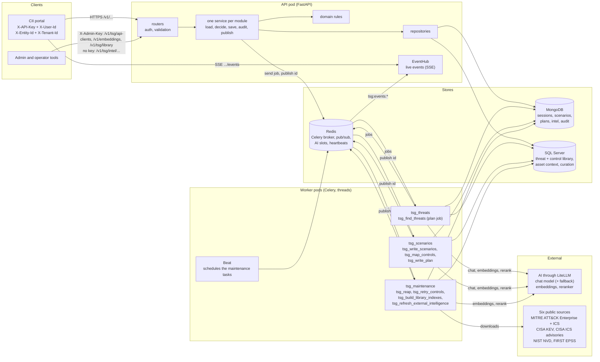
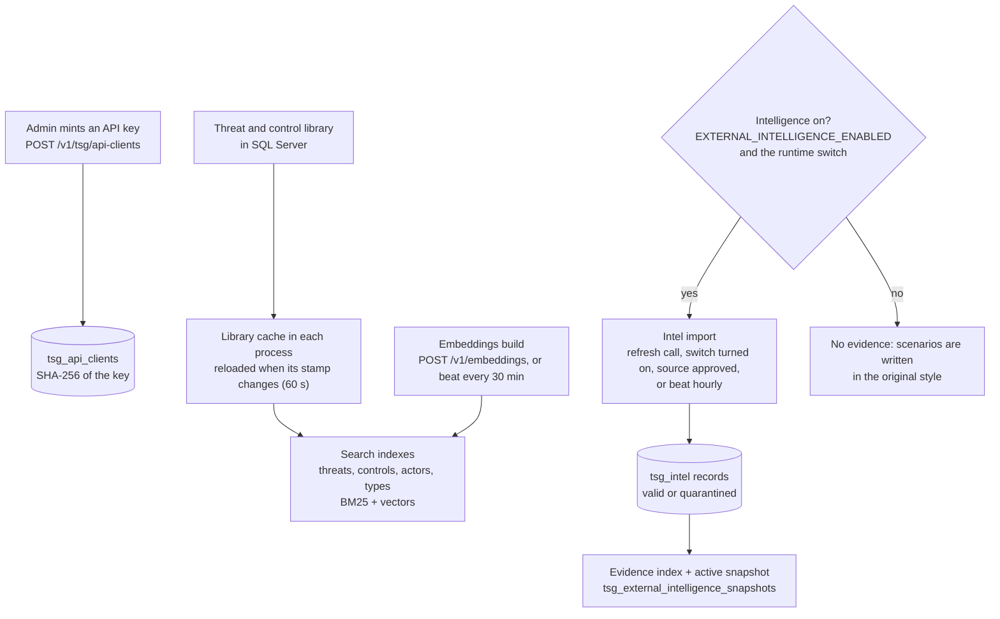
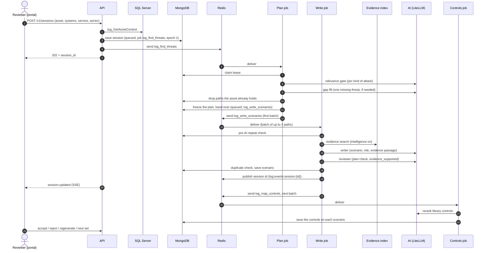
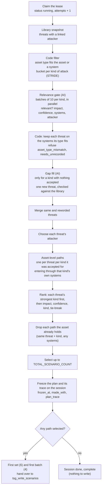
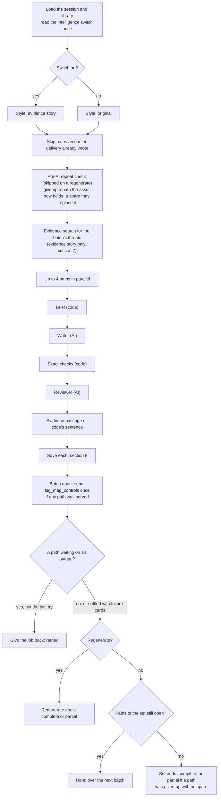
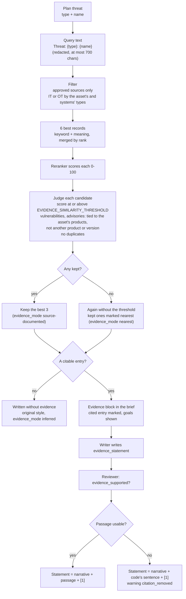
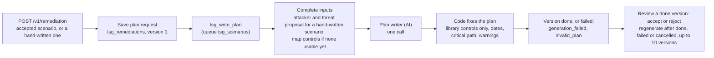
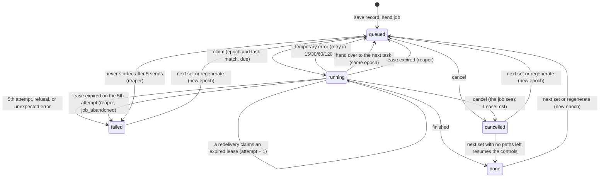

# TSG end-to-end flow

How the Threat Scenario Generator (TSG) turns one request into reviewed threat scenarios, with real-world
evidence, mapped controls and a treatment plan. Every step names the code that does it, so it can be
checked. Diagrams use Mermaid (they render on GitHub, GitLab and in VS Code with a Mermaid extension).

The design decisions behind this flow are in [SOLUTION_DESIGN.md](SOLUTION_DESIGN.md); the API reference is
in [API_DEVELOPER_HANDBOOK.md](API_DEVELOPER_HANDBOOK.md).

## Contents
1. [The big picture](#1-the-big-picture)
2. [Before any session: what must be in place](#2-before-any-session-what-must-be-in-place)
3. [One session from start to finish](#3-one-session-from-start-to-finish)
4. [Step 1: start a session](#4-step-1-start-a-session)
5. [Step 2: the plan job (threats and attack paths)](#5-step-2-the-plan-job-threats-and-attack-paths)
6. [Step 3: the write job (scenarios)](#6-step-3-the-write-job-scenarios)
7. [Step 4: evidence, found and added to the scenario](#7-step-4-evidence-found-and-added-to-the-scenario)
8. [Step 5: saving a scenario](#8-step-5-saving-a-scenario)
9. [Step 6: controls mapping](#9-step-6-controls-mapping)
10. [Step 7: live status](#10-step-7-live-status)
11. [Step 8: review actions](#11-step-8-review-actions)
12. [Step 9: treatment (remediation) plans](#12-step-9-treatment-remediation-plans)
13. [Step 10: curation, external-intelligence admin, service mapper](#13-step-10-curation-external-intelligence-admin-service-mapper)
14. [Reliability: leases, retries, the reaper](#14-reliability-leases-retries-the-reaper)
15. [Operations: health, logs, metrics, deployment](#15-operations-health-logs-metrics-deployment)
16. [Reference: states, stores, settings](#16-reference-states-stores-settings)

---

## 1. The big picture

**In one paragraph.** A reviewer starts a *session* for one critical asset and its supporting systems.
The API freezes the asset's facts and queues a **plan job**. The plan job asks the AI which library
threats fit, groups them into **attack paths** and ranks them. A **write job** then writes one scenario per
path, a set at a time (6 by default), with **evidence** from public threat intelligence when that is on.
Each written scenario gets library **controls** mapped to it. The reviewer accepts, rejects, regenerates or
asks for the next set; an accepted scenario can get an AI-written **treatment plan**. Every job is leased,
retried and watched by a **reaper**, so an outage never loses or duplicates work.

**The code layout.** Six business modules, `scenario` (with controls), `remediation`, `library`,
`external_intelligence`, `service_mapper` and `admin`, plus a shared `jobs` package (cancel, delete, the jobs
list). Each module has a folder only in the layers it needs (`api/routers`, `services`, `domain`,
`data_access`, `worker`, `models`); for example `service_mapper` has only a router, a service and models.
`app/container.py` builds every long-lived object once and passes it in.

---

## 2. Before any session: what must be in place

### 2.1 API keys and identity
- An admin mints a key with `POST /v1/tsg/api-clients` (admin key `X-Admin-Key`). The key (`ciip_...`) is
  shown once; only its SHA-256 is stored in `tsg_api_clients`. Revoke with
  `POST /v1/tsg/api-clients/{client_id}/revoke`.
- Every portal call sends `X-API-Key`, `X-User-Id`, `X-Entity-Id` and `X-Tenant-Id`. A missing header or an
  unknown key is 401; a malformed `X-Entity-Id` (not a positive whole number) is 422. Verified keys are
  cached for 60 s per process.
- **Entity isolation:** a session or plan of another entity answers 403 (`valid_session`, `valid_plan`).

### 2.2 The library (SQL Server)
- Threat types, threats, threat actors (attackers) and controls live in SQL Server. TSG reads them only
  through stored procedures: `tsg_GetLibraryStamp`, `tsg_GetThreatLibrary`, `tsg_GetControlLibrary`.
- **Library cache** (`app/search/library_cache.py`): each process holds the library in memory. A
  background thread checks the stamp every 60 s and reloads only when it changed. If SQL Server is down,
  the last good copy keeps serving (`tsg_library_check_failures_total` counts the failures).
- **Search indexes** (`app/search/`): one hybrid index per corpus (threats, controls, actors, types):
  keyword (BM25) plus vectors, merged by reciprocal-rank fusion. Vectors are cached in `tsg_embeddings`.
- **Embeddings build:** `POST /v1/embeddings` (admin, 202) queues `tsg_build_library_indexes`; beat also
  runs it every 30 minutes. One build at a time (409 `job_in_progress`).

### 2.3 External intelligence (the evidence source)
**The switches.** Evidence is used only when **both** are on:
1. `EXTERNAL_INTELLIGENCE_ENABLED=true`, the master switch (default false). While it is off, no
   intelligence store is read and beat schedules no import.
2. The runtime switch, **on by default**, stored in `tsg_external_feed_status` (document `_id: "switch"`).
   `PUT /v1/tsg/intel/switch {"enabled": false}` turns it off; `{"enabled": true}` turns it back on and
   queues an import. Each process caches it for 60 s. A write job that cannot be sure of it waits and
   retries; it never guesses.

**The six sources** (`IntelSource`):

| Source | Kind of record | For |
|---|---|---|
| `mitre_attack_enterprise` | technique | IT assets |
| `mitre_attack_ics` | technique | OT assets |
| `cisa_kev` | vulnerability (exploited in real attacks) | IT |
| `cisa_ics_advisories` | advisory (products, versions, fixes) | OT |
| `first_epss` | exploit score, joined to a KEV CVE | IT |
| `nist_nvd` | vulnerability detail, joined to a KEV CVE | IT |

**Approval.** Each source has an `approved` flag. `POST /v1/tsg/intel/sources/{source}/revoke` withdraws a
source and deletes its records and the vectors only it used; `.../approve` restores it and queues an import.
These routes take no API key or admin key; every change is audited under `X-User-Id`.

**The import** (`tsg_refresh_external_intelligence`, queue `tsg_maintenance`). It is queued by
`POST /v1/tsg/intel/refresh`, by turning the runtime switch on, by approving a source, or by beat every
hour while the master switch is on.
1. Sources run in order: KEV, ATT&CK Enterprise, ATT&CK ICS, ICS advisories, EPSS, NVD. A source runs only
   when it is due (ATT&CK every 168 h, the others every 24 h) or forced.
2. Each source is claimed, downloaded through the proxy (3 tries with back-off, size caps, allowed hosts
   only) and written in batches of 1000.
3. Safety: text that reads like instructions to an AI is **quarantined** whole (never indexed). A complete
   feed that suddenly holds less than half of the current records is refused, and the last good data stays.
4. One document per record version in `tsg_intel`; retired versions expire after 90 days.
5. The **evidence index** is rebuilt: approved, valid records, with EPSS, NVD details and advisories joined
   into each KEV entry. URLs, IPs, emails and hashes are removed before any text reaches a model. The new
   index is published as the **active snapshot** in `tsg_external_intelligence_snapshots`.
6. `GET /v1/tsg/intel/health` shows each source's state, the active `snapshot_id`, `stale` (older than 48 h)
   and `no_data`.

**Facts.** For each record, code (`PlainFactWriter`, `facts.py`) writes short plain sentences from
structured fields only, never the source's free text. Examples:
- technique: *"Stuxnet, a piece of malicious software, has used this technique."*,
  *"It is used for these attacker goals: persistence."*, *"It can be reduced by: Code Signing."*
- KEV: *"CISA lists weaknesses in Siemens SIMATIC WinCC as exploited in real attacks (added 2024-01-05)."*

At most 6 facts per record, each at most 320 characters, with no ids or links (the id is kept apart as the
entry's `ref`).

---

## 3. One session from start to finish

The rest of this document explains each of these steps.

---

## 4. Step 1: start a session

**Route:** `POST /v1/sessions` → `ThreatScenarioService.create_threat_scenario_session`
(`app/services/scenario/threat_scenario_service.py`).

**Request body** (`StartRunRequest`; unknown fields are refused):
`asset_id`, `supporting_system_id` (one id or a list, at least one, no repeats), and optional `service_id`,
`sector_id`, `subsector_id`. Headers: the four identity headers and, optionally, `Idempotency-Key`.

| # | What happens | Fails with |
|---|---|---|
| 1 | Authenticate the caller (key, user, entity, tenant) | 401 (missing header, unknown key); 422 (malformed `X-Entity-Id`) |
| 2 | Validate the body | 422 |
| 3 | **Idempotent replay:** the same `Idempotency-Key` returns the existing session (200). A different request under the same key is refused | 409 `idempotency_key_conflict` |
| 4 | **Intelligence has data:** when intelligence is on, the active snapshot must hold indexed records | 409 `intel_no_data` |
| 5 | **Asset facts:** one SQL call, `tsg_GetAssetContext` (entity, asset, systems, service, sector, subsector) returns the asset, services, sector, systems and options | 503 if SQL is down |
| 6 | **Freeze the context** (`freeze_context`): the asset must belong to the entity, each system must be linked to the asset, the service and sector must exist; systems get the aliases SYS1..n for prompts; required facts (`ASSET_PROPERTIES_REQUIRED`, `SYSTEM_PROPERTIES_REQUIRED`) must be present | 403 `asset_not_owned`, 403 `system_not_linked`, 404, 422 |
| 7 | **Save the session** in `tsg_sessions`: `status=queued`, `step=threats`, `active=true`, the frozen `context`, zeroed counts and the job `{task: tsg_find_threats, epoch: 1, attempts: 0, due_at: now}` | 409 `active_session_exists`; 409 `idempotency_key_conflict` (the key's earlier session was deleted meanwhile) |
| 8 | **Send the job** `tsg_find_threats` to queue `tsg_threats`; write the `run.started` audit record | a lost send is re-sent by the reaper |
| 9 | Answer **202** with the session's status board | |

**One active session per asset** is a unique index (`entity_id + asset_id` where `active=true`), so two
starts racing each other can never both win. The asset's facts are frozen at this moment: later edits in
SQL Server do not change a running session.

---

## 5. Step 2: the plan job (threats and attack paths)

**Task:** `tsg_find_threats` on queue `tsg_threats` → `PlanJob.plan_threat_scenario_session`
(`app/worker/scenario/plan_job.py`, rules in `app/domain/scenario/plan.py`).

### 5.1 Claim and inputs
- **Lease:** the job claims its session only if the epoch and task still match and it is due (or its old
  lease expired). It becomes `running` with a 120 s lease, renewed every 30 s (section 14).
- **Inputs:** the frozen context from the session (SQL is not read again), the in-memory library, and the
  country (`THREAT_CONTEXT_COUNTRY`, default United Arab Emirates) when intelligence is on.
- If **no library threat has a linked attacker**, planning is refused at once: `actor_library_empty`.

### 5.2 Which threats fit (AI: relevance gate)
1. Code keeps only threats whose asset type fits the asset or one of the chosen systems, and that have at
   least one linked attacker. It buckets them per kind of attack (STRIDE: Spoofing, Tampering, Repudiation,
   Information Disclosure, Denial of Service, Elevation of Privilege). One threat can sit in several kinds.
2. The AI task `relevance_gate` (temperature 0) judges each kind's candidates in batches of 10, all six kinds
   in parallel (at most 4 AI batches at once). For each threat it answers: relevant or not, impact (HIGH,
   MEDIUM, LOW), confidence (0-100), the systems it acts on, a reason, any facts it would need that are not
   recorded, and optionally which listed attacker fits.
3. Code checks every answer (known system aliases, valid values). Each accepted library threat keeps only
   the systems (or the asset itself) its asset type fits; a threat that fits none is refused
   (`asset_type_mismatch`). A threat needing unrecorded facts under one kind is refused under all kinds.
   Both checks run before any gap fill, so they can leave a kind empty.

### 5.3 A missing threat (AI: gap fill)
Only for a kind of attack where every threat was judged and none was accepted, the AI task `gap_fill` may
propose **one** new threat. It is dropped if it repeats a library threat (hybrid search + reranker at
`THREAT_SIMILARITY_THRESHOLD`, default 75). Its type must match a library type that links attackers, and
the gate re-judges it. It becomes an AI threat (key `ai:<name>`), at most one per kind. A curator can later
approve it into the library (section 13).

### 5.4 Merge, attacker, paths, rank
- **Merge:** one threat per key. An AI threat named like a library threat of the same type, or worded almost
  exactly like (cosine ≥ 0.98) a library threat or an earlier AI threat of the same type, is folded into it.
  Each kind keeps its own verdict through the merge: its systems, impact and confidence (`kind_places`).
  After the merge each kind's systems are re-fitted to the library threat's type; a kind that fits no place
  is dropped (and traced).
- **Attacker:** the gate's named pick when it gave one; otherwise the top-ranked linked attacker (one
  embedding search). A "none fits" answer under one kind never vetoes an attacker another kind named. A
  threat left with no attacker is dropped.
- **Asset-level paths** (owner, 2026-10-19): one path per threat per kind of attack it was accepted for,
  entering through **that kind's own systems** (one or several; the asset itself when none). A threat is
  never split per system, and two threats never share a path (`also_applies` is stored as `[]`). `path_id`
  is a hash of the threat key and `kind@scope`, so the same input always gives the same ids.
- **Rank:** each threat's strongest kind comes before any threat's next kind, so the first sets tell
  distinct threats; within that, highest impact first, then confidence, then the STRIDE order, then a fixed
  tie-break.

### 5.5 Never plan what the asset already holds
`_covered_by_held` reads the asset's scenarios from its **other** sessions that are written (scenario status
`done`), the current version, and still pending or accepted by a reviewer. A path with the same threat (key
or name) as the same kind is dropped before any writing, whatever systems either enters through (the
systems are entry points; the scenario is the asset's). The drop is per path: another threat on the same
kind and systems is never lost with it. Each drop is traced with the scenario holding it, and logged
(`planner.covered_paths_dropped`). Ranks are renumbered.

### 5.6 Select and freeze
- `TOTAL_SCENARIO_COUNT` (default 0 = no cap) selects the best paths; the rest are kept as spares
  (`unselected_reason=target_reached`). The list is never padded.
- The plan is stored on the session: threats; paths (rank, kind, systems, impact, confidence,
  `also_applies`, and `selected` / `served` / `attempts` / `abandoned`); the target; `prompt_version`;
  `frozen_at`; `made_with` (models and library stamp). The plan note reads *"N attack paths selected; 0
  written, N still to write, set by set."*
- **The plan's trace** (`plan_trace`, saved in the same write, read by no job): how many candidates each
  stage took in and let out (library threats; left out before the gate; slots asked; not judged, not
  relevant, needing unrecorded facts, wrong asset type, refused for a need under another kind; accepted;
  AI threats, and gap-fill proposals not kept (a library repeat, no matching type, not relevant...);
  merged; no attacker; threats; paths; already held; selected; first set), and each candidate
  left out with its stage, reason and a short detail (what it needs, the gate's reason, the threat it merged
  into, the held scenario), the most telling first (at most 300). `GET /v1/sessions/{id}/plan-trace` serves
  it with what became of the paths since (written, still to write, given up and why, replaced); one
  `planner.funnel` log line carries the counts.
- **Hand-over:** the first set is the best `INITIAL_SET_SIZE` (default 6) open paths; its first batch is up
  to 4 of them. One fenced write sets `job.task=tsg_write_scenarios`, `attempts=0`, and the job is sent with
  the same epoch.
- If nothing is selected, the plan is still stored and the session ends `done` / `complete` at once.

### 5.7 When the AI or a store fails
- A reply with problems is asked again once, listing the problems. Still unreadable: on a normal attempt the
  job is retried later; on the **last** attempt that batch (or that gap-fill proposal) is skipped and
  planning carries on with what was judged. A reply that was cut off is skipped on any attempt and never
  retried.
- If not one threat could be judged after 5 attempts, the session fails: *"The AI could not answer. Start a
  new session later."*
- Outages retry after 15, 30, 60 and 120 s, up to 5 attempts (section 14).

---

## 6. Step 3: the write job (scenarios)

**Task:** `tsg_write_scenarios` on queue `tsg_scenarios` → `ScenarioWriteJob.write_scenario_batch`
(`app/worker/scenario/write_job.py`, `path_writing.py`, rules in `app/domain/scenario/write.py`).

### 6.1 Load and choose the style
The job loads the session, drops any evidence an older plan kept (each write searches its own), and reads
the intelligence switch **once** in strict mode. On: **evidence story** style. Off: **original** style.
A path whose threat has nothing citable is written in the original style even when intelligence is on.

### 6.2 The batch
At most 4 paths (`Generation.WRITER_BATCH`), chosen from the set: selected, still open, never-tried first,
then best rank. Paths an earlier delivery already wrote are marked served without an AI call.

### 6.3 Pre-AI repeat check
Before any evidence search or AI call (and never on a regenerate), each path is compared with the scenarios
held now (this session's, and the asset's pending or accepted ones in other sessions): the same threat as
the same kind, whatever its systems. A repeat is given up with no AI call and no card, recording which
scenario it repeats;
a spare may take its place when the set's budget allows and one exists (section 8.4).

### 6.4 The brief (code, no AI)
`build_brief` checks the path is still writable: one named threat, a known kind, an acting attacker that a
check supports, every path system one of the session's systems, and nothing retired in the library. It then
builds what the writer reads:
- the asset's facts and the path's systems' facts, cut to fit the prompt budget;
- the acting attacker (as a type of attacker), the threat type, the threat, and why it applies (names of
  systems not on this path are removed from lists, or, where a name stands alone, replaced by "another
  supporting system", "other supporting systems" for several in a row);
- every supporting system marked applicable yes or no;
- on a regenerate, the older versions' stories (without their evidence passages), so the new one differs;
- for an evidence story: the country and the threat's evidence (section 7).

### 6.5 The writer (AI)
AI task `write_scenario`, prompt `app/domain/scenario/prompts/writer.txt`. The word limits come from `.env`:

| Field | Setting (default) | Rule |
|---|---|---|
| `scenario_statement` | `THREAT_SCENARIO_WORD_LIMIT` (150-200) | five beats: threat angle, entry, threat action per system, detection, consequence |
| `risk_statement` | `RISK_STATEMENT_WORD_LIMIT` (100-150) | adverse event, cause, objective, consequences; opens by kind ("Loss of trust in ...") |
| `evidence_statement` | `EVIDENCE_STATEMENT_WORD_LIMIT` (30-80) | the real-world passage (section 7.4); "" without evidence |

The upper number of each range is a **hard limit** in the prompt ("NEVER MORE"); the lower is a target.
Code cuts nothing. The writer also returns a title, assumptions, the entry point (one of the offered
systems), one reason per supporting system, and why the threat applies. An answer with a wrong entry point
or a missing system reason is asked again once.

### 6.6 Exact checks (code) and the reviewer (AI)
**Blockers found by code** (`check_exact_rules`):
- `unknown_id`: an internal label (SYS1, THR2) the brief never gave;
- `uncited_advisory_id`: a CVE, ICSA, GHSA, MS or VU# number no intelligence supplied;
- `unknown_marker`: any `[n]` marker the writer wrote (only code cites);
- `injection_echo`: the draft (the evidence passage included) repeats an instruction aimed at an AI.

**The reviewer** (AI task `plan_check`, prompt `app/domain/scenario/prompts/reviewer.txt`, skipped when code
already blocked) checks the draft against the plan: 8 rules (same threat, one attacker, listed systems only,
no cross-system links, impact matches the kind, risk aligned, grounded, no citation outside the passage) and
three verdicts:
- `same_threat` and `same_impact`: either false is a `scenario_mismatch` blocker;
- `evidence_supported`: whether the passage states only the cited entry's facts (section 7.4).

A broken rule is stored as a `plan_check` **note** on the scenario, for the person reviewing it; never a
blocker. A reviewer answer that stays unusable is a `plan_check_not_made` warning; the scenario is still
saved, flagged.

### 6.7 Ending the batch, the set or the regenerate
- After the whole batch, `tsg_map_controls` is sent once if any path was served (section 9).
- **Outages:** a path whose AI call or evidence search hit an outage waits; the job is given back and
  retried. On the 5th (last) attempt, when every outage is an AI or evidence `Unavailable` and a path of the
  batch was served (or it is a regenerate), each waiting path gets a failure card (a regenerate notes the
  failure on the old version). Otherwise the job raises again, and after the last attempt the session fails
  with `job.error`.
- **Next batch:** while paths of the set are open, the job hands the next batch to itself (same epoch).
- **Set ends:** `complete`, or `partial` when a path of the set was given up and no spare replaced it. For a
  next set, `last_next_set` records the outcome, how many were delivered and why it fell short.
- **Regenerate ends:** a regenerate batch never hands over. It ends `complete` when every chosen scenario
  got its new version, else `partial` (`last_regen.outcome`, `last_regen.replaced`).

---

## 7. Step 4: evidence, found and added to the scenario

This section applies only to the **evidence story** style: intelligence on, and the threat has something
citable. Off, there is no search, no evidence block and no citation, and any marker blocks the draft.

### 7.1 The search (`EvidenceAtWrite.attach`, `evidence_finder.py`)
1. **One search per batch**, one request per distinct threat of the batch, against the **active snapshot**.
2. **Query:** only the threat: `Threat: {type}: {name}`, redacted and cut to 700 characters. Indicators
   (URLs, IPs, emails, hashes) are removed first. The asset is never put in the query text; it enters
   through the filters instead.
3. **Filters before ranking:** approved sources only; IT or OT records by the asset's and its systems' type.
4. **Candidates:** the 6 best records (`EvidenceLimits.CANDIDATES`), found by keyword (BM25) and by meaning,
   merged by rank (one embedding call for the whole batch).
5. **Rerank:** the reranker model scores each candidate against the query (0-100). Up to 8 threats of a
   batch are reranked in parallel threads; a process-wide gate lets at most 4 reranks run at once on a
   remote reranker (a 60 s wait, then the request counts as an outage), or 1 on the local model.
6. **Judge each candidate:**
   - under `EVIDENCE_SIMILARITY_THRESHOLD` → left out (`below_threshold`);
   - a vulnerability or advisory record that cannot be tied to the asset's recorded products, or concerns
     another product or version → left out (`no_product_link`, `not_applicable`); otherwise its
     applicability is `confirmed` or `unknown` (unknown when the asset's product or version is not recorded);
   - the same record twice → left out (`duplicate`).
7. **Keep at most 3** (`PER_THREAT`), best first, swapping in a kind of record that is missing.
8. **Nearest evidence:** when the first pass kept nothing, the choice runs again ignoring the threshold (the
   other rules still apply). Each entry kept is marked `nearest`; when every kept entry is nearest, the
   scenario's `evidence_mode` is `nearest` (said as "related"). If even this pass keeps nothing, the path is
   written without evidence (7.2). A scenario is never blocked for lack of evidence.
9. **Audit:** one `external_intelligence.evidence_used` record per batch that was searched (none when the
   index holds no records); each threat's own search is kept on its scenario as `content.intel_search`.
10. **Outage:** an embedding or reranker outage, or no snapshot yet, is recorded on the threat's search and
    holds the path back; the job retries. On the job's last try, if other paths of the batch were written (or
    it is a regenerate), each held path is saved as a failure (`unavailable`) with the evidence-search reason.

### 7.2 Choosing the one entry to cite
The cited entry is the best-ranked **citable** one (`_precedent`):
- a **technique** whose facts name who used it (a group, malware or campaign; a campaign known only by an id
  such as C0027 does not count) and whose title survives cleaning; at most 2 users are named;
- any **other record** (vulnerability, KEV, advisory) whose first fact (not its goals or mitigations)
  survives cleaning.
- A claim that would contain a "[" or more than one sentence is not citable.

If none of the kept entries is citable, the path is written in the original style, without evidence, and
stored with `evidence_mode=inferred` (the scorecard script reports it as "no evidence found: written
without").

### 7.3 What the writer and reviewer see
The brief carries an **untrusted evidence block** between `<<<UNTRUSTED_EVIDENCE_BEGIN>>>` and
`<<<UNTRUSTED_EVIDENCE_END>>>`. It states the `evidence_mode` and, for each kept entry, what it is about
(`technique` with its title, or `about`), its plain facts and its applicability. Never an id, a link or a
source name. The cited entry is marked `"cited": true` and shows its attacker goals too; mitigations are
never shown. The reviewer reads the same block.

### 7.4 The evidence passage and how it is added
1. The writer returns `evidence_statement`, built **only** from the cited entry:
   - a technique: *In real-world attacks, {who used it, as named and described} have used the technique
     "{exact title}"* ("the related technique" when the mode is `nearest`), what attackers use it for, and at
     most one "could/may" sentence linking it to this scenario;
   - another record (`about`): only what its facts say, never called a technique.

   The narrative itself (`scenario_statement`) names no group from the evidence and tells no past event.
2. The reviewer answers `evidence_supported`: true only if the passage says nothing but the cited entry's
   facts.
3. Code decides (`_passage_problem`). The passage is **cited** when it is present, within the maximum of
   `EVIDENCE_STATEMENT_WORD_LIMIT`, free of markers, redactions ("["), links, codes and labels, and confirmed
   by the reviewer. Otherwise it is dropped with a `citation_removed` **warning**, never a blocker, and code
   builds its own sentence from the same entry's facts, for example
   *In real-world attacks, Stuxnet has used the technique "Modify Program"* (a nearest entry: *... used the
   related technique "..."*, or *A related record: ...*). Two exceptions: an instruction echoed in the passage
   blocks the draft (`injection_echo`); and when an exact check already blocks, the reviewer is not asked, so
   the passage is always dropped.
4. Code appends it (`_cited`): **statement = narrative + " " + passage (its final "." removed) + " [1]."**
   The scenario's `content.evidence` stores that one entry with `n: 1`: its `ref`, `kind`, `source`, `title`,
   `url` (for example https://attack.mitre.org/techniques/T0889), `score`, `facts`, `applicability`, `role`,
   `mitigations`, its dates, `searched_at`, and `supports` (the cited passage).

A real ending:
> ...degrade safe traffic sequencing. In real-world attacks, PLC-Blaster and Stuxnet have used the technique
> "Modify Program" for persistence. Attackers could use this technique to alter signal controller logic and
> deny traffic management service [1].

---

## 8. Step 5: saving a scenario

`PathSaver.save` (`app/worker/scenario/path_writing.py`).

### 8.1 Before the save
1. **Renew the lease** (`progress.hold()`): a session cancelled or deleted during the AI call never gets the
   scenario.
2. **Duplicate check**, read right before the save, only for a written scenario no other blocker has
   stopped: the same threat as the same kind (whatever its systems) or the same statement as one of this
   session's other paths' finished scenarios, or a pending or accepted scenario of the asset's other
   sessions, is a `near_duplicate` blocker, final at once. Hand-written scenarios count as held, but are
   never refused themselves.

### 8.2 The record (`tsg_scenarios`)
- Id: `uuid5(session, path, version)`, so a repeated delivery saves the same record once.
- `status`: `done`; `blocked` (any blocker; kept for audit only); or `failed` (the writer's answer stayed
  unreadable, an AI or evidence-search outage on the last try, the path is no longer writable, or an
  unexpected error in that one path).
- `decision`: `pending` until a reviewer decides.
- `content`: title, statement, risk, why it applies, assumptions, kind (category), threat, attacker(s),
  `also_applies`, systems and their applicability, evidence, `evidence_mode`, `intel_search`,
  `prompt_version`.
- `findings` (code, severity, message), `plan_check` (the reviewer's verdicts), `generation` (epoch, start,
  end), and for a `done` scenario `controls: {status: queued}`.

### 8.3 Unique titles
The title is tried as written, then "title (threat name)" (skipped when the title already contains it), then
"title (2)", "(3)" ... until the unique index on `(session_id, title_key)`, which covers written (`done`)
scenarios only, accepts it.

### 8.4 Given up, spares and regenerated versions
- A `done` scenario marks its path **served**.
- A `blocked` or `failed` one gives the path up at once (the writer's own retry is switched off; it can be
  switched back on in `PathSaver.save`).
- **Spare:** while the set's budget allows, `best_reserve` picks a replacement path with a supported
  attacker: first one the scenario count left out, else the best open path of a later set. The given-up path
  becomes `replaced_after_failure`; the spare joins the set. Every path change is one fenced write with the
  counts and plan note, followed by a live update.
- **Regenerate:** the new version (`version` n+1, `replaces` = the old id) is saved first; then the old one
  gets `superseded_by`. A blocked or failed new version is never served: the old one stays current with
  `regenerate_error`, and the path is not given up.

---

## 9. Step 6: controls mapping

**Task:** `tsg_map_controls` on queue `tsg_scenarios` → `ControlsJob` (`app/worker/scenario/controls_job.py`)
and `ControlMapper` (`app/domain/scenario/controls.py`). No AI writes controls.

1. **Sent** after each write batch that saved a scenario (a regenerate's included), by a delivery handing
   over to itself, by the sweep, and by next set or regenerate only to resume controls a cancel stopped. A
   treatment-plan job maps its own scenario's missing controls inline.
2. One delivery per session at a time (a 120 s delivery lease); it maps up to 4 scenarios, oldest first, then
   hands over to itself.
3. **Query** for each scenario: category, threat (type: name), acting attacker, title, asset (name and type),
   up to 6 MITRE mitigations from the cited evidence, then the systems' and asset's facts and the statements
   (at most 4000 characters, redacted).
4. **Search:** the top `CONTROL_CANDIDATES` from the hybrid control index, filtered to the scenario's asset
   types (AI-domain controls only for AI threats). If no control fits those types, the nearest of any type are
   kept (up to `MIN_CONTROLS`) with a warning.
5. **Rerank** each candidate 0-100, fold twins (same id or text), keep those at or above
   `CONTROL_SIMILARITY_THRESHOLD` (default 50) up to `MAX_CONTROLS` (10); if fewer than `MIN_CONTROLS` (1) are
   strong, the nearest below the threshold are added as `nearest`. Never empty while the library holds a
   control; an empty control library fails the mapping (`control_library_empty`).
6. Stored on the scenario: the controls, warnings, query and `made_with`; `controls.status=done`.
7. **Sweep** (`tsg_retry_controls` on `tsg_maintenance`, beat every 5 minutes): stops the waiting controls of
   cancelled sessions and deletes the scenarios of deleted ones; fails the controls whose lease expired on the
   5th attempt; re-queues stalled mappings (queued over 10 minutes, lease expired, or failed over 30 minutes
   ago with attempts left); then sends `tsg_map_controls` for each session no live delivery serves.

---

## 10. Step 7: live status

- After every save and state change, workers and API services publish only the record id on Redis
  (`tsg:events:session:{id}`, `tsg:events:remediation:{id}`). Publishing is best effort.
- Each API process has one `EventHub` subscribed to `tsg:events:*`.
- `GET /v1/sessions/{id}/events` (SSE): the stream subscribes first, then reads the status from MongoDB, and
  sends `session.updated` only when the status changed (`session.deleted` once if it is gone). It reads again
  every 30 s anyway, and ends quietly if the API key is revoked.
- Polling alternative: `GET /v1/sessions/{id}` (the status board) and `GET /v1/jobs`.

---

## 11. Step 8: review actions

Accept, reject, regenerate and next set refuse while the session is queued or running
(409 `generation_in_progress`), and answer 409 `run_failed` or `run_cancelled` when the session stopped while
finding threats. Reads, promote, cancel and delete do not.

| Action | Route | What it does | Job sent |
|---|---|---|---|
| Read results | `GET /v1/sessions/{id}/results`, `.../scenarios/{sid}`, `GET /v1/entities/{eid}/scenarios` | the scenarios with evidence, controls, findings, review flags | - |
| Read the plan's trace | `GET /v1/sessions/{id}/plan-trace` | why the session has as many scenarios as it has: each stage's counts, each candidate left out and why, what became of the paths (section 5.6) | - |
| Accept | `POST /v1/sessions/{id}/accept` | pending → accepted; one accepted version per path (`replace_accepted` swaps) | - |
| Reject | `POST /v1/sessions/{id}/scenarios/reject` | pending → rejected | - |
| Regenerate | `POST /v1/sessions/{id}/regenerate/scenarios` | a new version of each chosen current scenario, told differently; the old one is superseded only when the new one is written | `tsg_write_scenarios` (epoch + 1) |
| Next set | `POST /v1/sessions/{id}/scenarios/next-set` | the next `NEXT_SET_SIZE` (6) open paths. With none left, it resumes controls a cancel stopped (202), else 409 `nothing_left`, `target_reached` or `scenarios_abandoned` | `tsg_write_scenarios` (epoch + 1), or `tsg_map_controls` when resuming controls |
| Promote | `POST /v1/sessions/{id}/scenarios/{sid}/promote-to-library` | an accepted scenario's AI-proposed threat goes to the curators (`tsg_ResolveThreat`) | - |
| Cancel | `POST /v1/sessions/{id}/cancel` | stops queued or running work; a running job sees `LeaseLost` within about 30 s | - |
| Delete | `DELETE /v1/sessions/{id}` | removes the session, its scenarios and plans; refused with 409 `cancel_first` while work runs | - |

Every decision is audited (`tsg_audit`) and published as a live update.

---

## 12. Step 9: treatment (remediation) plans

Cancel (`POST .../cancel`) applies only while a version is queued or running.

1. **Request:** `POST /v1/remediation` (202). With `is_manual=false` it needs an accepted generated
   scenario. With `is_manual=true` it takes a **hand-written scenario** (with an `Idempotency-Key`): it is
   checked against the library, saved already accepted, and needs no evidence. One plan per scenario.
2. **Job:** `tsg_write_plan` (leased; the version number is its epoch). It completes the inputs. For a
   hand-written scenario it ranks the attackers and proposes a new threat wording to the curators
   (`tsg_ResolveThreat`). If the scenario has no usable mapped controls (none, or only retired ones), it maps
   them, or waits up to 120 s for the job already mapping them, then retries.
3. **AI:** one call, `remediation_plan` (temperature 0). An unusable answer is asked again once; still
   unusable, the version fails `generation_failed` (a plan with no action fails `invalid_plan`).
4. **Code fixes the plan:** strategy "Mitigate", recommended controls only from the library mapping and not
   already in the register, schedule dates and the critical path, urgency and coverage warnings.
5. **Later:** `GET .../treatment-plan` (and `/status`), `POST .../review` (accept or reject a version),
   `.../regenerate` (up to `REGENERATIONS_MAX_VERSION_COUNT`, default 10), `.../cancel`; live updates on
   `.../treatment-plan/events`. The prefix is `/v1/sessions/{sid}/scenarios/{scid}/treatment-plan`. Lists:
   `GET /v1/sessions/{sid}/treatment-plans` and `GET /v1/entities/{eid}/treatment-plans` (the register),
   filtered by `status`, `decision` and `risk_level`.

---

## 13. Step 10: curation, external-intelligence admin, service mapper

- **Curation** (admin key): `GET /v1/tsg/library/pending` lists the threats and threat types waiting for a
  curator: those promoted from AI-written scenarios and new ones from hand-written scenarios (paged, oldest
  first). `POST /v1/tsg/library/decisions {approve: [...], reject: [...]}` decides them in one SQL transaction
  (`tsg_DecidePendingThreats`). An approved threat joins the library at its next reload.
- **SQL write safety:** every write procedure goes through `tsg_sql_operations`: a finished operation is
  replayed, an unknown outcome is reconciled, a young pending one answers 409 `operation_in_progress`.
- **Admin** (admin key): API keys (`/v1/tsg/api-clients`) and the embeddings build (`/v1/embeddings`).
- **External intelligence** (`/v1/tsg/intel/...`, no admin or API key, audited under `X-User-Id`): the
  switch, the import (refresh), health, and revoking or approving a source (section 2.3).
- **Audit and AI logs:** `tsg_audit` is append-only and kept 365 days; it has no read route. The AI call log
  `tsg_ai_calls` is kept 14 days.
- **Service mapper:** a stub with canned answers (real authentication and validation, nothing stored).

---

## 14. Reliability: leases, retries, the reaper

- **Save first, then send.** Every job is a record (`job.*` on the session or plan) before its message is
  sent, so a lost message is re-sent, never lost.
- **Lease and epoch fence:** a claim sets a 120 s lease, renewed every 30 s (at most 1 hour per job). Every
  write is fenced on the record's id, `running` status, task id, epoch and attempt. A stale or duplicate
  delivery finds nothing to claim and is ignored. A delivery whose job was cancelled, deleted or taken over
  raises `LeaseLost` at its next write or AI call, and stops without writing.
- **Retries:** temporary errors (AI outage, MongoDB or Redis down, an SQL operation in progress) give the
  job back and retry after 15, 30, 60, 120 s; the 5th attempt fails it as `unavailable`. Refusals (a
  `JobFailed`, for example `actor_library_empty`, `ai_misconfigured`, `ai_answer_unusable`) fail at once,
  never retried.
- **Reaper** (`tsg_reap`, beat every 60 s): re-queues a job whose lease expired (fails it after 5 attempts,
  `job_abandoned`), and re-sends a job still queued after 120 s when its queue is empty (or after 15 minutes
  anyway); a job that never starts after 5 sends fails.
- **AI calls:** LiteLLM for chat and embeddings, and for rerank when `CII_RERANK_BASE_URL` is set (empty in
  dev: a local rerank model). Three quick retries (0.5, 1, 2 s) when the provider is busy or unreachable or
  the answer came back short; a timeout is not retried there and goes to the fallback model
  (`CII_CHAT_FALLBACK_MODEL`). An unreadable answer is asked again once. At most
  `CII_MAX_CONCURRENT_AI_CALLS` (16) calls run at once across all pods (Redis slots). Every chat call that
  gets an answer is copied to `tsg_ai_calls`; every AI call (chat, embedding, rerank) is counted in
  `tsg_ai_calls_total`.
- **Cancel and delete** are fenced the same way: a cancel stops the job at its next renewal, AI call or save;
  a delete is refused with 409 `cancel_first` while anything of the session is queued or running.

---

## 15. Operations: health, logs, metrics, deployment

- **Health:** `GET /health` (always 200) and `GET /ready` (200 only when MongoDB and Redis answer and each
  queue `tsg_threats`, `tsg_scenarios`, `tsg_maintenance` has a live worker; SQL Server is reported).
  Workers send a heartbeat to Redis every 20 s.
- **Logs:** JSON lines (structlog) to stdout, secrets masked; locally also to `logs/<role>.log`. Alloy ships
  them to Loki (kept 7 days).
- **Metrics:** `/metrics` on the API port, and on each worker at `CII_WORKER_METRICS_PORT` (9100; the local
  maintenance worker uses 9102): HTTP requests, jobs by task and outcome, runs, scenarios by outcome,
  decisions, plans, AI calls, tokens and seconds, dependencies up, workers online, AI slots, audit and
  library-check failures.
- **Alerts** (`observability/prometheus/rules.yml`): API errors and latency, failing jobs, the reaper, queue
  backlog and unknown queue depth, missing workers, stores down, the AI error rate and AI slots saturated,
  audit-write and library-check failures, scrape targets down, and pods (not starting, restarting, out of
  memory). Alertmanager has no receiver yet.
- **Dashboards:** Grafana (one TSG dashboard with rows Overview, API, Jobs and queues, AI, Dependencies and
  platform, Logs and audit) and Flower (Celery tasks).
- **Local run:** `.\run.ps1` checks the stores, opens the API (127.0.0.1:8000), the worker
  (`tsg_threats,tsg_scenarios`), the maintenance worker and beat, starts the monitoring tools, and waits for
  `/ready`. `.\run.ps1 stop` stops them cleanly.
- **OpenShift:** `deploy/deploy.yaml` runs the API (2 replicas), one worker per queue and beat in project
  `ai-threatgen`; `deploy/deploy.ai-remediation.yaml` adds a second threats and scenarios worker in project
  `ai-remediation`, which also holds the monitoring (`deploy/observability.yaml`) and Flower. Settings come
  from `.env.uat` through `scripts/gen_openshift_config.py` (ConfigMap `tsg-config`, Secret `tsg-secrets`);
  `deploy/deploy-uat.ps1` gates, applies, rolls out and smoke-tests.

---

## 16. Reference: states, stores, settings

### 16.1 Session status
| Status | Meaning |
|---|---|
| `queued` | a job is waiting (new, handed over, retrying, re-queued by the reaper, or a next set / regenerate) |
| `running` | a worker holds the lease |
| `done` | the set (or the action) finished; `last_action.outcome` says `complete` or `partial` |
| `failed` | the job failed; `job.error` says why |
| `cancelled` | stopped by its owner |

`step` says where it is (`threats`, `scenarios`). `progress.overall` on the status board says what to do
next: `pending`, `in_progress`, `awaiting_review`, `awaiting_next_set`, `complete`, `error`, `cancelled`.

### 16.2 Scenario status and decision
| Field | Values |
|---|---|
| `status` | `done` (served); `blocked` (a blocker; audit only; the path is given up, a spare may replace it); `failed` (no scenario could be written; a visible failure card; the path is given up) |
| `decision` | `pending`, `accepted`, `rejected` |
| `evidence_mode` | `source-documented`, `nearest`, `inferred` |
| `controls.status` | `queued`, `running`, `done`, `failed`, `cancelled` |

### 16.3 Where things are stored
| Store | What |
|---|---|
| MongoDB `tsg_sessions` | sessions: frozen context, plan, paths, its trace (`plan_trace`), counts, job |
| MongoDB `tsg_scenarios` | scenarios: content, evidence, findings, controls, decision |
| MongoDB `tsg_remediations` | treatment plans and their versions |
| MongoDB `tsg_intel`, `tsg_external_feed_status`, `tsg_external_intelligence_snapshots` | intelligence records, source state and switch, evidence snapshots |
| MongoDB `tsg_embeddings`, `tsg_query_vectors` | vector cache |
| MongoDB `tsg_api_clients`, `tsg_admin_jobs`, `tsg_audit`, `tsg_ai_calls`, `tsg_sql_operations` | keys, admin jobs, audit, AI call log, SQL write safety |
| SQL Server | threat and control library, asset context, curation (stored procedures only) |
| Redis | Celery broker (`tsg:` prefix), live events, AI slots, worker heartbeats |

### 16.4 Key settings
| Setting | Default | Controls |
|---|---|---|
| `EXTERNAL_INTELLIGENCE_ENABLED` | false | the evidence master switch |
| `EVIDENCE_SIMILARITY_THRESHOLD` | 1.0, dev only (`.env.example`: 20) | evidence kept at or above this reranker score; outside dev with intelligence on it must be set, or start-up stops |
| `THREAT_SCENARIO_WORD_LIMIT` | 150-200 | scenario statement words (max is hard) |
| `RISK_STATEMENT_WORD_LIMIT` | 100-150 | risk statement words (max is hard) |
| `EVIDENCE_STATEMENT_WORD_LIMIT` | 30-80 | evidence passage words (max is hard) |
| `INITIAL_SET_SIZE`, `NEXT_SET_SIZE` | 6, 6 | paths written per set |
| `TOTAL_SCENARIO_COUNT` | 0 (no cap) | paths selected per session |
| `THREAT_SIMILARITY_THRESHOLD` | 75 | an AI threat that is a library threat, or takes a library type |
| `CONTROL_CANDIDATES`, `MIN_CONTROLS`, `MAX_CONTROLS` | required, 1, 10 | controls search and count |
| `CONTROL_SIMILARITY_THRESHOLD` | 50 | controls kept as exact matches |
| `THREAT_CONTEXT_COUNTRY` | United Arab Emirates | the country an evidence story reads |
| `REGENERATIONS_MAX_VERSION_COUNT` | 10 | treatment plan versions |
| `CII_MAX_CONCURRENT_AI_CALLS` | 16 | AI calls at once, all pods |
| `CII_CHAT_MODEL`, `CII_CHAT_FALLBACK_MODEL` | - | the chat model and its fallback |
